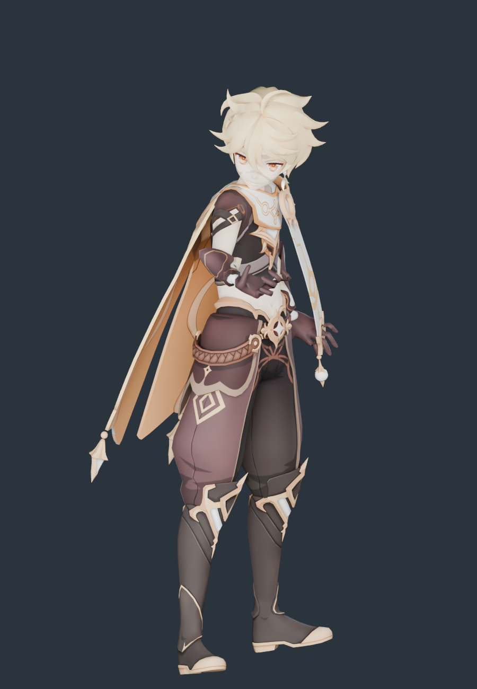

# 空 · 模型导入与体型核查

2026-11-11。源模型来自用户下载目录，已整体归档到 `assets/source/aether`；运行时和重建只读项目内归档，不依赖原下载路径。

**结论：没有发生体型压变形。** 每个源顶点只做一次等比变换加地面偏移，没有逐段身高映射、头部缩放或横向宽度缩放；30 根骨骼显示骨架按原模型关节长度建，只接收《流星》的原生旋转。

## 授权

配布说明与甘雨、雷电将军、荧同一套：允许完善物理、修正权重/表情，允许改色和适度改衣装；禁止二配、拆件、商用。原文保留在归档目录。

## 源模型

| 项 | 值 |
|---|---|
| 文件 | `空.pmx`（PMX 2.0，1.2 MB，模型名 `Kong`） |
| 顶点 / 三角面 | 15,563 / 17,890 |
| 骨骼 / 材质 / 贴图 | 225 / 21 / 7 |
| 二次骨骼 | 辫发 9 根；披风 90 根、围巾 8 根、裙布 12 根（均为刚性） |
| 署名 | 模型提供：miHoYo；模型改造：观海（BiliBili：观海子） |

## 体型核查

参照：源 PMX 网格经单一等比缩放到 39.4 个原生坐标单位，与运行时网格用同一批源顶点逐点比较。

| 指标 | 源模型 | 运行时 | 变化 |
|---|---:|---:|---:|
| 静止总高度 | 39.4000 | 39.4000 | 0.00000% |
| 肩关节跨度 | 5.8559 | 5.8559 | −0.00000% |
| 锁骨→肩 | 2.3090 | 2.3090 | 0.00000% |
| 上臂长 | 4.5733 | 4.5733 | −0.00001% |
| 前臂长 | 4.4561 | 4.4561 | 0.00001% |
| 大腿长 | 9.6780 | 9.6780 | 0.00000% |
| 小腿长 | 8.8047 | 8.8047 | −0.00000% |
| 足长 | 3.1630 | 3.1630 | −0.00000% |
| 髋→颈 | 9.7676 | 9.7676 | −0.00000% |
| 髋→下躯干 | 1.9639 | 1.9639 | −0.00002% |
| 下躯干→上躯干 | 3.4660 | 3.4660 | 0.00003% |
| 上躯干→颈 | 4.3377 | 4.3377 | −0.00002% |
| 颈→头 | 1.9967 | 1.9967 | −0.00005% |
| 头→头顶 | 6.8966 | 6.8966 | 0.00004% |

- 逐顶点最大偏差：**8.56 × 10⁻⁸**
- 显示骨架关节位置误差：**0**
- 长度发生变化的骨段：**无**
- 源包围盒 == 运行时包围盒（逐轴完全相同）
- 5 个身高截面用固定源顶点 ID 测宽测厚，变化均 **0.0000%**

对照图：[source-vs-current.png](../aether-proportions-2026-11-11/source-vs-current.png)、[侧面](../aether-proportions-2026-11-11/source-vs-current-side.png)

## 这套模型的特殊处理

| 情况 | 处理 |
|---|---|
| **没有 `足D/ひざD/足首D`**，只有 `左足/左ひざ/左足首` | 30 骨骼映射改为候选解析：优先 D 版，缺失时取非 D 版，顺序与原生 30 骨一致 |
| 4 根 `左发_6_1 / 右侧发_5_1 / 左带_6_1 / 右带_6_1` 被源模型错误挂到裙链、缎带下（层级本身是坏的） | 不纳入头发弹簧；随父级刚性跟随，避免异常抖动 |
| 唯一完整的发链是 `辫_*`（9 根，根在 `頭`） | 做 9 根弹簧骨骼 |
| 披风 90 根、围巾 8 根、裙布 12 根 | 刚性跟随躯干，不做布料解算 |
| 两个同名 `手套` 材质各 1448 面，索引区间不同（9156–11012 / 13962–14986） | 确认是左右手套镜像，两份都保留 |
| `脸红`、`> <` 是脸部叠加片 | 透明 + 不写深度 |
| 无重复的球面叠加材质 | 21 个材质、17,890 面**全部保留，0 丢弃** |

## 保留与未完成

保留：15,563 顶点、17,890 三角面全部保留、4 张基础色贴图按 SHA-256 原样复制、法线/UV/双面标志、9 根头发弹簧 + 3 个碰撞体、4 组动作烘焙（误差 7.6 × 10⁻⁶）、可编辑 Blender 文件。

未完成：披风、围巾、裙布刚性绑定，没有布料解算；表情 morph 未接；原版 sphere/toon 通道未复现；手指只映射到原生拇指/食指两段链；源 PMX 无可核实厘米标定，不宣称现实身高。

## 复现

```sh
/Applications/Blender.app/Contents/MacOS/Blender --background --factory-startup --disable-autoexec --python scripts/blender/build_aether.py
/Applications/Blender.app/Contents/MacOS/Blender --background --factory-startup --disable-autoexec --python scripts/blender/audit_aether_proportions.py -- --render
/Applications/Blender.app/Contents/MacOS/Blender --background --factory-startup --disable-autoexec --python scripts/blender/render_aether_preview.py
node --test tests/native-aether-character.test.mjs
```

## E → F → P

| 证据 | 内容 |
|---|---|
| E-001 | `assets/source/aether/` 9 个归档文件，SHA-256 见 [source-copy.json](source-copy.json) |
| E-002 | `scripts/blender/build_aether.py`：单一 `uniform()` 变换，无分段缩放 |
| E-003 | [proportions.json](../aether-proportions-2026-11-11/proportions.json)：逐顶点偏差、关节尺寸、同顶点截面 |
| E-004 | [build-evidence.json](build-evidence.json)：骨架误差、烘焙动作、贴图打包、运行资产哈希 |

F-001，severity=n/a，confidence=high，status=validated，evidence=E-001~E-004：空的原始身高、躯干与四肢比例在适配后未发生改变。P-001：源 PMX → 单一等比变换 → 原长度显示骨架 → 原生 AMB/POS 旋转 → 运行时网格。

