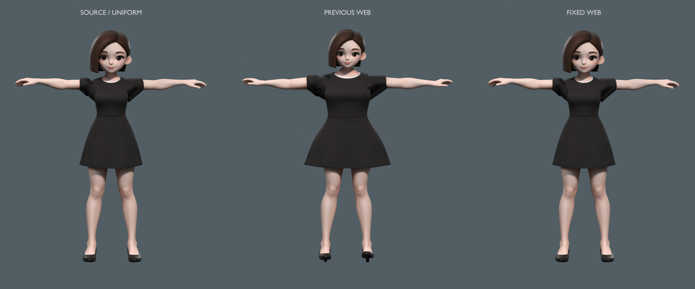

# 豆包体型核查与原比例修正

2026-11-10。核查确认旧适配改变了豆包体型，随后按用户“继续”指示完成修正。当前保留原PMX的完整形状，以单一等比变换适配显示骨架；原4K贴图、107,855顶点、180,698三角面均保留。原战斗骨骼与挂点保持数值一致，武器显示跟随新的手掌。

| 项目 | 修正前相对原比例 | 修正后 |
|---|---:|---|
| 静止网格总高度 | +0.47% | 与归一后的源高度一致 |
| 左右上臂根部关节跨度 | +37.38% | 保留源关节跨度 |
| 头部线性缩放 | −9.25% | 与全身使用同一等比缩放 |
| 下躯干至上躯干纵向间距 | +29.00% | 保留源间距 |
| 髋至下躯干纵向间距 | −14.37% | 保留源间距 |

修正前数据和图保存在[before](before/README.md)。当前[proportions.json](proportions.json)采用实际显示骨骼与同一批源顶点重新测量，误差仅为浮点舍入。源PMX无经过核实的现实厘米标定，这些数据不用于宣称真实身高。



左为源PMX等比变换，中为旧Web静止网格，右为修正后的Web静止网格。使用同一原贴图、材质、平行灯和正交相机，脚底对齐。手臂静止方向有差异，此图用于比例诊断；动作检查另见浏览器记录。

## 当前交付

- 工坊可选择豆包并点击「原模型姿态」，也可查看站姿、跑步、出招、跳跃、防御和脸部。
- 更新后的编辑工程：[豆包-完整人物-流星动作适配.blend](../doubao-import-2026-11-10/豆包-完整人物-流星动作适配.blend)。原4096²JPEG内嵌，含四段可编辑动作，30根显示身体骨骼加9发骨，无链接库。
- 原图字节与源档一致，归档和重建均在项目内，不依赖Downloads。
- 本次完整测试快照415/415通过；豆包及春田专项20/20通过；36运行模块语法检查通过。45组动作采样有限，原关节矩阵不变；原姿态蒙皮最大偏差2.7147e-7世界单位。包内4,153文件核验并与当前dist一致。
- 浏览器完成原姿态、脸部、跑步、跳跃、出招及炼铁狱实际演武L跳跃/J空中A，控制台无error/warn。测试人物选择已恢复为原来的孟星魂，临时对局关闭。

详见[验证摘要](validation.json)、[完整TAP](full-tests.tap)、[浏览器记录](browser-validation.json)、[技术报告](report.md)和[当前原姿态](source-pose-preview.png)。本轮未上传或发布模型。

## 复现

项目根目录执行：

```sh
/Applications/Blender.app/Contents/MacOS/Blender --background --factory-startup --disable-autoexec --python scripts/blender/build_doubao.py
/Applications/Blender.app/Contents/MacOS/Blender --background --factory-startup --disable-autoexec --python scripts/blender/check_doubao_build.py
/Applications/Blender.app/Contents/MacOS/Blender --background --factory-startup --disable-autoexec --python scripts/blender/audit_doubao_proportions.py -- --render
node --max-old-space-size=512 scripts/probe-doubao.mjs
node --max-old-space-size=512 --test --test-concurrency=1 tests/native-doubao-character.test.mjs tests/native-springfield-character.test.mjs
node --max-old-space-size=512 --test --test-concurrency=1 --test-timeout=180000 tests/*.test.mjs
npm run check
npm run package
```

## 保留的限制

源自动绑定的下半身枢轴高于实际髋关节，因此显示骨盆使用左右源大腿关节的中点，网格保持等比原形状。裙摆和腋下仅平滑权重，头部保持刚性；未实现布料、表情或独立手指。屈膝、踢腿等大幅动作仍可能穿插，保留原比例不等于完整MMD物理。

版权归属《豆包》，建模sdn1111，绑定鹿铃；项目原始署名与使用说明保留。
