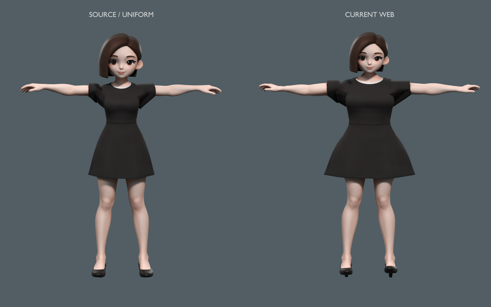

# 豆包体型与身高核查

2026-11-10。结论：豆包也存在旧适配改变原体型的问题，整体静止高度基本相同，但身体明显变宽、头部略小，躯干各段有不同程度的拉伸与压缩。当前尚未使用春田的独立原比例显示骨架。本轮只核查与生成诊断图，未改动游戏资源。

以原PMX等比缩到39.4个原生坐标单位作参照：

| 项目 | 当前旧适配相对原比例 |
|---|---:|
| 静止网格总高度 | +0.47% |
| 左右上臂根部关节跨度 | +37.38% |
| 头部线性缩放 | −9.25% |
| 下躯干至上躯干关节纵向间距 | +29.00% |
| 髋至下躯干关节纵向间距 | −14.37% |
| 左大腿骨长 | −4.20% |
| 左小腿骨长 | +3.98% |

静止网格直接测量也证实：选取同一批源顶点的躯干截面，宽度增加约34%—37%，前后厚度减小约9%—13%。截面使用固定源顶点ID，不把姿态或采样位置差异当成几何变化。关节跨度是适配目标，不等于包含衣袖的外轮廓宽度。

107,855顶点、180,698三角面及4096²原JPEG均保留，源图与运行图SHA-256完全相同；因此本次发现主要是几何与骨架适配改变体型。源PMX没有经过核实的厘米标定，不能据此宣称现实身高是多少。



左侧SOURCE / UNIFORM是原PMX按单一等比变换归一到目标高度；右侧CURRENT WEB是当前游戏静止网格。两者脚底对齐，使用相同原贴图、材质、平行灯和正交相机；没有分别拉到完全相同高度，右侧实测略高0.47%。手臂静止方向不同，图片用于几何比例诊断，不是同动作对照。

## Evidence → Finding → Path

| 证据 | 内容 |
|---|---|
| E-001 | `assets/source/doubao/豆包模型.pmx`、当前mesh与原BNC；SHA-256见proportions.json |
| E-002 | `scripts/blender/build_doubao.py`中的height_pairs、head_scale、width_scale及分段肢体变换 |
| E-003 | [proportions.json](proportions.json)：关节尺度、原网格截面、纹理哈希及身高测量 |
| E-004 | [同高度诊断图](source-vs-current.png)、[Blender日志](audit.log) |

F-001，severity=n/a_re，confidence=high，status=validated，evidence=E-001/E-002/E-003/E-004：旧适配没有完整保留豆包的体型。P-001，path_type=callflow：源PMX → 身高分段映射/横向与头部独立缩放 → 匹配孟星魂关节 → 平滑位移 → 当前Web静止网格。平滑接缝并不能恢复被改变的整体比例。

复现命令（项目根目录；只写诊断目录）：

```sh
/Applications/Blender.app/Contents/MacOS/Blender --background --factory-startup --disable-autoexec --python scripts/blender/audit_doubao_proportions.py -- --render
```

改进方向是沿用春田的独立原比例显示骨架：统一缩放原网格，让动作与显示武器适配人物。本轮没有实施该改动，也未重新打包或发布游戏。
