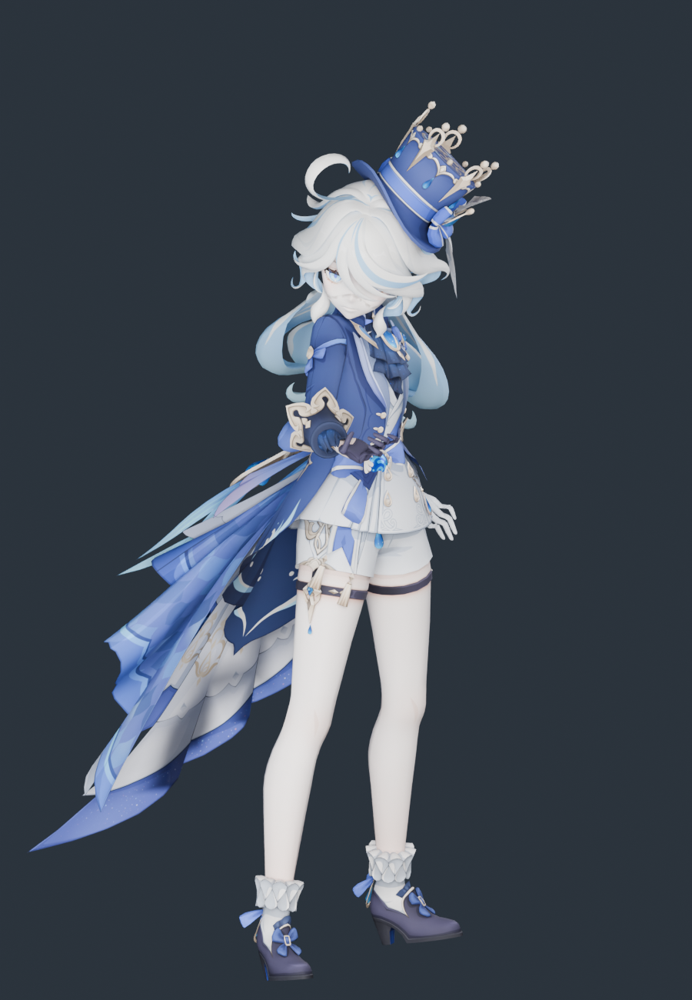

# 芙宁娜 · 模型导入与体型核查

2026-11-11。源模型来自用户下载目录，已整体归档到 `assets/source/furina`；运行时和重建只读项目内归档，不依赖原下载路径。

**结论：没有发生体型压变形。** 每个源顶点只做一次等比变换加地面偏移，没有逐段身高映射、头部缩放或横向宽度缩放；30 根骨骼显示骨架按原模型关节长度建，只接收《流星》的原生旋转。

## 授权与技术范围

配布说明与甘雨、雷电将军、荧、空同一套：允许完善物理、修正权重/表情，允许改色和适度改衣装；禁止二配、拆件、商用。原文保留在归档目录。

本包同时含 `【芙宁娜】.pmx` 与 `【芙宁娜_荒】.pmx` 两套，**本次导入的是前者**；`附件.zip` 里是蛋糕、海马、章鱼、神像等独立小道具，未纳入。

## 源模型

| 项 | 值 |
|---|---|
| 文件 | `【芙宁娜】.pmx`（PMX 2.0，3.6 MB，模型名 `Funingna`） |
| 顶点 / 三角面 | 31,099 / 39,037 |
| 骨骼 / 材质 / 贴图 | 425 / 32 / 10 |
| 二次骨骼 | 头发 49 根（左F 19、右F 19、DM 7、左右CF 各 2）；裙层 `HB1~HB4` 138 根、礼裙 `Q_*` 91 根、袖子 16 根（均为刚性） |
| 署名 | 模型提供：miHoYo；模型改造：观海（BiliBili：观海子） |

## 体型核查

参照：源 PMX 网格经单一等比缩放到 39.4 个原生坐标单位，与运行时网格用同一批源顶点逐点比较。

| 指标 | 源模型 | 运行时 | 变化 |
|---|---:|---:|---:|
| 静止总高度 | 39.4000 | 39.4000 | 0.00000% |
| 肩关节跨度 | 4.6912 | 4.6912 | −0.00001% |
| 锁骨→肩 | 2.0366 | 2.0366 | −0.00000% |
| 上臂长 | 4.8356 | 4.8356 | 0.00001% |
| 前臂长 | 4.1229 | 4.1229 | −0.00001% |
| 大腿长 | 9.0117 | 9.0117 | 0.00000% |
| 小腿长 | 9.4293 | 9.4293 | −0.00000% |
| 足长 | 1.9198 | 1.9198 | 0.00001% |
| 髋→颈 | 8.5919 | 8.5919 | 0.00000% |
| 髋→下躯干 | 2.0087 | 2.0087 | −0.00001% |
| 下躯干→上躯干 | 2.7272 | 2.7272 | −0.00003% |
| 上躯干→颈 | 3.8561 | 3.8561 | 0.00002% |
| 颈→头 | 1.7232 | 1.7232 | −0.00007% |
| 头→头顶 | 8.7238 | 8.7238 | 0.00003% |

- 逐顶点最大偏差：**9.30 × 10⁻⁸**
- 显示骨架关节位置误差：**0**
- 长度发生变化的骨段：**无**
- 源包围盒 == 运行时包围盒（逐轴完全相同）
- 5 个身高截面用固定源顶点 ID 测宽测厚，变化均 **0.0000%**

对照图：[source-vs-current.png](../furina-proportions-2026-11-11/source-vs-current.png)、[侧面](../furina-proportions-2026-11-11/source-vs-current-side.png)

## 这套模型的两个陷阱

**1. 名字像头发的骨骼其实是裙子。** `HB1~HB4` 共 138 根，看名字像 Hair Bone，但按材质权重实查，它们驱动的是「裙摆 / 裙1 / 裙2 / 裙3 / 裙饰」；`Q_*` 91 根驱动「服饰 / 裙」。真正的头发只有 `左F_*`、`右F_*`、`DM_*`、`左CF/右CF`，共 49 根，正好在 128 根弹簧上限之内。

**2. 四个 `+` 材质是同一批几何的叠加通道。** `髮+`(5495)、`裙摆+`(308)、`裙1+`(155)、`裙2+`(552)。判断依据不是三角面数，而是**源顶点位置集合**：前三个与基础材质完全相同，`裙2+` 是 `裙2` 的真子集（共享 324/324 个点）。同时绘制会重复着色并在共面处闪烁，因此作为叠加通道跳过，合计 6,510 面记入 `omittedRenderPasses`。

## 保留与未完成

保留：31,099 顶点全部保留，32,527 三角面（仅跳过 4 个叠加通道）、4 张基础色贴图按 SHA-256 原样复制、法线/UV/双面标志、49 根头发弹簧 + 3 个碰撞体、4 组动作烘焙（误差 5.7 × 10⁻⁶）、可编辑 Blender 文件。

未完成：多层裙摆、礼裙、袖子、礼帽刚性绑定，没有布料解算；表情 morph 未接；原版 sphere/toon 通道未复现；手指只映射到原生拇指/食指两段链；源 PMX 无可核实厘米标定，不宣称现实身高。`【芙宁娜_荒】` 形态未导入。

## 复现

```sh
/Applications/Blender.app/Contents/MacOS/Blender --background --factory-startup --disable-autoexec --python scripts/blender/build_furina.py
/Applications/Blender.app/Contents/MacOS/Blender --background --factory-startup --disable-autoexec --python scripts/blender/audit_furina_proportions.py -- --render
/Applications/Blender.app/Contents/MacOS/Blender --background --factory-startup --disable-autoexec --python scripts/blender/render_furina_preview.py
node --test tests/native-furina-character.test.mjs
```

## E → F → P

| 证据 | 内容 |
|---|---|
| E-001 | `assets/source/furina/` 25 个归档文件，SHA-256 见 [source-copy.json](source-copy.json) |
| E-002 | `scripts/blender/build_furina.py`：单一 `uniform()` 变换，无分段缩放 |
| E-003 | [proportions.json](../furina-proportions-2026-11-11/proportions.json)：逐顶点偏差、关节尺寸、同顶点截面 |
| E-004 | [build-evidence.json](build-evidence.json)：骨架误差、烘焙动作、贴图打包、运行资产哈希 |

F-001，severity=n/a，confidence=high，status=validated，evidence=E-001~E-004：芙宁娜的原始身高、躯干与四肢比例在适配后未发生改变。P-001：源 PMX → 单一等比变换 → 原长度显示骨架 → 原生 AMB/POS 旋转 → 运行时网格。

