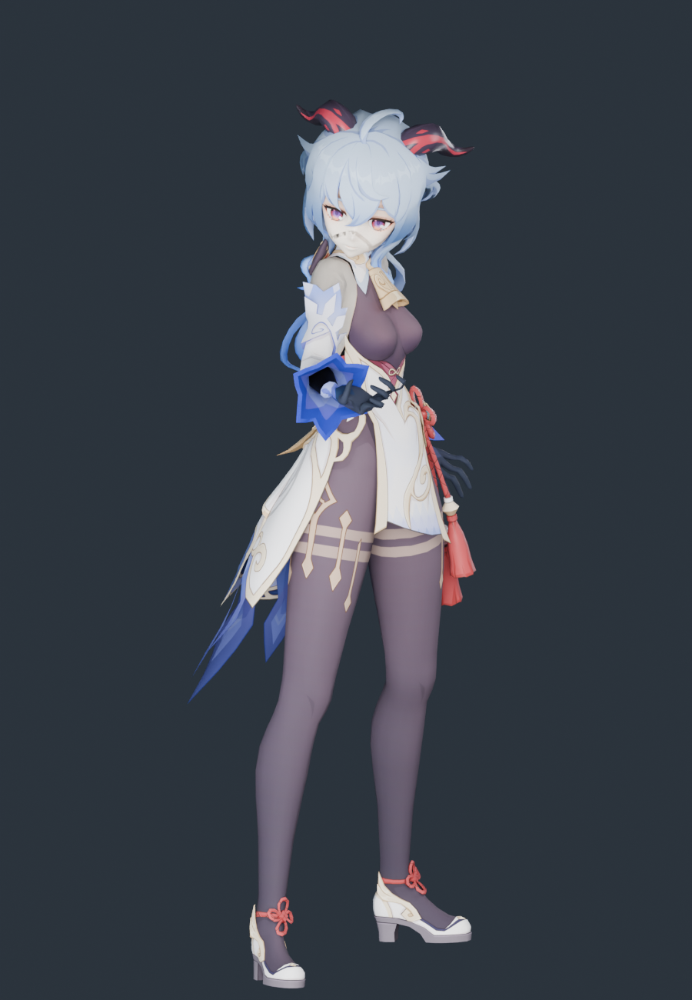

# 甘雨 · 模型导入与体型核查

2026-11-10。源模型来自用户下载目录，已整体归档到 `assets/source/ganyu`；运行时和重建只读项目内归档，不依赖原下载路径。

**结论：没有发生豆包那种体型压变形。** 构建对每个源顶点只做一次等比变换加地面偏移，没有任何逐段身高映射、头部缩放或横向宽度缩放；30 根骨骼显示骨架按原模型关节长度建，只接收《流星》的原生旋转。

## 源模型

| 项 | 值 |
|---|---|
| 文件 | `甘雨.pmx`（PMX 2.0，1.2 MB） |
| 顶点 / 三角面 | 16,589 / 21,111 |
| 骨骼 / 材质 / 贴图 | 275 / 19 / 5 |
| 关键骨骼 | 标准 MMD 全套（含足D、ひざD、足首D、足先EX、肩P/C、腕捩） |
| 二次骨骼 | 头发 4 条链（发_* 10、左发_* 7、右发_* 7、アホ毛_* 5），裙摆 前摆/后摆，流苏 2 条 |
| 署名 | 模型提供：miHoYo；模型改造：观海（BiliBili：观海子） |

原配布说明明确禁止二次配布、拆件改造和商业使用。本目录只是本地适配，不构成对上述条款的授权或发布。

## 体型核查（用户要求的重点）

参照：源 PMX 网格经单一等比缩放到 39.4 个原生坐标单位。运行时网格与同一批源顶点逐点比较。

| 指标 | 源模型 | 运行时 | 变化 |
|---|---:|---:|---:|
| 静止总高度 | 39.4000 | 39.4000 | 0.00000% |
| 肩关节跨度 | 5.1323 | 5.1323 | 0.00000% |
| 锁骨→肩 | 2.2281 | 2.2281 | 0.00001% |
| 上臂长 | 5.2902 | 5.2902 | −0.00001% |
| 前臂长 | 4.5106 | 4.5106 | 0.00001% |
| 大腿长 | 9.8591 | 9.8591 | −0.00001% |
| 小腿长 | 10.3159 | 10.3159 | 0.00000% |
| 足长 | 2.2443 | 2.2443 | 0.00000% |
| 髋→颈 | 9.7925 | 9.7925 | −0.00001% |
| 髋→下躯干 | 2.1976 | 2.1976 | 0.00004% |
| 下躯干→上躯干 | 2.9836 | 2.9836 | −0.00002% |
| 上躯干→颈 | 4.6114 | 4.6114 | −0.00002% |
| 颈→头 | 1.2929 | 1.2929 | 0.00004% |
| 头→头顶 | 5.9975 | 5.9975 | 0.00003% |

- 逐顶点最大偏差：**8.69 × 10⁻⁸**
- 显示骨架关节位置误差：**0**
- 长度发生变化的骨段：**无**
- 源顶点包围盒 == 运行时包围盒（逐轴完全相同）
- 5 个身高截面上用**固定源顶点 ID** 测宽/测厚，变化均为 **0.0000%**

对照图（同一材质、灯光、相机，脚底对齐，左源右当前）：[source-vs-current.png](../ganyu-proportions-2026-11-10/source-vs-current.png)、[侧面](../ganyu-proportions-2026-11-10/source-vs-current-side.png)

## 保留下来的东西

- 16,589 顶点、21,111 三角面，**0 丢弃**（无默认透明材质）
- 5 张原贴图（面/发/服/肌/表情）按 SHA-256 原样复制，运行时校验一致
- 法线、UV、平滑组、双面标志
- 头发 29 根独立弹簧骨骼 + 3 个碰撞体，`web-spring-bone-v2-restrained` 参数
- 动作烘焙：待机 6、跑步 144、跳跃 151、攻击 262（误差 7.6 × 10⁻⁶）
- 可编辑 Blender 文件：[甘雨-流星动作适配.blend](甘雨-流星动作适配.blend)

## 尚未完成

- 裙摆、流苏仍刚性绑在骨盆/躯干上，没有布料或弹簧解算
- 表情 morph 未接入
- 原版卡通着色、sphere/toon 贴图未复现，用的是基础色 + alpha 抠图 + 粗糙度
- 手指只映射到原生拇指/食指两段链，其余手指并入这两段
- 源 PMX 没有可核实的厘米标定，因此不宣称现实身高

## 复现

```sh
/Applications/Blender.app/Contents/MacOS/Blender --background --factory-startup --disable-autoexec --python scripts/blender/build_ganyu.py
/Applications/Blender.app/Contents/MacOS/Blender --background --factory-startup --disable-autoexec --python scripts/blender/audit_ganyu_proportions.py -- --render
/Applications/Blender.app/Contents/MacOS/Blender --background --factory-startup --disable-autoexec --python scripts/blender/render_ganyu_preview.py
node --test tests/native-ganyu-character.test.mjs
```

## E → F → P

| 证据 | 内容 |
|---|---|
| E-001 | `assets/source/ganyu/甘雨.pmx` 与 9 个归档文件，SHA-256 见 [source-copy.json](source-copy.json) |
| E-002 | `scripts/blender/build_ganyu.py`：单一 `uniform()` 变换，无 height_pairs／head_scale／width_scale |
| E-003 | [proportions.json](../ganyu-proportions-2026-11-10/proportions.json)：逐顶点偏差、关节尺寸、同顶点截面、贴图哈希 |
| E-004 | [build-evidence.json](build-evidence.json)：骨架误差、烘焙动作、贴图打包、运行资产哈希 |

F-001，severity=n/a，confidence=high，status=validated，evidence=E-001~E-004：甘雨的原始身高、躯干与四肢比例在适配后未发生改变，与豆包（肩宽 +37.38%、头 −9.25%）的失效模式不同。P-001：源 PMX → 单一等比变换 → 原长度显示骨架 → 原生 AMB/POS 旋转 → 运行时网格。

