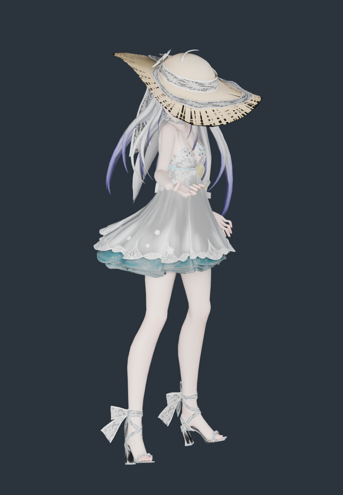

# TDA 弱音 · 夏日特调 · 模型导入与体型核查

2026-11-11。源模型来自用户下载目录，已整体归档到 `assets/source/haku`；运行时和重建只读项目内归档，不依赖原下载路径。

**结论：没有压变形，也没有浮空。** 每个源顶点只做一次等比变换；站立面按脚部顶点求（这包鞋底就是最低点）。30 根骨骼显示骨架按原模型关节长度建，只接收《流星》的原生旋转。

## 授权与署名

配布说明明确 **允许改造、优化骨骼和刚体、重制 UV**，禁止二次配布、商业用途、公开性质的 18 禁。按说明要求，借物表原样记录：

| 部分 | 作者 |
|---|---|
| 身体 | TDA / iRon0129 |
| 面部 / 头发 | coa / iRon0129 / larig-apagar / DD-372Cassin |
| 服装 / 鞋 | Samsink（机动战士牛肉） |
| 模型编辑 | DD-372Cassin |

`data/` 里另附了可替换的透明材质与 UV 贴图（原包的可选内容），未启用。

## 源模型

| 项 | 值 |
|---|---|
| 文件 | `Haku2.pmx`（PMX 2.0，2.2 MB，模型名 `TDA Haku`） |
| 顶点 / 三角面 | 29,555 / 43,251 |
| 骨骼 / 材质 / 贴图 | 633 / 36 / 24 |
| 二次骨骼 | 头发 26 根（`前髪*`、`左/右側髪*`、`左/右もみあげ*`、`t.062~071` 双马尾链，全部挂 `頭`）；裙 `スカート_*` 252、草帽 24、飘带 13（均为刚性） |
| 贴图 | 身体、面部、眼睛、头发 4 张主贴图 + `data/UV*.png` 服装图集，共 13 张基础色 |

## 体型与落地核查

| 指标 | 源模型 | 运行时 | 变化 |
|---|---:|---:|---:|
| 静止总高度 | 39.4000 | 39.4000 | +0.00000% |
| 肩关节跨度 | 4.2384 | 4.2384 | +0.00000% |
| 锁骨→肩 | 1.7179 | 1.7179 | +0.00001% |
| 上臂长 | 5.3151 | 5.3151 | −0.00001% |
| 前臂长 | 4.6728 | 4.6728 | +0.00001% |
| 大腿长 | 8.9655 | 8.9655 | +0.00000% |
| 小腿长 | 10.7155 | 10.7155 | −0.00000% |
| 足长 | 4.8227 | 4.8227 | −0.00000% |
| 髋→颈 | 9.0696 | 9.0696 | −0.00001% |
| 髋→下躯干 | 2.2263 | 2.2263 | −0.00003% |
| 下躯干→上躯干 | 2.1121 | 2.1121 | −0.00001% |
| 上躯干→颈 | 4.7312 | 4.7312 | +0.00000% |
| 颈→头 | 1.5844 | 1.5844 | +0.00011% |
| 头→头顶 | 5.9577 | 5.9577 | −0.00000% |

- 逐顶点最大偏差：**8.43 × 10⁻⁸**；骨架误差 **0**；长度变化骨段 **无**
- 源包围盒 == 运行时包围盒（逐轴完全相同）；4 个截面宽/厚变化均 **0.0000%**
- 落地：`meshFloor = soleFloor = −0.0065`，`geometryBelowSole = 0`；实测鞋底世界高度 **−0.8288**，与荧、芙宁娜、王昭君、刻晴一致

对照图：[source-vs-current.png](../haku-proportions-2026-11-11/source-vs-current.png)、[侧面](../haku-proportions-2026-11-11/source-vs-current-side.png)

## 这套模型（TDA 式）的特殊处理

| 情况 | 处理 |
|---|---|
| **没有 `足D/ひざD/足首D`，也没有 `足先EX`** | 30 骨骼映射候选解析：优先 D 版，缺失回落非 D 版；脚尖槽回落到 `つま先` |
| 双马尾骨骼是 `t.062~071`（TDA 通用命名），刘海叫 `前髪*`、侧发 `側髪*`、鬓发 `もみあげ*` | 四类命名统一识别，共 26 根做弹簧 |
| 头发材质叫 `前发/后发/发丝`（简体） | 按名识别为头发；其中 `发丝` 的 diffuse alpha = 0，按作者意图判定为不绘制 |
| 多材质 diffuse alpha < 1（鞋跟水体 0.8、拟水体平面 0.65、高光 0.9） | 规则扩展为「命名透明集 ∪ alpha<0.999」，不再依赖手工名单 |
| 36 个材质里有 1 个是默认透明（`发丝`，375 面） | 记入 `omittedRenderPasses`，其余 35 材质、42,876 面全部保留 |
| 贴图分散在 `tex/`、`data/`、`sph/`、`toon/` | 按引用路径复制，13 张基础色全部 SHA-256 校验 |

## 保留与未完成

保留：29,555 顶点；42,876 三角面（仅跳过作者设为全透明的 375 面）；13 张贴图原样复制；法线/UV/双面标志；26 根头发弹簧 + 3 个碰撞体；4 组动作烘焙（误差 5.7 × 10⁻⁶）；可编辑 Blender 文件。

未完成：裙（252 骨）、草帽、飘带、配饰刚性绑定，无布料解算；表情 morph 未接；TDA 的 sphere/toon 通道（`sph/`、`toon/` 里那 24 张）未复现；手指只映射到原生拇指/食指两段链；无可核实厘米标定，不宣称现实身高。

## 复现

```sh
/Applications/Blender.app/Contents/MacOS/Blender --background --factory-startup --disable-autoexec --python scripts/blender/build_haku.py
/Applications/Blender.app/Contents/MacOS/Blender --background --factory-startup --disable-autoexec --python scripts/blender/audit_haku_proportions.py -- --render
/Applications/Blender.app/Contents/MacOS/Blender --background --factory-startup --disable-autoexec --python scripts/blender/render_haku_preview.py
node --test tests/native-haku-character.test.mjs
```

## E → F → P

| 证据 | 内容 |
|---|---|
| E-001 | `assets/source/haku/` 66 个归档文件，SHA-256 见 [source-copy.json](source-copy.json) |
| E-002 | `scripts/blender/build_haku.py`：单一 `uniform()` 变换 + 按脚部顶点定站立面 |
| E-003 | [proportions.json](../haku-proportions-2026-11-11/proportions.json)：逐顶点偏差、关节尺寸、同顶点截面 |
| E-004 | [build-evidence.json](build-evidence.json)：骨架误差、烘焙动作、落地高度、运行资产哈希 |

F-001，severity=n/a，confidence=high，status=validated，evidence=E-001~E-004：该模型的原始身高、躯干与四肢比例在适配后未发生改变，且站稳地面。P-001：源 PMX → 单一等比变换 → 原长度显示骨架 → 原生 AMB/POS 旋转 → 运行时网格。

