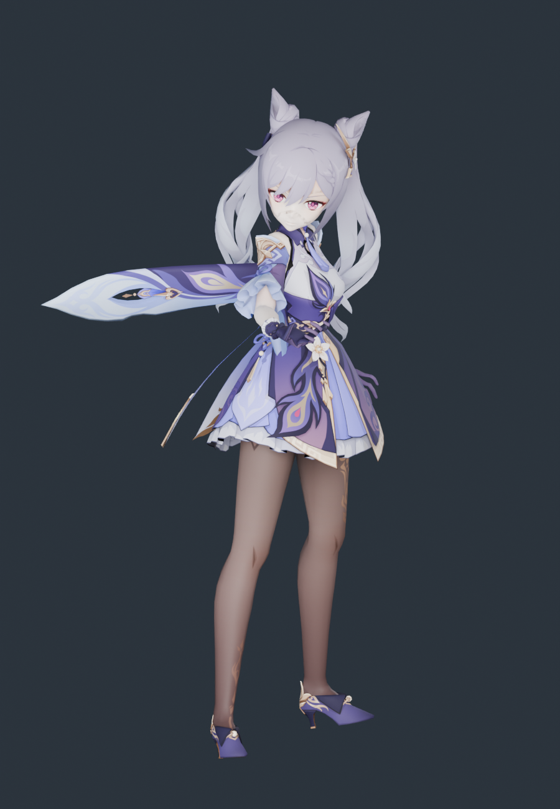

# 刻晴 · 模型导入与体型核查

2026-11-11。源模型来自用户下载目录，已整体归档到 `assets/source/keqing`；运行时和重建只读项目内归档，不依赖原下载路径。

**结论：没有发生体型压变形，也没有浮空。** 每个源顶点只做一次等比变换；站立面按脚部顶点求（这一包鞋底本身就是最低点，所以与整网格最低点一致）。30 根骨骼显示骨架按原模型关节长度建，只接收《流星》的原生旋转。

## 授权

配布说明与甘雨、雷电将军、荧、空、芙宁娜同一套：允许完善物理、修正权重/表情，允许改色和适度改衣装；禁止二配、拆件、商用。原文保留在归档目录。

## 源模型

| 项 | 值 |
|---|---|
| 文件 | `刻晴.pmx`（PMX 2.0，1.2 MB，模型名 `KeQing`） |
| 顶点 / 三角面 | 16,254 / 20,103 |
| 骨骼 / 材质 / 贴图 | 276 / 20 / 9 |
| 二次骨骼 | 头发 30 根（左发 9、右发 9、左侧发 6、右侧发 6，全部挂 `頭`）；裙 `スカート_*` 84、飘带 20、袖子 16、流苏 5（均为刚性） |
| 署名 | 模型提供：miHoYo；模型改造：观海（BiliBili：观海子） |

## 体型与落地核查

| 指标 | 源模型 | 运行时 | 变化 |
|---|---:|---:|---:|
| 静止总高度 | 39.4000 | 39.4000 | +0.00000% |
| 肩关节跨度 | 4.7016 | 4.7016 | −0.00001% |
| 锁骨→肩 | 2.0896 | 2.0896 | −0.00002% |
| 上臂长 | 4.9615 | 4.9615 | +0.00001% |
| 前臂长 | 4.2303 | 4.2303 | −0.00001% |
| 大腿长 | 9.2465 | 9.2465 | −0.00000% |
| 小腿长 | 9.6749 | 9.6749 | −0.00001% |
| 足长 | 1.8639 | 1.8639 | −0.00000% |
| 髋→颈 | 9.0273 | 9.0273 | +0.00000% |
| 髋→下躯干 | 2.0610 | 2.0610 | −0.00003% |
| 下躯干→上躯干 | 1.2475 | 1.2475 | +0.00004% |
| 上躯干→颈 | 5.7188 | 5.7188 | +0.00000% |
| 颈→头 | 1.5564 | 1.5564 | −0.00003% |
| 头→头顶 | 7.7479 | 7.7479 | +0.00003% |

- 逐顶点最大偏差：**1.03 × 10⁻⁷**
- 显示骨架关节位置误差：**0**；长度变化的骨段：**无**
- 源包围盒 == 运行时包围盒（逐轴完全相同）；5 个截面宽/厚变化均 **0.0000%**

落地（这次单独测了）：`meshFloor = soleFloor = 0.0098`，`geometryBelowSole = 0`。游戏内实测鞋底世界高度 **−0.8288**，与荧、芙宁娜、王昭君（修正后）完全一致。

对照图：[source-vs-current.png](../keqing-proportions-2026-11-11/source-vs-current.png)、[侧面](../keqing-proportions-2026-11-11/source-vs-current-side.png)

## 这套模型的情况

| 情况 | 处理 |
|---|---|
| 骨骼是标准 MMD 命名，头发 `左发/右发/左侧发/右侧发` 四链共 30 根 | 按 `发/髪/辫` 子串识别，全部做弹簧（上限 128 内） |
| 裙 `スカート_*` 84 根 | 刚性跟随骨盆，不做布料 |
| 材质名是短日文名（面/发/服/肌…） | 用精确名集合分类，不做子串猜测 |
| 无重复叠加通道材质、无退化法线、无低于鞋底的几何 | 20 材质、20,103 面**全部保留，0 丢弃**，`degenerateNormals = 0` |
| `照れ`（脸红叠加片，flag 1 单面） | 透明 + 不写深度 |

## 保留与未完成

保留：16,254 顶点、20,103 三角面全保留；5 张贴图 SHA-256 原样复制；法线/UV/双面标志；30 根头发弹簧 + 3 个碰撞体；4 组动作烘焙（误差 5.2 × 10⁻⁶）；可编辑 Blender 文件。

未完成：裙摆、飘带、袖子、流苏刚性绑定，无布料解算；表情 morph 未接；原版 sphere/toon 通道（`sph/hair-sph.jpg`、`sph/st.png`）未复现；手指只映射到原生拇指/食指两段链；源 PMX 无可核实厘米标定，不宣称现实身高。

## 复现

```sh
/Applications/Blender.app/Contents/MacOS/Blender --background --factory-startup --disable-autoexec --python scripts/blender/build_keqing.py
/Applications/Blender.app/Contents/MacOS/Blender --background --factory-startup --disable-autoexec --python scripts/blender/audit_keqing_proportions.py -- --render
/Applications/Blender.app/Contents/MacOS/Blender --background --factory-startup --disable-autoexec --python scripts/blender/render_keqing_preview.py
node --test tests/native-keqing-character.test.mjs
```

## E → F → P

| 证据 | 内容 |
|---|---|
| E-001 | `assets/source/keqing/` 11 个归档文件，SHA-256 见 [source-copy.json](source-copy.json) |
| E-002 | `scripts/blender/build_keqing.py`：单一 `uniform()` 变换 + 按脚部顶点定站立面 |
| E-003 | [proportions.json](../keqing-proportions-2026-11-11/proportions.json)：逐顶点偏差、关节尺寸、同顶点截面 |
| E-004 | [build-evidence.json](build-evidence.json)：骨架误差、烘焙动作、落地高度、运行资产哈希 |

F-001，severity=n/a，confidence=high，status=validated，evidence=E-001~E-004：刻晴的原始身高、躯干与四肢比例在适配后未发生改变，且站稳地面。P-001：源 PMX → 单一等比变换 → 原长度显示骨架 → 原生 AMB/POS 旋转 → 运行时网格。

