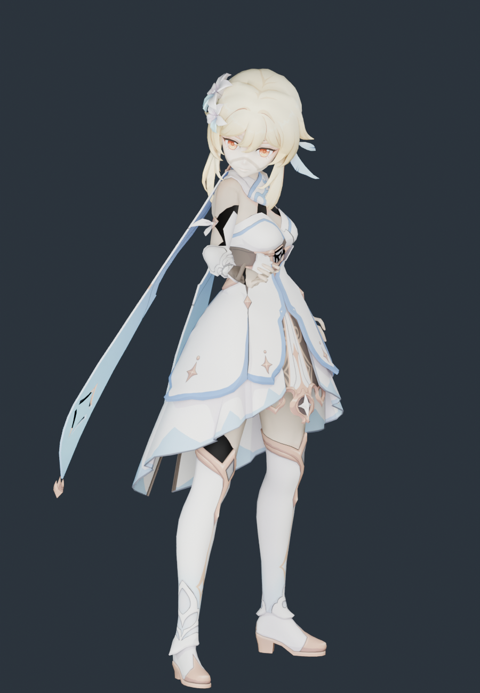

# 荧 · 模型导入与体型核查

2026-11-11。源模型来自用户下载目录，已整体归档到 `assets/source/lumine`；运行时和重建只读项目内归档，不依赖原下载路径。

**结论：没有发生体型压变形。** 每个源顶点只做一次等比变换加地面偏移，没有逐段身高映射、头部缩放或横向宽度缩放；30 根骨骼显示骨架按原模型关节长度建，只接收《流星》的原生旋转。

## 用的是哪一包

用户先后给了两个荧的模型包。第一次那包（`荧 - [晴空绘卷] 1.0 ver`）的配布说明写明**禁止改造，且仅限 MMD 及 MMD 延伸软件**，与"重建成 Web 游戏角色"直接冲突，因此先向用户确认；用户随后改指本包。

本包 `【原神女主角_荧】_by_原神` 的条款与甘雨、雷电将军同一套：**允许完善物理、修正权重/表情，允许改色和适度改衣装**，禁止二配、拆件、商用。归档目录保留原始说明原文。

## 源模型

| 项 | 值 |
|---|---|
| 文件 | `荧.pmx`（PMX 2.0，1.2 MB，模型名 `PlayerGirl`） |
| 顶点 / 三角面 | 17,757 / 22,868 |
| 骨骼 / 材质 / 贴图 | 272 / 20 / 11 |
| 二次骨骼 | 头发 22 根（`+HairS/+HairB` 共 11 条链，全部挂 `頭`）、裙 `Q_*` 80 根、飘带 `带_*` 38 根、头饰 11 根 |
| 署名 | 模型提供：miHoYo；模型改造：观海（BiliBili：观海子） |

## 体型核查

参照：源 PMX 网格经单一等比缩放到 39.4 个原生坐标单位，与运行时网格用同一批源顶点逐点比较。

| 指标 | 源模型 | 运行时 | 变化 |
|---|---:|---:|---:|
| 静止总高度 | 39.4000 | 39.4000 | 0.00000% |
| 肩关节跨度 | 5.3149 | 5.3149 | 0.00001% |
| 锁骨→肩 | 2.2462 | 2.2462 | −0.00001% |
| 上臂长 | 5.3333 | 5.3333 | 0.00002% |
| 前臂长 | 4.5473 | 4.5473 | −0.00000% |
| 大腿长 | 9.9394 | 9.9394 | 0.00001% |
| 小腿长 | 10.4000 | 10.4000 | 0.00000% |
| 足长 | 1.9285 | 1.9285 | −0.00000% |
| 髋→颈 | 9.6258 | 9.6258 | −0.00000% |
| 髋→下躯干 | 2.4816 | 2.4816 | −0.00001% |
| 下躯干→上躯干 | 2.7417 | 2.7417 | −0.00004% |
| 上躯干→颈 | 4.4025 | 4.4025 | 0.00002% |
| 颈→头 | 1.7511 | 1.7511 | −0.00009% |
| 头→头顶 | 5.7586 | 5.7586 | 0.00005% |

- 逐顶点最大偏差：**8.44 × 10⁻⁸**
- 显示骨架关节位置误差：**0**
- 长度发生变化的骨段：**无**
- 源包围盒 == 运行时包围盒（逐轴完全相同）
- 5 个身高截面用固定源顶点 ID 测宽测厚，变化均 **0.0000%**

对照图：[source-vs-current.png](../lumine-proportions-2026-11-11/source-vs-current.png)、[侧面](../lumine-proportions-2026-11-11/source-vs-current-side.png)

## 这套模型的特殊处理

| 情况 | 处理 |
|---|---|
| 材质 `髪+` 与 `髪` 都是 2073 面，且 `髪+` 用球面图 `sp.png`、alpha 0.7 | 作为球面叠加通道跳过并记录，避免头发被重复叠加 |
| 头发骨是英式命名 `+HairS L B01` 等，11 条链全部挂 `頭` | 按 `+Hair` 前缀识别，做 22 根弹簧骨骼 |
| 裙 `Q_*` 根在 `下半身`、飘带 `带_*` 根在 `上半身2` | 随父级落到骨盆/上躯干槽，不做布料解算 |
| 本包有 `足先EX` | 第 6/10 槽锚到真实的脚尖末端骨 |
| `元素+` 是发光元素符号 | 保留为不透明高金属度材质 |

## 保留与未完成

保留：17,757 顶点全部保留（跳过 2,073 面重复球面通道，其余 20,795 面全在）、5 张基础色贴图按 SHA-256 原样复制、法线/UV/双面标志、22 根头发弹簧 + 3 个碰撞体、4 组动作烘焙（误差 7.6 × 10⁻⁶）、可编辑 Blender 文件。

未完成：裙摆、飘带、头饰仍是刚性绑定，没有布料解算；表情 morph 未接；原版 sphere/toon 通道未复现；手指只映射到原生拇指/食指两段链；源 PMX 无可核实厘米标定，不宣称现实身高。

## 复现

```sh
/Applications/Blender.app/Contents/MacOS/Blender --background --factory-startup --disable-autoexec --python scripts/blender/build_lumine.py
/Applications/Blender.app/Contents/MacOS/Blender --background --factory-startup --disable-autoexec --python scripts/blender/audit_lumine_proportions.py -- --render
/Applications/Blender.app/Contents/MacOS/Blender --background --factory-startup --disable-autoexec --python scripts/blender/render_lumine_preview.py
node --test tests/native-lumine-character.test.mjs
```

## E → F → P

| 证据 | 内容 |
|---|---|
| E-001 | `assets/source/lumine/` 13 个归档文件，SHA-256 见 [source-copy.json](source-copy.json) |
| E-002 | `scripts/blender/build_lumine.py`：单一 `uniform()` 变换，无分段缩放 |
| E-003 | [proportions.json](../lumine-proportions-2026-11-11/proportions.json)：逐顶点偏差、关节尺寸、同顶点截面 |
| E-004 | [build-evidence.json](build-evidence.json)：骨架误差、烘焙动作、贴图打包、运行资产哈希 |

F-001，severity=n/a，confidence=high，status=validated，evidence=E-001~E-004：荧的原始身高、躯干与四肢比例在适配后未发生改变。P-001：源 PMX → 单一等比变换 → 原长度显示骨架 → 原生 AMB/POS 旋转 → 运行时网格。

