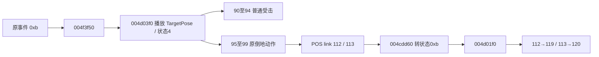

# E-hit-reaction-source：原版受击、倒地与起身

日期：2026-10-30。范围沿用 `work/meteor-original/scope.md` 的 granted / offline 授权。原始 `Meteor.exe` 未执行、未修改；SHA-256 仍为 `289afb0aa44a47921d167fc24d6d404c60d6d00c299ac27d45fc61e16231b498`。本次使用既有 Ghidra 数据库的 `-readOnly -noanalysis` 静态导出，并读原版 POS / EF。结构化结论、原文件位置和 23 份关键源码/反汇编哈希在同名 JSON 中；可重跑 `node work/meteor-original/evidence/hit-reaction-source-audit-2026-10-30.mjs`。

## Evidence → Finding → Path

1. 原版 `004af630` 非致死、未防御的伤害处理向角色发送事件 `0xb`；`004ed9d0` 将该事件分发到虚表 `+f4`，原 PE 指针为 `004f3f50`。`004f3f50` 把消息内的目标 Pose 直接传给状态对象 `+48`。该对象的原虚表 `005aa6a8 +48` 指向 `004d03f0`。
2. `004d03f0` 在当前状态不是数值 7 / 9 时开始该 Pose，并将角色状态改为 4。这是明确的受击动作切换；仅扣 HP / 飘字而让目标继续原攻击，漏掉了此链。7 / 9 的完整身份暂未恢复，不能擅自命名为某种无敌。
3. 原状态 4 更新函数 `004cdd60` 检查 `0055c4e0` 返回的关联 Pose：动画状态完成且关联 Pose 为 112 / 113 时进入状态 `0xb`；其他受击动作完成后转状态 1。原 POS 中剑第三下 264 的 `TargetPose=98`，98 有 `link112`；大刀第三下 297 的 `TargetPose=96`，96 有 `link113`。95 / 96 → 113，97 / 98 / 99 → 112。
4. 原状态 `0xb` 更新 `004cdf90` 在无方向输入且内部字段 `[de]==1` 时调用虚表 `+f8=004d01f0`；有方向输入则进入原 `004cbf10` 的移动/翻滚路径。`004d01f0` 明确选择：关联 Pose 113 → 120；其他非 117 Pose → 119；117 → 35。本轮 Web 倒地恢复只采用已确认的 112 → 119、113 → 120。
5. 原版防御消息是独立的事件 `0xe`，分发到 `004f4010`。成功防御不能无条件套用普通 `TargetPose` 而把对手击倒。原有 `AttackType` 非零绕过防御规则见 `E-guard-break-2026-10-29.json`，本次不改变其伤害结论。

这张图是可编辑的证据流程源，不是声称已渲染的图片。

## 原资源直接可用的动作与音效

| 来源动作 | 原 TargetPose | 原关联 | 用途边界 |
|---|---:|---|---|
| 匕首普通 248 / 249 | 90 / 91 | 无倒地 link | 普通受击，无依据让每一下倒地 |
| 剑普通 262 / 263 / 264 | 93 / 91 / 98 | 264 的 98 → 112 | 第三式有原倒地链 |
| 大刀普通 295 / 296 / 297 | 90 / 91 / 96 | 297 的 96 → 113 | 第三式有原倒地链 |
| 112 / 113 | 单帧卧地 | 各有同帧 LoopStart/End | 不能只播一帧便覆盖成站立 |
| 起身 119 / 120 | 原 8 帧，Speed2 | 112→119 / 113→120 | 动作约 0.133 秒，宿主停留时长另算 |
| 90–94 | 原 8 帧 | 各有尾帧 LoopStart/End | 非无限播放；普通动作约 0.267 秒 |

EF 原文件含以下可验证音频名：`W00BL093 → W00HIT01.wav`、`W00BL098 → W00HIT02.wav`、`W00GD093 → W00GRD01.wav`、`W05BL096 → W05HIT02.wav`。字节长度、SHA-256 在 JSON 的 `sounds` 中。本次只能据此确认本地 EF 音效引用，不声称恢复了全部原版混音、声道与随机化政策。

## 已确认的方向选择与尚未恢复的边界

原 `004f3380` 按角度选择攻击记录的 `+4c(front)` / `+50(back)` / `+54(left)` / `+58(right)`，角度边界为约 ±0.7853975、±2.3561925 弧度。原解析器 `005754d0` 会将未指定的方向 Pose 回填为基础 `TargetPose`。但本轮未核清原方向矩阵/有符号角与 Web 世界朝向之间的完整坐标映射。Web 若先使用基础 `TargetPose`，是保守引用；若用 Web 向量选方向，应明确标注宿主几何适配。

以下仍不能写成“已从原版恢复”：

- `TargetMove` / `TargetValue` 的完整物理、时间与状态语义。不能拿它们作 HP、直接距离或受击免疫门槛。
- 固定卧地停留时长。`004cdf90` 使用状态/输入/内部字段；未查到一个统一的 0.65 秒常数。Web 的 0.65 秒等待属于可游玩的宿主适配。
- `NextPose.Time` 的原运行时混合/计时语义。POS 的 `.2/.25` 等值存在且被解析，不足以断言“延迟这些秒再出下一招”。连续普通 J 时保留旧攻击窗口属于 Web 修复策略，不应冒称原 Time 已还原。
- 局部命中停顿、镜头反馈、接触视觉与自动恢复政策的所有数值。

本轮运行时路径应保留普通受击与真正倒地的区别、生命值为零的死亡 Pose117 的区别，并确保受击锁期间不会被每帧待机/移动/普通攻击覆盖。测试结论由对应运行时测试文件记录；此文是原来源证据，不代替真实浏览器试玩。
