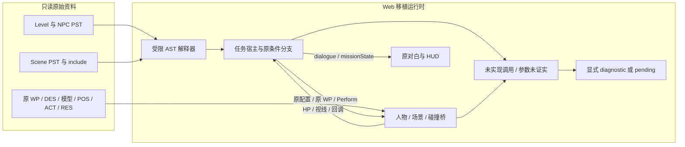

# 钟乳洞原版 PST 宿主与验证报告

日期：2026-10-23。类型：普通逆向与 Web 移植，`flavor = null`。范围依据：[scope.md](../scope.md)。本次只读取授权的本地客户端，未执行原版 Windows EXE，也未改写原始 PST。

第一关已经由原 `Level/sn01_.pst`、三个 NPC 脚本、地图脚本和其 include 驱动，Web 引擎提供人物、地图碰撞、动作、基础投射和对白显示。原始配置、原对白、巡逻路线及条件分支已实际执行；七星已能从原手骨按原攻击窗释放、飞行并扣除原 NPC HP。首关新增 CPU 验收证明了原 WP 路径可步行、活敌自然造成玩家死亡、失败和重开，以及冻结反击条件下的三 NPC 胜利链。**完整活 AI 对战通关尚未证明，也不能据此宣称全游戏、原物理或 AI 已完整还原。**

## 运行与复现

在 `meteor-web` 项目目录执行：

```sh
npm run dev
```

打开 `http://localhost:4173`，选择钟乳洞的原版第一关任务。程序入口调用 `game.start({map:'sn01',mode:'story'})`，自动加载宿主；使用原 PlayerSpawn，而不是多人模式的 D_user 出生点。

```sh
npm test
npm run check
node scripts/verify-native-scenes.mjs
```

已验证的全套快照为 58/58，通过 10 个运行模块语法检查；包含原 13 项宿主测试、新增 13 项投射测试和 7 项首关 CPU 验收。该结果由 game_engine 验证，记录于[验证快照](../evidence/E-validation-current.json)；7 项首关验收另存有[完整 TAP](../evidence/mission-cpu-acceptance.tap)，单独运行耗时约 25.55 秒。随后新增机关伤害 resolver 和两项已通过测试，默认引擎接入与预计 60 项的最终全套检查正在整合，58 项不作为最终数量。先前的 [native-mission-tests.tap](../evidence/native-mission-tests.tap) 和 E-mission-host 中 38 项结果也保留为历史快照。

新增 CPU harness 只省略 WebGL、图片解码、音频输出、名字贴图和浏览器事件循环；实际地图/场景三角形、SKC/BNC/AMB 骨动画、手挂点、原兵器几何、POS/ACT、RES、伤害与 PST 宿主使用真实运行代码。浏览器验证由主代理单独完成，未把这些测试当作人工完整通关。

## 原版配置与执行顺序

| 角色 | 脚本 | Model | Weapon item | Spawn WP | HP |
|---|---|---:|---:|---:|---:|
| 孟星魂 | Level/sn01_.pst | 0 | 5，副武器 1 | 9，方向 90 | 1500 |
| 铁枪哨兵﹒甲 | Level/npc01_01.pst | 8 | 7 | 53 | 1000 |
| 铁枪哨兵﹒乙 | Level/npc01_02.pst | 8 | 7 | 80 | 1000 |
| 军枪哨兵长 | Level/npc01_03.pst | 8 | 16 | 32 | 2000 |

item 5/1/7/16 分别解析为原 `w1_0`、`w3_0`、`w7_0`、`w7_1` 模型。三个 NPC 共用 Model 8，但 `scriptId`、引擎运行 ID 和模型 ID 分离，`GetChar` 不会把三人合并。第一关 `Rule=10`、`RoundTime=10` 均从源文件读取。

宿主先加载 include，再执行 `Scene_OnLoad → Scene_OnInit → level.OnInit（若存在）→ level.OnStart`。`AddNPC` 异步读取 NPC 源配置，创建角色后执行该 NPC 的 `OnInit(scriptId) → OnStart`，所有创建完成后执行首个 `level.OnUpdate`。此后以 0.05 秒浏览器适配节奏执行关卡/NPC 更新、Scene_OnUpdate/Scene_OnIdle；对象 OnIdle 每 0.1 秒委托源回调。

下面的Mermaid对应已接入的源数据/宿主/引擎调用路径；“未实现调用/参数未证实”分支保留显式诊断，不表示相关原行为已实现。可编辑独立源码见 [native-mission-flow.mmd](../diagrams/native-mission-flow.mmd)。本机没有mmdc，仅提供源码并检查连接关系，未声称已导出渲染图片。



甲的原巡逻路线为 `0,1,4,2,3`；乙为 `18,19,75,55,79,38,77,78,14,20`。路径连接与边长来自原 WP；浏览器用 Dijkstra 寻路。WP 的 `position` 保留原坐标，另将 `navigationPosition` 投影到真实碰撞地面以匹配人物脚底，避免 WP53 原高度 2.8 与实际脚底高度不同而永远无法抵达。地面偏移 0.015、抵达半径等是明确的宿主参数，并非已经恢复的原 AI 常量。

## 引擎接入接口

宿主模块为 `dist/native-mission-host.js`，解释器为 `dist/native-script.js`。解释器使用 tokenizer、AST 和受限执行器，未使用 `eval` 或 `new Function`。

| 接口 | 行为 |
|---|---|
| `NativeMissionHost.create(game,{mapId,sources?,fetcher?})` | 在已载入真实地图的 game 上加载关卡、场景及 includes；可注入源文本 Map |
| `await host.start()` | 按原配置放置玩家，执行初始化，创建原 NPC |
| `host.update(dt)` | 原条件分支、Perform 队列、感知、控制桥、完成状态 |
| `host.sceneItemAttack(nameOrId,attackerScriptId,damage)` | 执行真实对象的 `_OnAttack`；伤害必须由已明确的外部 resolver 提供 |
| `host.sceneItemIdle(nameOrId)` | 执行真实对象的 `_OnIdle` |
| `host.dispose()` | 停止脚本并清除控制；晚到的 NPC 加载会清理，避免切菜单后残留 |
| `host.levelVm / sceneVm / npcVms` | 调试原 globals、函数和实际宿主调用需求 |

引擎桥包括 `createScriptActor`、`placeScriptPlayer`、`removeScriptActor`、`hasScriptLineOfSight`、`finishStory`、场景对象与 pose/active/collision 方法。每个 NPC 获得 `scriptIntent` 和 `scriptControl`；引擎优先使用脚本的移动目标、攻击目标、暂停和防御，剧情角色死亡后不按演练模式重生。

对白通过 `game.onEvent({type:'dialogue',scriptId,speaker,text,duration,source})` 输出。`mission-diagnostic` 明示未实现 API/命令，失败回调会禁用，其他回调可继续。`Output/Print` 保存在 `host.stdout` 并输出 `script-output`。MakeString 使用解释器输出参数引用，支持原库的对象名生成。浏览器 fetch 保留 `globalThis` 接收者，防止 Window.fetch 的 Illegal invocation。

原源码的 `Perofrm`、`Distanve`、`InitBBoxs` 仅在宿主启用明确兼容映射，分别委托 Perform、Distance、InitBBoxes；源文件保持原样，映射记录在 compatibilityUsed。未知 API 不自动返回成功。

## 已验证的原脚本行为

13 项宿主测试覆盖：原 NPC 配置与 WP、Window.fetch 接收者、真实引擎放置/装备/不重生桥、原巡逻路线、WP 脚底投影、View 距离与视线、发现玩家与失踪、再次发现后逃向长官并报告、原生命阈值的撤退、长官临死对白、石块回调及实际道具激活、结算边界、加载中退出的清理。

7 项新增首关 CPU 验收的[完整说明](../evidence/E-mission-cpu-acceptance.md)区分了三种条件：

- 导航隔离验收从 WP9 沿原图边真实走至 WP53、WP80、WP32，经过实际地面、台阶和三角碰撞；无需先破坏机关。WP9→WP53 路线为 `9→11→5→6→7→1→4→74→63→65→64→37→67→32→53`。
- 活 AI 自然失败验收从原 WP9 使用普通移动走到 WP53，再前进接近活敌；玩家不攻击，由真实敌方攻击耗尽 1500 HP，检查唯一失败与重开后 HP、NPC、武器、怒气和接触计数恢复。没有定位到敌人身边或修改 HP/dead。
- 胜利链隔离验收冻结 NPC 物理反击，并在每个原 NPC 出生附近测试玩家攻击；关卡时钟与原 PST 继续更新。正常匕首攻击累计造成恰好 4000 伤害、击杀 3 人，执行哨兵长原死亡台词并触发唯一 Rule10 推断胜利。没有直接修改 NPC HP/dead，也没有直接调用 kill/finish；该条件不等于完整活 AI 实战获胜。

探索性正常输入 bot 已实际发生交战和失败：匕首追击造成 1002 伤害后死亡，近距七星策略造成 2372 伤害、击杀一名原 1000 HP 哨兵后死亡。它们没有完成通关，记录不能用作通关证据。旧“静止 WP67 玩家必须在 90 秒内死亡”断言不成立：原脚本报告后可能让哨兵长 wait、两哨兵 follow 长官，玩家应正常前进接敌，不改写源意图。

场景 `D_St20` 原 HP 500；调用原 StoneOnAttack 后，原脚本关闭石块碰撞、播放 pose、激活真实 `D_itSt20`，OnIdle 再隐藏破坏完毕的石块。当前 DES 没有 `D_itSt01`，宿主不会补造同名物体。早期 Node 测试显式传入 500，验证的是源回调本身；它没有证明引擎接触到原伤害参数的完整路径。

本次新增[机关伤害静态证据](../evidence/E-native-machine-damage.json)已闭环 `004f3380 → 004ad530(case 0x1d) → 004af570 → 005643f0 → 00560500 → PST OnAttack`：原伤害入参为 `nativePoseAttack(effectiveAttack, moveRecord)`，不减角色防御，不应用队伍倍率、防御状态或 HP 除十。原匕首248/249分别为50/59，七星200/202为49。`createNativeSceneDamageResolver` 及两项新增测试已通过；当前默认引擎接入与最终全套验收正在整合。该证据只恢复数值和参数传递，不证明原完整接触体、事件频率、爆炸映射或全部机关物理。

## 战斗公式与实现边界

角色伤害的数值依据是主代理恢复的原 EXE 分支，见 [原 EXE 数值报告](2026-10-23_逆向-MeteorEXE战斗数值-report.md)、[公式证据](../evidence/E-exe-combat-formulas.json)及[运行验证](../evidence/E-formula-runtime-verification.json)。当前代码从原 RES 读取武器/动作修正，先求有效攻击，再应用动作修正、减防御和队伍倍率，按原截断语义处理。HP 保持原内部整数单位，不能单独把伤害除以十。

七星基础地面/空中投射现已接入，见[原投射证据](../evidence/E-native-projectiles.md)。原 P0.POS200/202 的攻击窗各释放一枚原 W3_0，从实际 d_wpnR 世界位置发出；连续扫掠裁决最近墙体或角色，命中后只结算一次。真实 SKC/BNC/AMB、原地图和手骨测试中，WP67→WP53 连续三发各扣普通哨兵 34 HP，1000→898；原 WP9 直走桥上射击由 mesh T 遮挡。item16/W7_1 防御为 0，同一基础飞镖对长官伤害为 49，而不是普通哨兵的 34。

浏览器已观察到七星四次命中长官使 2000→1804；该射击观察不证明完整任务获胜。暂停冻结弹体年龄与飞行；换图、退出、重开和结算清理弹体；换武器不改变已发射弹体的武器/动作/队伍快照。速度 50 world/s、半径 0.12、寿命 3 秒、重力 0、自旋 28 rad/s、瞄准与胶囊碰撞体是明示的浏览器适配参数，未证实为 EXE 常量。八方手里剑、怒招、EF 完整轨迹和全部投射语义仍未恢复。

数值分支和基础投射已接通，不等于所有战斗条件都恢复。原输入识别、击退/受击/防御条件、怒气消耗触发、所有物品效果、原物理和视锥仍有未完成部分。对象机器伤害不能套用角色伤害公式。

宿主还保留以下明确边界：

- 第一关源脚本没有 GameOver；“所有敌对原 NPC 倒下即胜利”是标注 provenance 的 Rule10 适配推断。玩家死亡失败也是宿主适配。RoundTime 原值用于计时显示，超时结果尚未从原 GameRule 验证。
- View 数值按原单位乘 0.08，并查询真实地图/动态物体遮挡；原视角、巡逻策略和攻击等待时间尚未完整恢复。
- pause/guard 数值按秒适配，阅读时长是 Web 显示辅助。完整 PonEF 视觉渲染未完成，音效/效果事件已有桥。
- 当前接入并完成上述生命周期验收的是 sn01，完整活 AI 通关仍待证明。其他 PST 能解析不代表其他关卡已可通关；Misc、rand/Rand、SetScene、GameCallBack、GetLeader 等尚未接入的调用会明确报错。sn09 的 Misc 时间/随机序列需后续实现。

## Evidence → Finding → Path

| Evidence | source_ref / 复现 | 固定性 |
|---|---|---|
| E-mission-host | [E-mission-host.json](../evidence/E-mission-host.json)；`npm test` | SHA256 `7ff9d51e422e221cef6a04031499a353f2a9deb2c25953bdd01c590bd88deab1`；内含源文件和实现 SHA256 |
| E-pst-runtime | [E-pst-runtime.json](../evidence/E-pst-runtime.json)；`node --test tests/native-script.test.mjs` | 原 API、源位置、包含关系与 Def.h 参数 |
| E-exe-combat-formulas | [E-exe-combat-formulas.json](../evidence/E-exe-combat-formulas.json) | 原样本 SHA256 与地址、反汇编交叉核对；数值复现见上链报告 |
| E-native-projectiles | [E-native-projectiles.md](../evidence/E-native-projectiles.md)；`node --test tests/native-projectiles.test.mjs` | 原 POS/RES/GMC/EF 观察及 13 项投射测试；明示宿主飞行常数 |
| E-mission-cpu-acceptance | [验收说明](../evidence/E-mission-cpu-acceptance.md)、[7 项 TAP](../evidence/mission-cpu-acceptance.tap)；`node --test tests/mission-acceptance.test.mjs` | 原始 TAP 固定性见说明与 [E-validation-current.json](../evidence/E-validation-current.json) |
| E-native-machine-damage | [E-native-machine-damage.json](../evidence/E-native-machine-damage.json)；`node --test tests/native-script.test.mjs` | 原 EXE 事件到 PST 入参的静态链、x86 汇编及文件哈希；默认引擎接入和最终全套结果另行确认 |

| Finding | 状态 / 置信度 | 证据与位置 |
|---|---|---|
| F-mission-source：第一关剧情由真实 PST 的 globals/functions/原分支驱动 | validated / high / n/a_re | E-mission-host + E-pst-runtime；native-mission-host.js、真实 Level/sn01_.pst、13 项测试。剩余风险：测试不能证明全部原 AI 与浏览器物理一致 |
| F-mission-identity：同模型多 NPC 保留独立身份、原物品 ID 与原 WP | validated / high / n/a_re | E-mission-host 的 source/config 与真实 engine bridge 测试 |
| F-mission-completion：Rule10 的现有完成策略属于适配推断 | candidate / medium / n/a_re | E-mission-host 的 provenance 与源 Level/sn01_.pst；仍需恢复原规则实现 |
| F-dart-basic：原动作/手骨/模型已参与基础飞行和原伤害 | validated / high / n/a_re | E-native-projectiles 原数据观察与真实地图/人物测试、E-mission-cpu-acceptance；剩余风险：宿主飞行参数未与 EXE 逐项对照 |
| F-mission-lifecycle：原路径移动、实际战斗伤害、自然失败、隔离胜利和重开可联通 | validated / high / n/a_re | E-mission-cpu-acceptance + E-native-projectiles；剩余风险：尚无完整活 AI 实战胜利证据，隔离胜利不能外推为人工通关 |
| F-scene-damage-argument：原机关 OnAttack 传入 nativePoseAttack，无角色防御/队伍倍率 | validated / high / n/a_re | E-native-machine-damage 的静态调用链及新增 resolver/回调测试；剩余风险：默认引擎接入、原接触体和完整机关行为尚待最终验证 |

P-mission，`path_type=callflow`：

1. 原 manifest 找到 Level、scene、NPC 和 includes（E-mission-host / F-mission-source）。
2. AST 解释器加载 globals/functions，调用 Scene 与 Level 生命周期（E-pst-runtime / F-mission-source）。
3. AddNPC 读取原配置，通过原 WP 与 weapon item 创建独立角色（E-mission-host / F-mission-identity）。
4. 原 OnUpdate 依据 GetEnemy/GetHP/Distance 改变行为，Perform/Say 生成对白和控制（E-mission-host / F-mission-source）。
5. 原角色伤害分支更新 HP；宿主完成策略明确附带推断来源（E-exe-combat-formulas、E-mission-host / F-mission-completion）。
6. 原 POS200/202 窗口经 d_wpnR 释放原 W3_0，实际扫掠地图和人物后委托同一伤害分支（E-native-projectiles / F-dart-basic）。
7. 原 WP 步行与实际攻击可到达自然死亡、失败和重开；冻结反击的独立夹具耗尽三 NPC HP 后验证唯一推断胜利（E-mission-cpu-acceptance / F-mission-lifecycle、F-mission-completion）。
8. 原事件 0x1d 将 sceneIndex/poseId 送入原服务器分支，计算 nativePoseAttack，再原样传给 PST 对象 OnAttack；该数值桥的默认引擎接入仍在整合（E-native-machine-damage / F-scene-damage-argument）。

时间线：2026-10-22 读取/导出资源并完成 PST 语法与 VM；2026-10-23 接通第一关宿主及引擎、修复浏览器 fetch 接收者和脚底 WP 高度，先完成 38 项阶段测试，随后接入七星基础投射、补齐首关 CPU 验收并通过 58 项快照，之后恢复机关原伤害入参并开始最终集成。原时间线见 [timeline.md](../timeline.md)。后续应完成机关默认接入与最终全套检查、活 AI 通关验收，继续原 GameRule 与进阶投射恢复，再扩大原任务范围。

先前阶段发布记录见 [E-web-deployment.json](../evidence/E-web-deployment.json)：私有部署succeeded，源提交`ce1c35f2bf126589d6e05af8a7eb3d113e784452`，3953运行文件比对0差异。该历史记录不证明本次本地新增投射和验收代码已上线。线上浏览器此前只看到私有登录门，未登录验证游戏，不外推为线上通关或完整游戏完成。收尾职责/未完成工单见 [workitems.md](../workitems.md)，项目内匿名经验见 [field journal](../field-journal/2026-10-23_native-game-port.md)。
