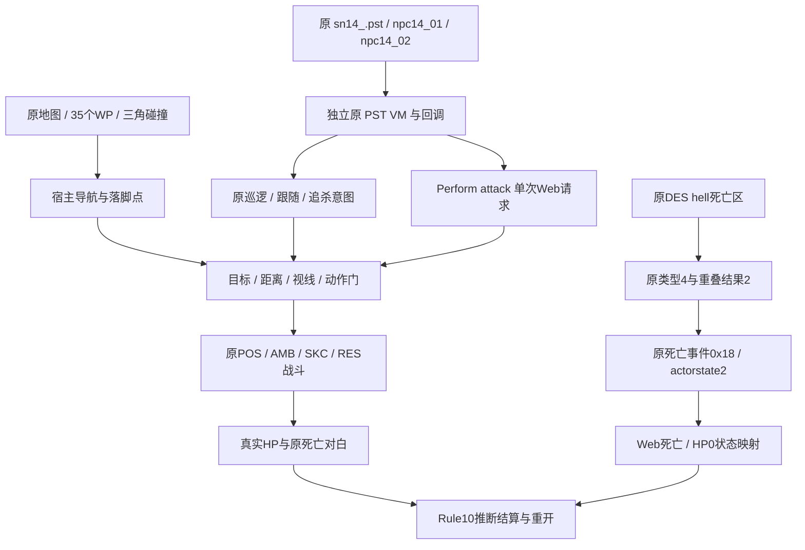

# 炎硫岛原任务 Web 接入报告

日期：2026-10-26（Asia/Shanghai）。报告类型：普通原生游戏资源与脚本移植，flavor=null。范围和授权沿用 [scope](../scope.md)，过程汇总见 [timeline](../timeline.md)。本分项只读取用户的原客户端，未执行或修改原 EXE，也未访问原联网服务。

## 结论

炎硫岛 `sn14` 的原玩家配置、两 NPC、对白、巡逻、敌人发现和同伴死亡分支已接入当前 Web 宿主。原 `Perform attack` 通过明确标注的单次 NPC 攻击意图执行，保留正常距离和视线限制。使用真实地图、原人物动作和伤害代码完成 6 项 CPU 验收，全部通过。源出生点到两守卫的普通步行、活守卫造成自然失败与重开、隔离反击条件下的正常攻击胜利链分别验证，不能合并称为完整活 AI 通关。任务目录以名称与 SN 编号展示，当前没有证实原剧情排序。

`sn02` 是秦皇陵的配置型场景，Rule5、无原 NPC 或剧情回调，不能因地图编号称其为第二关。炎硫岛采用的本地 S2 是原音乐文件，但关卡映射未恢复。独立静态追踪另已确认 `hell` 是直接死亡区，并非周期扣血；其Web检测适配不在本报告六项测试的覆盖内。

## 原始材料与目标

| 材料 | 已读取的原内容 | 作用 |
| --- | --- | --- |
| Level/sn14_.pst | Rule10，10分钟，玩家WP34/朝向180/HP1000/武器6+0 | 原任务入口、NPC添加、对白与触发分支 |
| Level/npc14_01.pst | 大刀哨兵：Model2、Weapon8、Weapon2=2、Team2、WP0、HP1000 | 原角色配置和独立脚本身份 |
| Level/npc14_02.pst | 铁枪哨兵：Model8、Weapon7、Weapon2=2、Team2、WP33、HP1000 | 原角色配置和独立脚本身份 |
| Level/sn14.wp | 35个原路点及连接 | 出生、巡逻和宿主导航 |
| sn14 GMB/DES/PST与cmodel/FMC | 原场景、三角碰撞、物件和初始化库 | Web几何、场景生命周期和真实落脚点 |
| Pmodel/Common与Meteor.res导出 | 原蒙皮、骨骼、姿态、兵器和数值 | 不使用替代人物或自造攻击帧 |

原样本和 Windows 依赖已由 [E-imports](../evidence/E-imports.json) 保全：Meteor.exe 为 PE32 x86，SHA-256 `289afb0aa44a47921d167fc24d6d404c60d6d00c299ac27d45fc61e16231b498`，依赖 D3D8、DirectInput、DirectSound、Win32 等。本轮没有新增 PE 反编译或动态 Hook；原数值公式复用此前已核对的 x86 结果。

逐源文件 SHA、参数和测试原始记录见 [E-native-island-2026-10-26](../evidence/E-native-island-2026-10-26.md)。所有原脚本文件保持原样，兼容处理发生在宿主侧。

## Evidence → Finding → Path

| Evidence | Finding | Confidence / 状态 |
| --- | --- | --- |
| 原sn14 Level/NPC/PST、[准备度输出](../evidence/mission02-sn14-readiness-2026-10-26.json) | 两NPC、玩家HP1000/主剑/无副兵器、原巡逻和对白来自源脚本 | high，配置与执行已验证 |
| [六项原始TAP](../evidence/mission02-sn14-tests-2026-10-26.tap)第2项 | 普通移动从原WP34走到WP0及WP33，实际碰撞导航可达 | high，冻结战斗的导航验收 |
| 同TAP第3/4项、当前宿主与引擎 | 原重见分支请求 NPC 攻击；距离/LOS/动作门通过才开始原出招并消费请求 | high，Web意图适配已验证；原Perform时序未恢复 |
| 同TAP第5项 | 正常原长剑攻击耗尽2000真实HP、两条死亡对白、唯一Rule10推断胜利和重开 | high，仅隔离反击的结算链 |
| 同TAP第6项 | 活原守卫实际使玩家自然死亡、唯一失败、重开恢复 | high，接触场景；不是源出生点完整实战 |
| 原sn02_.pst、menu.res、singlerec.ini | 地图编号不等于剧情排序；SN02没有NPC任务；保存记录不能证明原顺序 | high，当前不标原剧情第二关 |
| 原music/s2.mp3与导入记录 | S2原曲身份已核，sn14对应关系未核 | high / mapping unverified |
| [原hell静态链](../evidence/E-native-hell-semantics-2026-10-26.json) | DES hell→type4→原角色包围体重叠result2→死亡事件0x18/actorstate2/deathcounter++ | high，原分类和死亡跳转闭环；完整原重叠算法未恢复 |

P-island-1：`原Level OnStart → 两份AddNPC → 原NPC OnInit/OnStart → 原Level OnUpdate → 开场/patrol/follow/kill/死亡对白`。

P-island-2：`原trg2丢失后重见 → Perform attack → 宿主单次请求 → 原当前目标与兵器距离/真实场景射线/动作检查 → 原POS出招 → 请求消费`。`StopPerform`、死亡、RemoveNPC或退出会取消未消费请求；不会覆盖原follow/kill。玩家脚本的 `PlayerPerform attack` 没有在本分项实现，继续显式诊断。

P-island-3：`原动作/原伤害耗尽敌人HP → 原死亡对白 → 敌对NPC全部死亡 → Rule10宿主推断完成`。原文件没有显式 `GameOver`，该最后规则仍是推断，非恢复后的 EXE GameRule。



图为可编辑 Mermaid 源码，未导出独立渲染图。

## 验证和复现

在项目根目录运行：

```sh
node --test tests/native-mission-island.test.mjs
node work/meteor-original/evidence/mission02-sn14-readiness-2026-10-26.mjs
node --check dist/native-mission-host.js
```

单文件 6/6 通过，29.07秒，原始TAP SHA-256为 `a682eb222d651cfcb630d1a1ffad9d8b17648326256c58dd7e433588d53ae019`。测试读取真实原资源，只略去图像解码、音频、标签和浏览器渲染循环。自然失败在30 FPS、固定测试随机源的 Web AI 冷却间隔下由源守卫造成，88.70模拟秒后失败；没有通过直接赋HP/dead结束。导航不传送玩家，但冻结敌人反击；胜利不改敌方HP，却放置玩家于原NPC位置附近并冻结反击。三项各证明各自环节，不共同构成完整实战通关。

## 原环境死亡语义

独立反编译证据显示：00563300把DES的精确名称 `hell` 分类为type4；00564ab0用原角色包围体查询活动/可交互场景区，重叠后返回result2；004ebc10随后发送0x18等事件、写actorstate2、在适用模式增加死亡计数。这与004af630的战斗HP0死亡分支相互印证。该分支没有周期伤害常数，也没有调用角色扣血公式。Web侧使用原几何区域的脚点连续段检测触发死亡，HP=0是给显示/PST的状态映射；没有据此声称已复现原00570630包围体重叠、容差或采样频率。此独立分项的运行验证由主代理汇总，不混入上面的六项TAP。

## 剩余工作

全剧情排序、原GameRule、完整原NPC策略/副武器/道具、原导航物理、精确Perform时序和完整活AI人工胜利仍未证明。原 `hell` 分类和直接死亡跳转已经独立证实；其Web几何检测仍是明确适配，不能据本六项测试声称原环境碰撞完全一致。浏览器画面、界面入口、跨任务切换及全套最终检查由主代理汇总，本报告不把它们记为已完成；本分项没有上传网站或执行任何原客户端程序。
