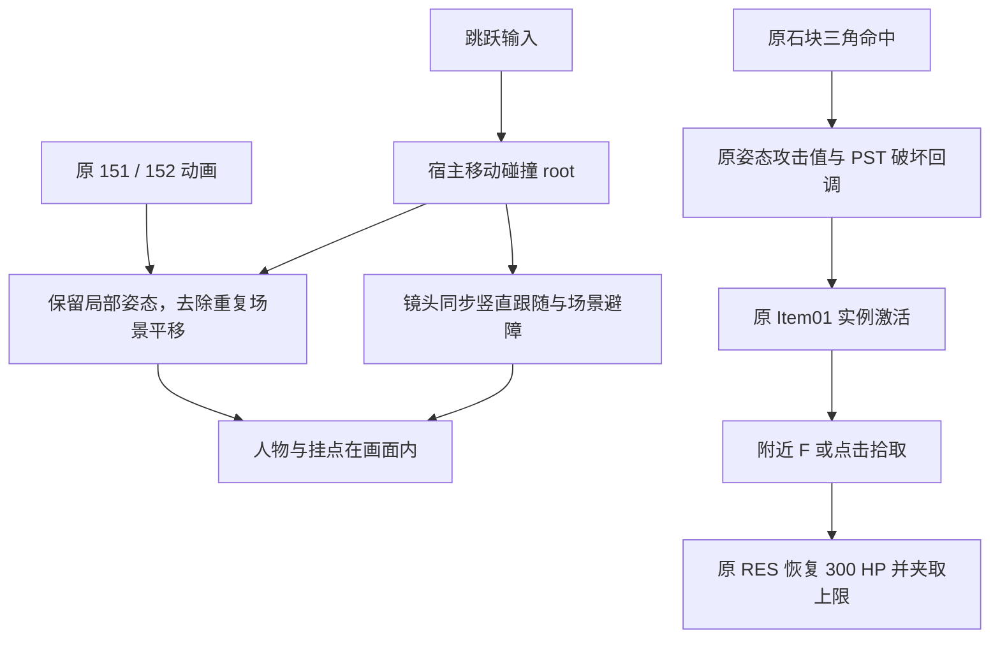

# 原版跳跃对齐与肉包交互验证报告

日期：2026-10-26（Asia/Shanghai）。普通离线资源与 Web 适配研究，flavor=null。授权和样本边界沿用 [scope](../scope.md)，本轮没有执行或修改原客户端。

## 结果

已修复用户反馈的“跳跃时人物飞出画面”：消除原动画场景平移与宿主物理的重复位移，使蒙皮、武器挂点和碰撞体一起跳跃；镜头竖直同步跟随，保留水平方向的缓动和场景避障。新增首关原版肉包拾取，按 F 或点击附近提示恢复原 RES 指定的 300 HP，最多恢复到最大 HP。

当前 83/83 项测试通过，11 个运行模块语法检查通过。浏览器确认平地与锁定跳跃时人物保持在画面中。肉包完整链使用真实 sn01 DES、cmodel、三角碰撞、PST 和 RES 在 CPU 验收；未将其记作人工实机拾取或整关通关。当前版本留在本地，尚未上传更新。

## Evidence → Finding → Path

| Evidence | Finding | 适用范围 |
| --- | --- | --- |
| [跳跃对照](../evidence/E-jump-follow-2026-10-26.md)及两份原始 TAP | 原 `d_base` 给整个蒙皮和挂点额外添加约 5.90 world 单位高度，外层碰撞体又独立执行跳跃；旧身体中心投影 y 最大 2.133，超出可见区 | 真实 P0 SKC/BNC/AMB/POS，旧代码 2/10 通过，修复后 10/10 通过 |
| 同上及全部 20 份 BNC | 就地播放恢复各角色自己的 BNC `d_base` 初始位置；保留骨盆局部高度、所有旋转与层级，避免只移动镜头掩盖碰撞错位 | P19 初始 pivot 非零；非就地与显式 `rootMotion:true` 仍保留原始轨迹 |
| [原肉包完整单链](../evidence/scene-meatbun-chain-2026-10-26.json)、[原机关数值](../evidence/E-native-machine-damage.json) | 实际七星弹体命中原石块，原 PST 扣除姿态攻击值，破碎动画结束后关闭碰撞并激活原掉落物 | 真实 D_St22 连续 11 次几何命中，每次 49，原石块 HP500→-39；动画结束激活 Item01，探针地面位置拾取后 HP1000→1300；不是人工步行或 F 实机 |
| [肉包验收](../evidence/E-native-items-2026-10-26.md) | 原 RES type2/id1、Item01 的 stat2/mode0/value300 是即时回血；原属性夹取语义限定当前 HP 不超过最大 HP | 9 项物品及引擎接线测试，包含真实 D_St22 → D_itSt22、重复拾取与重开 |
| [最终 TAP](../evidence/native-runtime-current.tap) | 83 项全部通过，无失败或跳过 | 当前本地引擎快照；UI另有语法与浏览器检查 |

跳跃调用路径：`L / 右键 → action('jump') → 宿主 root/vy → 原 151/152 蒙皮姿态 → 就地 d_base 适配 → 镜头随 root 升降 → 实际屏幕投影`。

物品路径：`原三角命中 → 原姿态攻击值 → 原 StoneOnAttack → 原破碎姿态 → 原掉落实例激活 → 附近 F/点击 → 原 Item01 效果 → HP 夹取 → 实例隐藏且停止交互`。有真实 `_OnPickUp` 回调时交回原场景 VM，首关肉包没有该回调，不创建替代脚本。



图为可编辑 Mermaid 源码，未导出独立渲染图。

## 复现

从项目根目录运行：

```sh
node --test tests/native-jump-camera.test.mjs
node --test tests/native-items.test.mjs
node work/meteor-original/evidence/scene-meatbun-chain-2026-10-26.mjs
npm test
npm run check
```

本地运行 `npm run dev` 后打开 `http://localhost:4173`，进入演武，按 L 或鼠标右键跳跃，再按 Q 锁定后重复。截图位于项目 `artifacts/jump-follow-fixed.png` 和 `artifacts/jump-lock-follow-fixed.png`。这些截图只证明当时的本地画面，完整跳跃过程由逐帧回归测试补充。

## 保留边界

镜头、跳跃速度/重力、肉包拾取范围与输入属于 Web 适配。满血不消耗、每局一次且没有计时重生，也是显式的当前交互约定，未冒称原 EXE 行为。原始资源文件保持原样；原版完整位移仍可用于非就地预览，但没有据此声称已经恢复全部原动作的物理轨迹。

其他道具效果、武器拾取、全剧情、完整活 AI 人工通关、原 GameRule 和多人同步仍未完成。工作项见 [workitems](../workitems.md)，过程见 [timeline](../timeline.md)。
