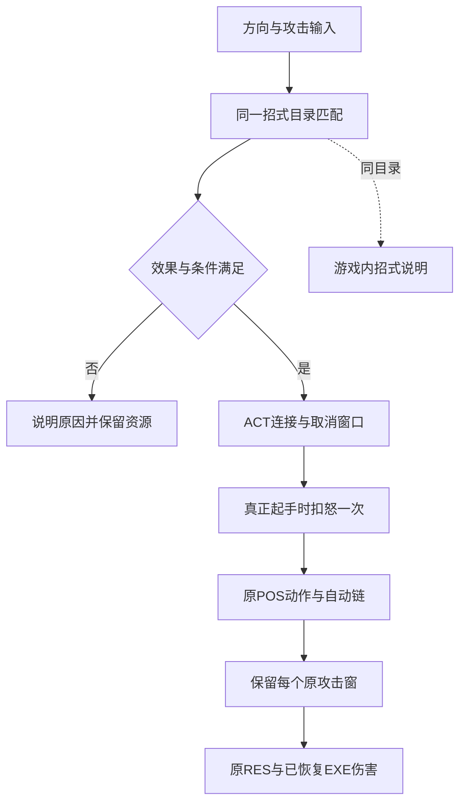

# 五类兵器手搓招式补齐与原动作验收

日期：2026-10-29。交付范围：本地 Web v0.5；普通逆向报告，`flavor = null`。

## 结果与范围

本轮按原版招式资料、本地 POS / ACT / RES 检测并补齐当前五类可装备兵器的手搓入口。目录登记 83 条指令，其中 79 条可通过公开输入进入原动作，4 条效果攻击因原实现尚缺而拒绝起手；相对旧显式输入新增 36 条可用入口。大刀左右 A 旋风、剑下上上 A 五段突刺、长枪左右 A 与左右上 A，以及匕首、剑、枪、刀的空中下 A 均已接通。输入说明与实际选择器使用同一目录，避免界面列招与引擎支持脱节。

“可起手”证明输入选择、原动画和已支持的攻击阶段接通，不代表全部原版特效已完成。原 EXE 的完整输入容错、耗怒触发、远端攻击体与持续状态仍未全部恢复。当前没有完成原版十二类兵器，也没有新的线上上传或部署。

授权沿用 [scope.md](../scope.md) 的 `auth.status=granted`：本地用户样本的离线静态分析、资源解析、Web 移植与验证。原 Meteor.exe 只读、未执行或修改。其 SHA-256 为 `289afb0aa44a47921d167fc24d6d404c60d6d00c299ac27d45fc61e16231b498`。原 PE 身份和 Windows 输入 / 渲染依赖沿用 [E-imports.json](../evidence/E-imports.json) 与[前期数值报告](2026-10-23_逆向-MeteorEXE战斗数值-report.md)，本轮未重新运行原 EXE 或声称完成其动态输入追踪。

## 原因与修复

旧选择器只取最后两个方向，且只处理地面方向输入，因此三方向指令与空中下击没有正确入口。旧匕首普通链还把 ↑A 家族拼进普通 A；长枪、大刀空中 A 则直接选成下击。现改为按兵器、地面 / 空中、有效前招匹配最长方向后缀；重复方向由独立按下 / 松开记录，不把同时按住的方向臆造成有序指令。

控制器以整条攻击链的占用状态决定是否允许移动待机覆盖，保留没有 Attack 块的起手、自动 Link、空中保持段与后续落地。提前输入只在原 NextPose / ACT 允许的窗口执行；排队不扣怒，真正起手时重新检查条件并扣除一次。跨帧越过窗口或自动衔接时保留各原姿态的攻击片段，按 serial / 原窗口 / 目标去重，避免多段突刺漏击或保持帧重复扣血。

原 POS 的身体攻击骨骼还存在带空格的名称，而 BNC 实际骨骼使用下划线。生产角色和机关接触路径统一通过 `getNativeAttackAttachment` 做该已知命名转换，保留原实际骨骼取样；否则枪圈腿击、剑踢击和匕首部分身体技即使选中正确动作也会没有接触点。该修复不生成额外攻击范围，不把缺失的 effect 攻击骨骼猜成身体部位。

方向时限使用 Web 参数：整段 1.2 秒、相邻方向及末方向到攻击不超过 0.45 秒。怒气门槛来自交叉核对的社区指令表；这些不是已恢复的 EXE 输入识别器参数。动作帧、播放速度、攻击骨骼、攻击窗与合法连接继续读取本地原 POS / ACT，伤害沿用已恢复的 RES / EXE 运算链。

| 用户提出的输入 | 原姿态与行为 | 实际验证 |
| --- | --- | --- |
| 大刀 ←→A | 免费旋风 374→375，旋身后自动收斩 | 公开方向输入选中，整链回到原刀站姿，两阶段实际骨骼 / 武器接触可扣目标 HP |
| 剑 ↓↑↑A | 忌冬雨 277，原文件有 5 个攻击窗 | 真模型引擎在 60 FPS 和 10 FPS 均产生 5 次伤害，累计值一致 |
| 长枪 ←→A | 蛟龙海覆波 290 | 公开输入进入独立原姿态；与 →←A 的 286 区分 |
| 长枪 ←→↑A | 应龙空翔蹴 292 | 三方向优先匹配，进入原撑杆飞脚姿态 |
| 跳、↓A | 匕252、剑265→342、枪282、刀298 | 通过同一个公开 jump 动作离地后输入，剑无攻击窗起手不被覆盖，原下插阶段保持并自然落地 |

同一生产引擎夹具还让固定近身目标接受实际下击：匕252扣66、剑342扣68、枪282扣72、刀298扣89；角色使用公开jump离地12帧后手搓↓A，接触点来自真实原模型 / 骨架，未伪造挂点。剑265起手不造成提前伤害，扣血发生在原342下插窗。上述数值属于隔离夹具的已知武器 / 防御配置，不宣称对所有目标都是同一伤害。

刀 ←→A 不再被 60 怒的 →←A 狂风挤占。长枪、大刀空中普通 A 恢复为 338 空踢；空中 ↓A 才是各自下击。匕首普通链恢复 248→249，250→251 为另一条 ↑A 链。原飞镖没有空中 ↓A 近战下刺，不增加该指令。完整映射与两处外部资料歧义见 [E-combo-catalog](../evidence/E-combo-catalog-2026-10-29.md)。

### 破防分支

原 POS 的 `AttackType` 不再仅作为展示字段。静态闭环为：Bison语法 `attacktype KEY_number` 规则0x30 → `0057AAF0` 将数值写入攻击记录+0x30 → `004F3380` 以type左移10位封包 → `004AF630` 仅在 `((type >> 10) & 63) == 0` 且guardflag为1时进入防御分支；非0类型进入原HP伤害分支。生产引擎据此计算有效护架：`target.guard && ((attack.attacktype ?? 0) & 63) === 0`。

角色即使正在按住防御，原破防攻击也能按原伤害链扣血；普通攻击仍沿用护架分支。命中事件与GD / BL声音按有效护架选择，避免伤害发生却播放防御反馈。原护架角度、强制击退和取消护架输入状态未在本轮恢复，不用这条数值分支宣称全部防御行为完成。证据与独立测试见 [E-guard-break](../evidence/E-guard-break-2026-10-29.md)。

## 投射与未完成效果

飞镖 ↑A / ↓A 对应 209 / 210，已使用原模型、攻击窗、各自原音效和姿态攻击系数发射；攻击75、防御15夹具中各扣23，攻击窗外不发射、同窗不重复，墙面可优先截获。它们 RES 参数引用的 item10 / item11 持续附加状态尚未恢复，不能把飞行与伤害通过写成完整雷神锥 / 赤练牙效果完成。

| 暂不可用指令 | 原动作 | 拒绝原因 |
| --- | --- | --- |
| 飞镖地面 ↓↑A | 八方绝 201 | 原父节点、通道和球形效果攻击体尚未完整接入 |
| 飞镖空中 ↓↑A | 八方绝 551 | 空中对应效果攻击体尚未完整接入 |
| 飞镖地面 ↓↑↑A | 落樱雪 203→204→205 | 多个原攻击波形体、变换及通道时序尚未接入 |
| 匕首地面 ↓↑↑A | 阎罗 259 | 原攻击引用效果骨骼，整招缺可工作的原效果命中体，禁止扣100怒后空挥 |

其他招式中，剑气、长枪冲击波、匕首破空弹等远端效果仍在招式表提示。匕首专诸鱼肠343的首窗可通过武器近身命中，后半窗依赖效果攻击体，仍待恢复。不能用一个普通飞镖、程序扇形弹或近战范围替代这些原效果。只读 EF 类型 / 绑定链的进一步证据见 [E-command-projectiles](../evidence/E-command-projectiles-2026-10-29.md)。

## 验证与复现

在项目根目录执行：

```sh
npm test
npm run check
node --test tests/native-input.test.mjs tests/native-combo-controller.test.mjs tests/native-move-catalog.test.mjs tests/native-move-guide.test.mjs tests/native-command-engine.test.mjs tests/native-command-projectiles.test.mjs tests/native-guard-break.test.mjs
```

最终全套 **182/182通过**，0失败 / 跳过 / 取消，46.175088583秒；18个运行模块语法检查通过。完整 TAP 与哈希保存在[本轮验证快照](../evidence/E-manual-combos-validation-2026-10-29.json)和[原始全套输出](../evidence/native-runtime-combos-2026-10-29.tap)。公开输入引擎测试逐项验证目录：79条进入对应原动作、4条明确拒绝且不降级普通攻击。分组覆盖输入6项、控制器12项、目录6项、说明渲染4项、生产引擎含身体骨骼接触7项、方向投射6项及破防7项。

全套进程启动后，另补209 / 210招式行“投射命中可用，附加持续效果待补”的说明，并在既有说明测试中增加断言。该最终文案另单跑说明模块4/4通过（105.436125ms），记录在验证快照 `postFullSuiteGuideCheck`；不把这些后来增加的文案断言宣称为此前全套已经执行，也不因此重复累计测试数。

生产引擎夹具使用原 SKC / BNC / AMB、原武器 GMC、原 POS / ACT / RES 与恢复的伤害公式；贴图、音频、GPU 渲染与 NPC 反击被隔离，测试地面是规则平面。它证明真实资源驱动的输入、动作、骨骼接触和伤害链，不证明原地图寻路、完整活 AI 战斗或浏览器人工命中伤害。

浏览器另通过实际按键确认大刀旋风、剑忌冬雨、长枪蛟龙海覆波与应龙空翔蹴的动作 / 招式反馈，并检查YS-胡桃外观继续沿用原动作。该浏览器位置附近没有用于测伤的近敌；实际扣血结论来自上述 CPU 真实资产测试。截图：[大刀旋风](../../../artifacts/blade-spin-live-2026-10-29.png)、[剑连续突刺](../../../artifacts/sword-flurry-live-2026-10-29.png)、[长枪画圈](../../../artifacts/spear-circle-live-2026-10-29.png)、[桌面招式表](../../../artifacts/combo-guide-desktop-2026-10-29.png)、[旋风说明](../../../artifacts/combo-guide-spin-2026-10-29.png)。

375×812 手机视口另验收招式行单列、五武器按钮换行且无横向溢出；通过 Tab＋Enter 切换长枪说明后焦点保持在对应按钮。证据：[手机招式表](../../../artifacts/combo-guide-mobile-2026-10-29.png)。这属于浏览器窄视口与键盘检查，不代替真实手机触屏战斗验收。

## Evidence → Finding → Path

| E-id | source_ref | repro_command | content_hash |
| --- | --- | --- | --- |
| E-C01 | [目录审计与源文件哈希](../evidence/combo-catalog-audit-2026-10-29.json) | `node --test tests/native-move-catalog.test.mjs` | 见该 JSON 的各原文件 SHA-256；验证快照另记录审计 JSON 哈希 |
| E-C02 | [生产输入、控制器和引擎完整 TAP](../evidence/native-runtime-combos-2026-10-29.tap) | `npm test` | 见本轮验证快照 `fullSuite.contentHash` |
| E-C03 | [方向投射与原 EF 静态证据](../evidence/E-command-projectiles-2026-10-29.json) | `node --test tests/native-command-projectiles.test.mjs` | 见该 JSON 的逐文件哈希与本轮验证快照 |
| E-C04 | 上述浏览器按键截图 | `npm run dev` 后按实际手搓顺序输入 | 见本轮验证快照 `browser.artifacts` |
| E-C05 | [原AttackType读取、封包和受击分支](../evidence/E-guard-break-2026-10-29.md) | `node --test tests/native-guard-break.test.mjs` | 见本轮验证快照与证据文件中的原导出哈希 |

| F-id | severity | evidence_ids | confidence | location | status |
| --- | --- | --- | --- | --- | --- |
| F-C01 | n/a_re | E-C01, E-C02 | high | `dist/native-input.js`、`dist/engine.js` | 三方向、地面 / 空中及前招条件已接入 |
| F-C02 | n/a_re | E-C01, E-C02 | high | `dist/native-combat.js`、`getNativeAttackAttachment`、原 POS / ACT | 无攻击窗起手、自动链、取消窗口、多窗接触与身体骨骼命名已接通 |
| F-C03 | n/a_re | E-C01, E-C03 | high | 原 EF / RES、`dist/native-projectiles.js` | 209/210发射与伤害已验证；4条纯效果攻击禁用，其余远端 / 附加状态明确未完成 |
| F-C04 | n/a_re | E-C02, E-C04 | high | `dist/native-move-guide.js`、`dist/app.js` | 同目录招式说明、怒气与前招条件、实际出招反馈已接入 |
| F-C05 | n/a_re | E-C02, E-C05 | high | 原0057AAF0 / 004F3380 / 004AF630、`_applyNativeHit` | 原非0攻击类型绕过护架伤害分支已接通；原护架角度和强制击退未恢复 |

P-C01，`path_type=callflow`：方向按下 / 松开 → 按兵器、姿态与前招选择最长指令（F-C01）→ pending / 怒气门槛检查 → ACT 合法排队与起手回调 → 原 POS 帧、骨骼与自动链（F-C02）→ 近身接触或已支持的原武器投射 → RES / EXE 伤害 → 招式反馈（F-C03 / F-C04）。

P-C02，`path_type=callflow`：原POS数值 → 语法归约0x30 / 0057AAF0读取 → 004F3380类型封包 → 004AF630按攻击类型与guardflag选分支（E-C05 / F-C05）→ Web有效护架 → 同一伤害公式与命中声音；不改写按键状态或补造护架角度条件。



该图为可编辑 Mermaid 源码，未生成图片或声称通过图像渲染验收。阶段记录见 [timeline.md](../timeline.md)，本轮通用经验保存在[项目内 field journal](../field-journal/2026-10-29_manual-command-port.md)。

## 继续保留的差异

当前只支持五类可装备兵器；火铳、飞轮、双刺、重锤、乾坤刀、指虎和忍刀尚未接入战斗。社区招式映射不替代 EXE 输入识别器的证据；原容错、全部连招捷径、耗怒事件与物理细节仍待追踪。复杂 EF、远端攻击、持续状态、完整剧情、活 AI 通关和联网仍有未完成项。本报告是本地增量验收，不证明全部原版玩法或线上版本已完成。
