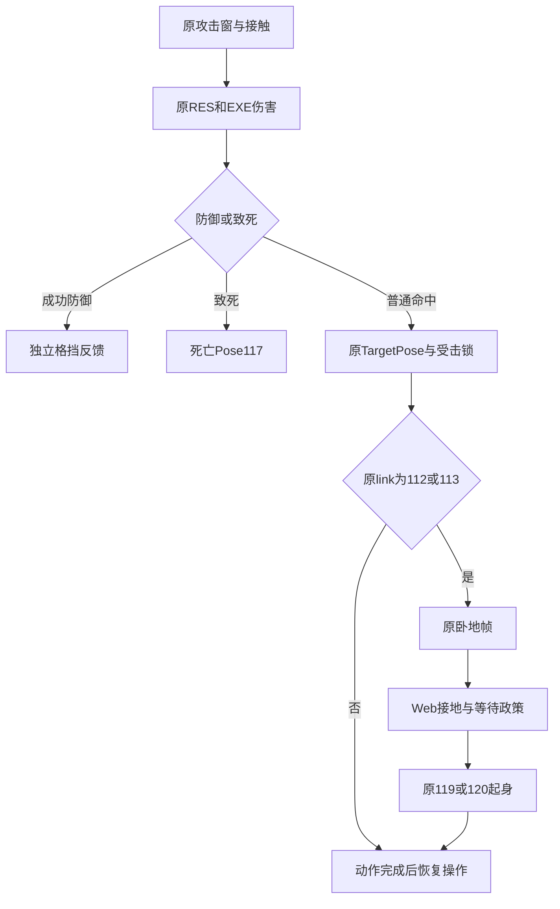

# 原版受击、击倒与起身反馈接通

日期：2026-10-30。普通逆向报告，`flavor = null`。本轮仅更新本地项目，未上传或部署。

## 结果与范围

用户试玩指出敌人无法击倒、打击感弱。检查发现原伤害计算已工作，但宿主只扣血和飘字，遗漏原 `TargetPose` 受击切换；AI和待机还会覆盖受击姿态。现已接通受击锁、真正的原倒地与起身动作，并修复快速连按J跳过普通连招前两击的实际问题。命中声音继续来自原EF引用的WAV，短促接触火花、局部停顿与微小镜头反馈是明确的Web表现适配。

这使“敌人扣血仍照常走打”变成“按攻击原数据受击，具备倒地链的招式能将敌人打倒后起身”；没有把每次轻击改成击倒，也没有用死亡动画替代倒地。CPU真实资产测试已验证公开三次普通攻击使目标按原链倒地起身；浏览器在四方阵、原孟星魂 / 剑和正常活AI条件下，以普通按键实测第三击倒地、保持卧地及随后站立追击。完整活AI通关、原版精确击退物理、输入翻滚、卧地策略与EF渲染仍未全部还原。

授权沿用 [scope.md](../scope.md) 的 `granted / offline` 本地静态分析、资源解析、Web移植和验证。原 `Meteor.exe` 只读，未运行或修改；SHA-256仍为 `289afb0aa44a47921d167fc24d6d404c60d6d00c299ac27d45fc61e16231b498`。基础PE身份与导入依赖沿用 [E-imports](../evidence/E-imports.json)，本次使用既有Ghidra数据库的 `-readOnly -noanalysis` 导出和原资源校对，不声称原程序动态追踪。

## 原数据与状态链

[原来源证据](../evidence/E-hit-reaction-source-2026-10-30.md)通过原事件分发、虚表指针、反汇编和POS关联，确认了以下调用关系。

| Evidence | Finding | Web接入路径 |
| --- | --- | --- |
| 非致死未防御命中事件0xb，经004ed9d0至004f3f50；后者调用状态对象+48=004d03f0 | 原版将命中包TargetPose交给反应状态，004d03f0播放姿态并转状态4 | `_applyNativeHit`调用`combat.react`，立即显示首原帧并清除受击者攻击队列 |
| 原状态4更新004cdd60检查关联112/113并转卧地状态0xb | 原倒地与普通受击不同，单帧卧地必须留在动作链中 | 受击与卧地 / 起身占用busy，玩家移动、跳跃与AI追击不覆盖姿态 |
| 原004d01f0明确113→120，其他非117→119；原POS95/96→113、97/98/99→112 | 本轮可采用112→119、113→120原起身动作 | 原倒地link后等待宿主地面条件，再播放对应原起身，不直接跳站姿 |
| 原防御事件0xe独立分发004f4010；HP零进入死亡链 | 成功防御与致死均不能无条件套普通受击倒地 | 防御保留原GD声音；致死Pose117优先，击倒不增加击杀数 |

原剑262 / 263 / 264的目标姿态是93 / 91 / 98；其中第三式98→112，起身119。原大刀295 / 296 / 297的目标姿态是90 / 91 / 96；其中第三式96→113，起身120。匕首普通248 / 249为90 / 91，不能凭“打击感”给它们凭空增加倒地效果。



该图为可编辑Mermaid源码，未生成图像或声称完成图片渲染验收。原调用地址与23份关键导出的逐文件哈希见 [E-hit-reaction-source JSON](../evidence/E-hit-reaction-source-2026-10-30.json)。

## 连按空挥与表现适配

快速普通J输入原先可能在当前招首个原攻击窗之前就执行下一式排队，使前两下空挥。同一真实资产夹具每100毫秒按一次公开attack，旧策略只留下264的一次接触；当前 `preserveQueuedStrikes` 保留262 / 263 / 264三击，伤害分别24 / 46 / 57，累计127。该策略仍使用原攻击窗和合法ACT连接，不改原伤害公式；它是Web排队政策，不代表已恢复原 `NextPose.Time`。对照文件见 [E-hit-queue-replay](../evidence/E-hit-queue-replay-2026-10-30.json)。

原声音链能够解析：如W00BL093→W00HIT01、W00BL098→W00HIT02、W00GD093→W00GRD01。没有发现普遍缺失原音频文件的证据；首次命中才加载解码仍可能产生延迟，本轮未测量其真实浏览器延迟或完成原混音系统。

新增接触点短火花、防御与命中差异、仅攻受双方22 / 32 / 50毫秒停顿及受控微震。它们不暂停任务时钟和无关角色，也不改变攻击帧、伤害或原WAV选择。模块限制同时效果数量并在结束时释放GPU资源；镜头偏移仅用于当前渲染，避免累积漂移。细节和来源边界见 [E-combat-impact-integration](../evidence/E-combat-impact-integration-2026-10-30.md)与 [E-impact-feedback](../evidence/E-impact-feedback-2026-10-30.json)。

以下部分明确保持未恢复：原 `TargetMove / TargetValue` 的精确物理与时长、原方向矩阵到Web坐标的完整映射、状态7 / 9的完整身份、原卧地输入翻滚与自动起身条件、原 `NextPose.Time` 计时 / 混合语义。脚点物理、落地后0.65秒等待、连招首窗保护和新表现参数均属Web适配，不能作为原常数引用。

## 验证与复现

在项目根目录执行：

```sh
node work/meteor-original/evidence/hit-reaction-source-audit-2026-10-30.mjs
node --test tests/native-hit-reaction.test.mjs tests/native-environment.test.mjs tests/native-impact-feedback.test.mjs
npm test
npm run check
```

最终受击10项、环境9项与反馈4项均已通过，并进入最终全套。受击测试使用原POS / RES / SKC / BNC / AMB和原武器模型，隔离贴图、GPU、音频与NPC反击，规则地面替代复杂场景；普通公开attack可造成三击，并实际检查头骨卧地高度和起身变化。覆盖还包括受击不能取消、AI不能覆盖动作、空中等待接地、轻击不能把卧地者拉站、成功防御不误倒地、死亡优先、重开恢复、仅接触双方停顿、空挥无反馈及旧停顿不拖延死亡。

最终全套 **207/207通过**，0失败 / 跳过 / 取消，30.570101208秒；[完整TAP](../evidence/native-runtime-hit-reaction-final-2026-10-30.tap)保留原输出。19个运行模块语法检查通过，原资产3858条覆盖核验零问题，diff空白检查通过；哈希和当前状态见[验证快照](../evidence/E-validation-current.json)。首轮全套曾为203/205：HUD夹具缺少新reaction字段，以及旧队列测试假设与明确的新普通连招政策不一致；修复和调整后再验证，不把这次初始失败包装为通过。

浏览器先以正常Q锁定、W接近与J攻击，产生2次实际命中，目标HP由1000降到952，见[初次实际命中](../../../artifacts/hit-reaction-live-2026-10-30.png)。后续在四方阵、原孟星魂 / 剑和正常活AI条件下每100毫秒连续J，显示第三击“击倒·57”且目标HP825；用普通暂停菜单保存画面，恢复后普通K守架约650毫秒仍显示“倒地”，再过约750毫秒目标恢复站立追击。图像分别为[第三击](../../../artifacts/hit-reaction-desktop-2026-10-30.png)、[卧地](../../../artifacts/hit-knockdown-desktop-2026-10-30.png)、[起身](../../../artifacts/hit-getup-desktop-2026-10-30.png)，详细操作与哈希见[浏览器证据](../evidence/E-hit-reaction-browser-2026-10-30.json)。本次未通过调试接口改变HP、位置或单独冻结NPC；9次总命中包含其他敌人，不当作同一目标9击。session错误 / 警告日志为空只覆盖本次操作，不替代完整地图战役验收。本轮没有上传本地资源或更新旧线上站点，原外观和其他未提交功能继续保留。

## Evidence → Finding → Path与阶段记录

完整E-H01至E-H06、F-H01至F-H03及哈希表见 [E-combat-impact-integration](../evidence/E-combat-impact-integration-2026-10-30.md)。其中F-H01，`severity=n/a_re / confidence=high`，基于原调用与真实资产测试确认受击、倒地和起身链接通；F-H02基于新旧重放确认普通连击漏窗修复；F-H03基于模块测试与浏览器证据确认受控表现及公开输入的实际击倒 / 起身。

P-H01，`path_type=callflow`：公开输入 → 原攻击窗 / 骨骼接触 → 原伤害 → 防御 / 死亡分支 → 原TargetPose反应 → 原倒地link → Web接地等待 → 已确认原起身动作 → 恢复控制。P-H02，`path_type=callflow`：快速普通输入 → 合法ACT排队 → Web保留当前首窗 → 三个原窗各命中一次；残留边界是原Time尚未恢复。

本轮从用户试玩反馈定位缺失状态，静态闭环原反应与起身，再以真实资产和浏览器分别核验；阶段记录见 [timeline.md](../timeline.md)。可复用经验保存在[项目内field journal](../field-journal/2026-10-30_hit-reaction-feedback.md)，没有写入外部技能目录或外传本地样本。
