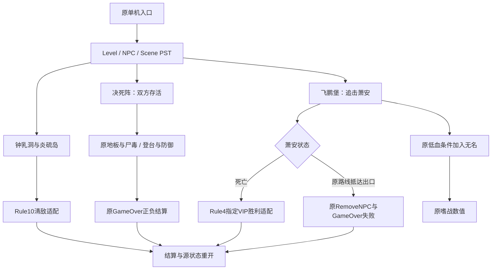

# 决死阵与飞鹏堡原任务接入报告

2026-11-06，本地 v0.6.0。普通逆向与移植报告，`flavor = null`。未运行或修改原 EXE，未上传或部署。

## 结果与授权范围

单机入口现有钟乳洞、炎硫岛、决死阵、飞鹏堡四项任务。新增两关复用本地原地图、模型、动画、兵器、NPC配置和PST。决死阵保留双方存活目标、尸毒、100块随机分圈塌落地板和原正负结算；飞鹏堡保留萧安的分阶段逃跑、条件援军及原逃脱失败。双刺、重锤使用各自原模型和动作，普通输入分组已纠正。

决死阵已用CPU正常移动、跳跃、防御，从原出生点完成约199秒的全程存活；冷燕AI和场景机制始终开启，未直接改血量、位置、死亡或胜负。飞鹏堡的击杀胜利链、实际逃跑失败和援军条件分别验收，其中胜利夹具冻结NPC反击并将玩家放到接触位置，不代表完整活AI战斗通关。最终228/228测试通过。浏览器试玩因工具连接/授权限制未完成。

授权沿用 [scope.md](../scope.md) 的本地离线静态分析、资源解析、Web移植和验证。原 `Meteor.exe` 为PE32/x86、大小1,945,600字节、基址0x400000、入口0x50982e，SHA-256为 `289afb0aa44a47921d167fc24d6d404c60d6d00c299ac27d45fc61e16231b498`。已有 [E-imports](../evidence/E-imports.json) 保留导入表，涉及KERNEL32、WINMM、图形与网络等依赖；本轮不执行这些原生接口，只静态导出既有Ghidra项目并运行自行实现的Web宿主。

## 原条件与实现边界

| 机制 | 原数据或证据 | Web接入与边界 |
|---|---|---|
| 决死阵 | `sn09_.pst`，Rule1，PlayerHP3000，武器5/1；冷燕HP3000、屠城HP9990 | 不以杀光NPC判胜；原180秒后分支排入对白和17秒等待，随后原GameOver；任一主角死亡改为失败 |
| 塌落地板 | `sn09.pst` 与 Def.h；1000ms步长；1–36、37–64、65–84、85–100四圈 | 原FMC姿态和真实碰撞跟随运动；Web Fisher-Yates保证圈内不重复，未恢复原PRNG及精确调度 |
| 尸毒 | RES type2/id14，stat2=-10、period5，参数2=99999、8=10 | 每5秒扣10HP，生命周期9999.9秒；不会叠加，刷新保留周期进度，死亡仍走正常引擎/PST链 |
| 嗜战 | RES type2/id4，stat3=+25，参数2=600、8=10 | 原有效攻击计算读取activeItems；60秒过期，同物品刷新不叠加；完整原EF未完成 |
| 道具计时 | EXE004d59d0、004d5020、004d4e30、004d4d30；005a84ac为float10 | 保留源数值、刷新与HP夹取；Web保留帧间小数，未复现原服务端逐tick截断/事件排序 |
| 原起跳 | AMB/POS151的d_base轨迹；004ce850读取d_base并参与场景运动 | 起跳约5.9m，碰撞体和镜头跟随同一位置，皮肤不再额外叠加轨迹；中断、下落和碰撞仍部分为Web适配 |
| NPC登台 | 原WP7→0等高差链接、Jump配置 | Web路径适配器在邻近高目标且Jump>0时请求同一原起跳；不是原AI决策恢复 |
| 飞鹏堡 | `sn15_.pst`，Rule4，PlayerHP2500、双刺13/飞镖10；七敌初始总HP27500 | 萧安HP7500；受伤后原79→107→115→53→116目标序列保留，抵达出口原RemoveNPC/GameOver失败 |
| 飞鹏堡胜利 | 该PST没有正GameOver分支 | 击败指定VIP后完成为明确的Rule4宿主适配，未恢复EXE完整GameRule |
| 无名援军 | 原UnknownHelp要求玩家低于1/3HP且护法看到玩家 | 原AddNPC08只触发一次，Model10/Weapon23/HP9999/Team1；原use4生效，同伴用独立HUD标记 |

`ChangeBehavior("attacktarget", slot)` 现捕获调用时的目标种类和ID。源飞鹏堡在最后一段逃跑期间复用slot0进行Distance查询；若宿主持续读取全局slot0，VIP目标会变成自己并停在WP53。保留目标快照后，他能自然走向WP116并触发原失败。这一兼容语义由源脚本的实际调用顺序和真实逃跑回归支持，不冒充已找到EXE该API实现。

原飞鹏堡援军后段有两条 `Perform(c, "对白")` 遗漏say。宿主只对白名单中的这两条做显式兼容映射，写入compatibilityUsed，原PST不改写。其它未知API仍报告诊断。

双刺普通A为230→231→232，上刺233→234单列；重锤普通A为315，↑A为316，↓A为317，空中A为338，空中↓A为318。完整目录现登记118条指令，111条有动作/近身或已接投射入口、7条禁用；部分已能近身命中的技能仍缺远端EF或持续效果，不能当作完整技能还原。指令证据沿用本地POS/ACT与[招式表](https://www.lxres.com/LiuXingBiJi/1559.html)、[动作表](https://www.lxres.com/LiuXingBiJi/1758.html)的既有核对，原EXE输入识别器仍未完整恢复。

## 验证结果

[完整TAP](../evidence/native-runtime-new-missions-2026-11-06.tap)：228/228通过，0失败、跳过或取消，29.351秒。19个运行模块通过语法检查；[资源覆盖](../evidence/E-asset-coverage-current.json)的3858条记录无缺失、大小或哈希异常。第一次全套的225/228失败来自重复创建名牌时触碰CPU夹具中的DOM；已改为创建演员时传入阵营、只创建一次名牌，再完成最终全套。保留[失败迭代](../evidence/native-new-missions-failed-iteration-2026-11-06.tap)，不将其算作通过。

新增8项任务集成检查见[独立TAP](../evidence/native-mission-expansion-2026-11-06.tap)：

1. 两关真实原地图、站立碰撞、武器挂点及原HP/Team/Spawn配置。
2. 决死阵正常输入登台、冷燕跟上、100地板全部塌落、双方HP均2660、199.03秒原成功；重开清空道具并恢复全部地板。
3. 留在原出生点后实际塌落、重力、死亡与原延迟失败；冻结NPC反击以隔离场景失败链。
4. 原PST已经安排成功后，受保护者死亡仍改判失败；此项直接提供HP0作为VM边界输入，不是击杀验收。
5. 原双刺动作、原骨骼/武器接触及RES计算耗尽萧安7500HP；其它六敌仍活着，唯一VIP胜利和重开有效；冻结反击，玩家在连段间重置接触位置。
6. 实际伤害将萧安降至1783HP后，他从原位置以真实导航和碰撞经过全部逃跑阶段，242.03秒执行原失败；其HP、位置、dead和脚本触发器未直接赋值。该项冻结其它NPC。
7. 左护法真实攻击使玩家低于1/3HP，原脚本加入一次无名、原嗜战应用、阵营和小地图分类正确；其余NPC反击隔离。
8. 暂停冻结任务、地板及道具时钟，退出清除脚本效果。

另有5项脚本道具检查，覆盖原参数、攻击增量、60秒过期、刷新不叠加、5秒周期、跨帧率一致、HP夹取与清理；原轨迹跳跃和近墙镜头也通过回归。空中招式接触验收改为正常下降且进入站立目标可达高度时输入；目录遍历夹具另设高空条件，仅证明选择与衔接，不据此宣称所有空中连段能在一次自然跳跃中完成。

内置预览返回“Timed out waiting for the Browser webview to attach”；Chrome工具返回“Computer Use was not approved to use Google Chrome”，没有进一步理由。未尝试绕过访问限制，无本轮浏览器截图、手工通关或线上验证结论。本地HTTP首页已返回200，临时服务收尾时停止。

## Evidence → Finding → Path

汇总证据 [E-new-missions](../evidence/E-new-missions-2026-11-06.json) 包含14份原关卡/NPC/场景脚本的source/UTF8哈希、关键EXE导出、模块和TAP的逐文件SHA-256。

| E-id | source_ref | repro_command | content_hash |
|---|---|---|---|
| E-M01 | [原剧本基线审计](../evidence/mission-catalog-audit-2026-11-04.json) | `node work/meteor-original/evidence/mission-catalog-audit-2026-11-04.mjs` | 既有审计JSON与新汇总originalScripts |
| E-M02 | [道具原函数](../evidence/mission-items-native-2026-11-05/functions.tsv) | 下方Ghidra只读导出 | 新汇总nativeArtifactSha256 |
| E-M03 | [d_base运动原汇编](../evidence/hit-reaction-getup-2026-10-30/004ce850_FUN_004ce850.asm)及[定位函数](../evidence/jump-motion-native-2026-11-05/00557ef0_FUN_00557ef0.c) | `node --test tests/native-jump-camera.test.mjs` | 新汇总nativeArtifactSha256/moduleSha256 |
| E-M04 | [两关运行验证](../evidence/native-mission-expansion-2026-11-06.tap) | `node --test tests/native-mission-expansion.test.mjs` | 新汇总artifacts |
| E-M05 | [最终全套](../evidence/native-runtime-new-missions-2026-11-06.tap) | `npm test` | sha256:0d12ad5d82dad9acc8c879c3bb6904c7870575d6120c8699e931cd45c2efd292 |

上表E-M05与[当前验证JSON](../evidence/E-validation-current.json)记录同一份最终TAP的实际SHA-256。

| F-id | severity | evidence_ids | confidence | location | status |
|---|---|---|---|---|---|
| F-M01 | n/a_re | E-M01/E-M04 | high | native-mission-host.js、native-missions.js | 决死阵原正负结果及物理可达性已验证 |
| F-M02 | n/a_re | E-M01/E-M04 | high | ChangeBehavior/updateControls | 飞鹏堡目标覆盖修复、实际逃跑失败和条件援军已验证；胜利适配单列 |
| F-M03 | n/a_re | E-M02/E-M04/E-M05 | high | native-items.js、engine.js | 两种源数值效果接通；服务端精确调度仍开放 |
| F-M04 | n/a_re | E-M03/E-M04/E-M05 | high | native-character.js、_beginJump/_move | 原起跳轨迹与单一碰撞/皮肤位置验证；完整原物理未完成 |

P-M01，`path_type=callflow`：单机卡片 → 原Level/NPC/Scene PST → 原配置与WP → Web碰撞/导航、原动作和道具 → 原条件分支 → 原GameOver或明确的Rule适配 → HUD/结算/重开。



可编辑源文件见[任务扩展流程](../diagrams/mission-expansion-2026-11-06.mmd)。图中的导航、Rule10/4适配不推断为原EXE实现；渲染状态见附录。

## 复现与后续边界

在项目根目录执行：

```sh
node --test tests/native-mission-expansion.test.mjs tests/native-script-items.test.mjs tests/native-jump-camera.test.mjs
npm test
npm run check
python3 scripts/analysis/verify-recovered-assets.py
npm run dev
```

在本机浏览器打开 `http://127.0.0.1:4173/`，进入「原版单机」选择对应任务。决死阵需在剧情放开操作后跃上中央石台、保持双方存活；飞鹏堡需要追击萧安。CPU验收采用可重复的输入驱动，不替代人工体验。

静态道具导出沿用本地Ghidra12.1.4项目，Java21；原样本始终只读：

```sh
JAVA_HOME=/opt/homebrew/opt/openjdk@21/libexec/openjdk.jdk/Contents/Home \
/opt/homebrew/Cellar/ghidra/12.1.4/libexec/support/analyzeHeadless \
  work/meteor-original/ghidra-project MeteorOriginal \
  -process Meteor.exe -readOnly -noanalysis -scriptPath scripts/analysis \
  -postScript ReadOnlyHitReactionTrace.java \
  work/meteor-original/evidence/mission-items-native-2026-11-05 \
  004d4e30 004d5020 004d59d0 004d5220 005a9490
```

其余五份原单机剧情、火枪/飞轮等剩余兵器、NPC副兵器操作、完整EF/原PRNG/物理/AI/GameRule/输入识别器及多人同步仍未完成。原打击感还原目标继续开放。本轮没有创建PR、提交共享工作树、上传资源或改变线上访问范围。

阶段与既有分析索引恢复记录见[timeline](../timeline.md)和[workitems](../workitems.md)。经验记录在[项目内journal](../field-journal/2026-11-06_mission-expansion.md)，未写外部技能库。案件初始化脚本覆盖的未提交索引曾按留存证据重建，报告正文与原证据文件均保留；不将重建索引冒充原逐时记录。

图表渲染附录：已调用 diagram-generator 的 render_diagram.py，当前缺少 mmdc，未生成SVG；保留可编辑Mermaid源码，未自动安装渲染器。输出见[渲染记录](../evidence/mission-diagram-render-2026-11-06.log)。
