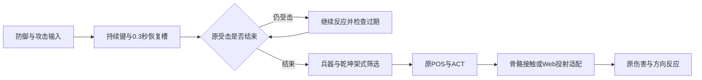

# 十二兵器、群战输入与炽雪城接入报告

2026-11-06，本地 v0.7.0；普通逆向与 Web 移植，`flavor=null`。本阶段承接“继续其他关卡”，并优先处理用户提出的群殴打断和隐藏兵器选择问题。

## 结果与范围

十二类兵器已进入首页、演武选择和招式表，乾坤刀三种架式分别选择原动作。火铳和飞轮已有实际伤害入口，目录包含196条指令、165条可执行入口及31条明确禁用的待补效果。受击中按住防御可以在恢复时接上护架，恢复前的短暂攻击输入可保留，未锁定近战不再被附近敌人强行扭转朝向。炽雪城新增原城门损坏、坍塌和结算链。整套293项 CPU 测试通过；这不证明原版霸体、完整群战节奏、所有怒技或人工实战已还原。

授权沿用 [scope](../scope.md)：用户指定客户端的离线静态逆向、资源解析、Web 移植和本地验证。样本为 PE32/x86 `Meteor.exe`，1,945,600字节，基址0x400000、入口0x50982e；SHA-256：`289afb0aa44a47921d167fc24d6d404c60d6d00c299ac27d45fc61e16231b498`。原 EXE 未执行、修改或上传。原 Windows、图形、声音、网络依赖见 [E-imports](../evidence/E-imports.json)。本阶段没有恢复原可执行程序的全部依赖与引擎。

## 群战操作修正

原 Web 输入在受击期间拒绝防御按下事件，后续要靠再次按键或系统键盘重复事件才可能进入护架。现在持续保存防御键状态，在更新和反应结束帧读取；一次按下能跨越普通受击和连续格挡，松开仍立即有效，原破防类型仍可打断。CPU 检查覆盖一次防御按下后连续六次普通来袭和松开后的真实扣血。

攻击增加单个0.3秒恢复输入槽，记录人物、兵器、空地姿态及方向历史，硬直结束后才尝试执行。输入过期、长时间倒地、换兵器、重开、失焦或暂停会清除，不借此取消硬直。原004cc130键队列使用双精度常量005aa8b8=`0.3`；Web 的单槽恢复策略只是参考该时限，不能据此宣称完整原识别器已恢复。

未锁定时，近战起手保留玩家当前朝向；Q 锁定仍朝向选定目标。此前无条件寻找8单位内最近敌人，会在围攻或攻击城门时突然转向侧后敌人。远程发射的辅助瞄准仍有独立 Web 规则。

普通有效命中仍会打断攻击。静态追踪004d03f0的状态排除、姿态367及多个对象的`+0x374`字段，尚不足以证明完整霸体或爆气解围条件；相同偏移不代表相同对象语义。本阶段没有添加通用霸体，也没有确认原版群战的 AI 出手间隔和 Think 权重。

## 十二兵器与可用范围

| 兵器 | 指令 | 可执行入口 | 待补并禁用 |
|---|---:|---:|---:|
| 长剑 | 21 | 21 | 0 |
| 大刀 | 19 | 19 | 0 |
| 长枪 | 18 | 18 | 0 |
| 匕首 | 17 | 16 | 1 |
| 飞镖 | 8 | 5 | 3 |
| 双刺 | 21 | 20 | 1 |
| 重锤 | 14 | 12 | 2 |
| 火铳 | 5 | 3 | 2 |
| 飞轮 | 6 | 3 | 3 |
| 乾坤刀 | 24 | 23 | 1 |
| 指虎 | 18 | 14 | 4 |
| 忍刀 | 25 | 11 | 14 |

“可执行入口”包括原动作、身体/兵器接触、已接投射和架式转换；其中部分怒技只有原骨骼伤害与视觉，远端效果伤害仍缺失。表中待补数不能解释为所有其他技能已完整还原。

演武 E 循环十二类，剧情 E 仍只切换原随身两件。1–5 保留已有快捷键。招式表筛选不改变装备，UI 共用 `native-weapon-menu.js` 的信息；长标签不换行，筛选按钮允许换行排列。

### 乾坤刀、指虎与忍刀

原004e2860将乾坤刀模式0/1/2的中立姿态分别映射401/402/403；004e29d0先提交模式转换再进入公共姿态路径。Web 控制器在转换动作真正起手时更新架式，排队时不提前切换。持刀←A转持枪、↓↓A转拔刀；持枪→A转持刀、↓↓A转拔刀；拔刀→A转持刀、←A转持枪。普通攻击和方向招按当前架式筛选，原521→522→524自动链亦有实际引擎检查。

指虎接407/408/409及空中405/406；忍刀接461/462和空中478/479。忍刀脚击使用原骨骼接触，不用武器挂点伪造命中。瞬移、隐身、擒拿、自爆、爆弹，指虎换兵器、气功波和持续嗜血，以及乾坤刀鞘投射等仍禁用。

各兵器防御表取自本地状态初始化，补齐火铳12、飞轮13、乾坤刀481、指虎480和忍刀482站姿及方向反应。社区表的火铳/飞轮标注存在交叉差异，本阶段以本地004de970/004df930为准。此前七类的方向与防御过渡见[前阶段报告](2026-11-06_逆向-方向受击与防御过渡-report.md)。

### 火铳、飞轮与效果

火铳接原206/207/208释放窗口、模型及姿态伤害。Web 采用显式射程的即时射线，按最近角色胶囊或原场景三角遮挡结算，同距墙体优先，单次释放去重。此射线、瞄准、射程和弹道不是已恢复的原火铳物理；216/215特殊弹道仍禁用。

飞轮接原218/220/222窗口及原W6模型，投出后隐藏手持模型，飞行体返回接取后恢复，pose219等待回收才允许下一次投掷。Web 参数为出速30、最远24、返速38、半径0.24、最长5秒；每次投掷只结算一次伤害，返回不重复伤害。原多段接触、轨迹和回收语义尚未恢复。换关、结束、暂停和销毁均处理其生命周期。

从本地 Patch 按字节复制并登记27份W09/W10/W11原WAV，补齐乾坤刀、指虎、忍刀出招、格挡和命中声音；来源与目标SHA-256见[音效来源](../../all-weapons-audit/audio-provenance.json)。同步保留已有外观、蝶剑、凤凰枪和原怒技视觉工作。怒技导入包现为54份定义、236个可绘制形状、49张原贴图；视觉播放不制造额外伤害。PARTICLE、DONUT及其他未支持节点按清单保留边界。

指令参考[资源站手册](https://www.lxres.com/LiuXingBiJi/1559.html)与[动作对照](https://www.lxres.com/LiuXingBiJi/1758.html)，并用本地POS/ACT和原状态函数交叉核对。公开指令表不等于原 EXE 输入识别器。

## 炽雪城与后续关卡

sn04接入原七名Team2 NPC、玩家2000HP和物品16/13，沿用Rule3与原PST。Def.h把城门初值覆盖为10000，按7500/5000/2500阶段切换，低于0进入pose8，FMC结束状态3后由`GameCallBack("end",1)`结束。宿主仅对本关接受该受限回调，未改成清敌通关。交互物件与阻挡物件分别查询，原门即使collision=0也可通过实际兵器接触触发OnAttack。

隔离验收将玩家放到敌门旁一次，冻结 NPC 战斗和导航，再通过普通移动/攻击输入击破原门。127.50模拟秒后结算一次胜利，七名 NPC 仍存活且血量未变，击杀数0，并验证重开恢复门和天气。没有直接改门血、脚本全局或结算结果；它不能代表从出生点的活 AI 实战通关。落雪读取五项原SetScene参数，200粒子等参数进入有界 Web 表现；更新不额外抽随机数，构造Three.js对象的UUID抽样另计。

另接入RES道具15/19/20的恢复、攻击强化和气血上限效果并通过三项原记录检查。炼铁狱仍缺道具7的stat10消费者、闪避及部分原脚本异常处理，没有因此开放该关。原`vip`/`enemyvip`分别按同队/敌队筛选；现有飞鹏堡指定萧安的规则仍是适配，尚未完整恢复。其余四项源剧情仍不在可玩注册表中。

## Evidence

各观察时间及194份静态文件的SHA-256索引在E-TW01中，完整测试起始文件快照另存。

| ID | source_ref / artifact_path（相对案件目录） | content_hash（SHA-256） | repro_command / 观察 |
|---|---|---|---|
| E-TW01 | [源证据索引](../evidence/E-twelve-weapons-2026-11-06.json) | `67aa4ac45c6b64ff8ee9cd516ed2eb1ceec29d4ae4be0db6dca83ec28bd88916` | 复读索引所列C/ASM及原清单；原样本只读，Ghidra `-readOnly -noanalysis`；原函数不能在当前平台直接执行 |
| E-TW02 | [全套TAP](../evidence/native-runtime-twelve-weapons-2026-11-06.tap) | `2e2ca65e21d25f8f7884c17e11b50d6bca8b69ac2b75a3ae35e73d78d4bd1d05` | `npm test`：293通过，0失败/跳过/取消，52510.207042ms |
| E-TW03 | [语法日志](../evidence/native-twelve-weapons-syntax-2026-11-06.log) | `d9095ef807011d794ccf76a8684f45f1591dcfe070151c5b53279aa032c5cc6e` | `npm run check`：25运行模块通过 |
| E-TW04 | [资源核验](../evidence/E-asset-coverage-current.json) | `2f6628ed4da58ade0ecb97c976aaab47a871a3a66363436fecfca55ba87af8e2` | `python3 scripts/verify-recovered-assets.py`：3885记录，0新异常；已声明原缺项保留 |

全套开始时记录68份源代码、测试和导入脚本，以及5份资源清单；结束和交付前复核均未改变。README、报告等文档在测试后补写，运行代码未再修改。主资源清单3064项；3885核验不包含独立怒技包的全部文件，怒技包由专项测试验证，不能混称全目录文件总数。

## Findings

### F-TW01：恢复阶段能继续防御和接招

- severity: n/a_re；category: other；status: validated；confidence: high。
- evidence_ids: [E-TW01, E-TW02]。
- location: `dist/engine.js` 输入、受击结束和近战起手；`dist/native-input.js` 恢复时限；`tests/native-hit-reaction.test.mjs`。
- impact: 受击中按下防御不再丢失，短时攻击不依赖重新敲键，近战面向可控。
- repro_steps: `node --test tests/native-hit-reaction.test.mjs tests/native-mission-weapons.test.mjs`；检查持续防御六次普通来袭、松开损血、硬直后接招、长倒地过期和前后敌人面向。
- remediation: 已接入Web输入修正；残余边界是原霸体、爆气与完整AI打断规则仍未确认。

### F-TW02：十二类兵器能装备并进入各自原动作路径

- severity: n/a_re；category: reverse_algo；status: validated；confidence: high。
- evidence_ids: [E-TW01, E-TW02, E-TW04]。
- location: `dist/native-combat.js`、`native-move-catalog.js`、`native-projectiles.js`、`native-weapon-menu.js`及UI。
- impact: 乾坤刀、指虎、忍刀等无需隐藏入口；架式、火铳伤害、飞轮投出回收经过实际引擎检查。
- repro_steps: `node --test tests/native-mission-weapons.test.mjs tests/native-musket.test.mjs tests/native-move-catalog.test.mjs tests/native-move-guide.test.mjs`。
- remediation: 当前范围已接入；残余边界是31条禁用指令、部分可执行招式的远端效果和原投射物理。

### F-TW03：原城门损坏与坍塌能驱动炽雪城结算

- severity: n/a_re；category: reverse_algo；status: validated；confidence: high。
- evidence_ids: [E-TW01, E-TW02]。
- location: `dist/native-missions.js`、`native-mission-host.js`、`native-scene-models.js`；sn04原PST/Def.h。
- impact: 使用原机关目标和动画结束时机通关，不要求清除七名敌人。
- repro_steps: `node --test tests/native-mission-snow-city.test.mjs`，观察原10000门耐久、各损坏阶段、最终pose8/state3与唯一结算。
- remediation: 本地隔离任务链已验证；残余边界为活AI实战和浏览器人工验收。

## Path与复现

P-TW01，`path_type=callflow`。start为普通防御/攻击输入，goal为恢复后进入允许的原姿态：①保存持续键与短输入槽（E-TW01/F-TW01）；②让原受击轨迹和最低保持时长完成（E-TW02/F-TW01）；③校验输入仍新鲜、人物/兵器/姿态一致（E-TW02/F-TW01）；④进入当前兵器/乾坤架式的原POS与ACT连接（E-TW01、E-TW02/F-TW02）；⑤近身骨骼或明确Web投射适配完成接触（E-TW02/F-TW02）。residual_risks为尚未恢复的原输入、群战AI与效果语义。



可编辑源码：[Mermaid](../diagrams/twelve-weapons-input-2026-11-06.mmd)。本地渲染结果以[渲染日志](../evidence/twelve-weapons-diagram-render-2026-11-06.log)为准；没有交付已渲染SVG或截图。

在项目`meteor-web`目录运行：

```sh
npm test
npm run check
python3 scripts/verify-recovered-assets.py
node --test tests/native-hit-reaction.test.mjs tests/native-mission-weapons.test.mjs tests/native-mission-snow-city.test.mjs
```

原0.3常量及队列引用可只读复查，输出保存在`work/combat-interruption-audit/input-queue-0.3s.r2.txt`：

```sh
/opt/homebrew/bin/r2 -2 -q -e scr.color=0 -c 'px 8 @0x005aa8b8; pD 1100 @0x004cc130; q' '/Users/dulinfeng/Downloads/流星86726/lxhdj_/Meteor.exe'
```

## 历史失败与验证边界

十份迭代TAP/探针日志保留在[迭代目录](../../all-weapons-audit/iterations/)，包括旧目录计数、架式测试准备、正面受击期望和Three.js构造随机数断言的失败。早期城门驱动超时也保留，最终面对城门的连续接触通过。原始未播种钟乳洞停滞仍未解释，后续30种种子通过不能倒推该失败已修复。

本阶段未进行新浏览器、GPU、触屏或人工通关验收。此前内置预览连接超时，Computer Use访问Chrome未获批准且未返回进一步原因；未通过其他浏览器自动化绕过该限制。没有发布或上传动作，旧线上版本不代表本地v0.7.0。

时间线见[timeline](../timeline.md)，开放范围见[workitems](../workitems.md)。原物理、完整识别器/霸体/爆气、全部效果、VIP语义、其余剧情和多人仍开放，完整战斗还原目标保持active。

- [x] 复核现有授权及原样本哈希，保留导入表证据。
- [x] 本阶段Evidence、Finding和Path已对应原文件与运行检查。
- [x] 293项全套、25模块语法、3885资产记录和测试期间哈希稳定性通过。
- [x] 保留失败迭代、可编辑图源及渲染尝试日志。
- [x] 更新README、时间线、工单及项目内匿名日志。
- [ ] 完整原版战斗、全部剧情、活AI人工验收与联网还原。
