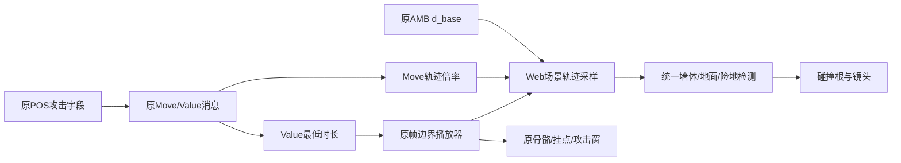

# 原场景位移与受击时长接入报告

2026-11-06，本地v0.6.1。普通离线逆向/移植报告，`flavor=null`；原客户端未运行、修改或上传。

## 结果与范围

四项已接任务保留：钟乳洞、炎硫岛、决死阵、飞鹏堡。本阶段修正其中共用的战斗运动：原`d_base`场景轨迹驱动出招、无攻击窗的起手、收招和受击，骨盆局部摆动不再驱动碰撞根。原`TargetMove`轨迹倍率、`TargetValue`最低保持时长按原消息打包/解包精度接入。所有位移通过已有墙体、地面与险地检测。

修复空中单帧保持姿态越过LoopEnd采到相邻帧，造成角色不落地；修复空中已接受的合法续招因到达衔接帧前落地而被丢弃。目录111条可用指令全部以地面输入或正常起跳验证，移除了旧目录夹具的额外100单位高度。7条必要效果未完成的指令继续禁用。

最终234/234测试通过，19个运行模块语法检查通过，3,858条已登记原资产大小/哈希核验零异常。没有本阶段浏览器或人工对照结论，没有部署。原生完整战斗还原目标仍开放。

授权延续[scope](../scope.md)的离线静态分析、资源解析、Web移植及本地验证。样本`Meteor.exe`为PE32/x86、1,945,600字节，基址0x400000，入口0x50982e；SHA-256为`289afb0aa44a47921d167fc24d6d404c60d6d00c299ac27d45fc61e16231b498`。导入依赖沿用[E-imports](../evidence/E-imports.json)，没有调用原EXE的Windows、图形或网络接口。

## 原语义与Web实现

| 数据/分支 | 原证据 | 本地接入与限制 |
|---|---|---|
| 场景运动 | 004ce850定位d_base并读取角色虚函数+20；0055df00拷贝角色+304/+308/+30c；004cc130先推进动画 | 改读AMB的d_base逐帧差，按Web角色朝向换轴，通过统一_move；原运动向量生产及完整旋转链尚未全部恢复 |
| 骨盆局部姿态 | AMB骨骼根与dummy轨道分别存储 | 保留sampleRoot及骨骼姿态，新增的场景轨迹接口不改写蒙皮、骨架和挂点 |
| TargetMove | Yacc规则0x37、0072b980、攻击记录+60；004d03f0存actor+37c，004cdd60传给004ce850 | 乘于受击场景运动，不当作直接距离或伤害 |
| TargetValue | 规则0x38、0072b984、攻击记录+64；004cfc00→004dbf80→0055d260存动画+608 | 最低保持时长；0055d910/0055d560推进+604。源P0的299个攻击块全部显式提供非负Move/Value；未知记录的负哨兵未实现 |
| 消息精度 | 004f3380打包，004af630选择普通受击/护架，004f3f50解包 | `uint16(trunc(float32(v)*100+.5))`再乘float32(.01)，不是直接使用JS双精度源值 |
| DefenseMove/Value | 规则0x33/0x32、攻击记录+3c/+40；分别位于两个消息字的高16位 | 字段和消息语义已恢复，护架动画/位移尚未接入本阶段运行链 |
| 竖直运动 | 004ce850对native速度取整数绝对值，再与float0.1比较 | 达到阈值时使用原轨迹竖直速度，其余沿用Web重力；过滤原浮点噪声。自由落体、碰撞等仍非完整原物理 |
| 播放边界 | 0055d560模式1到End结束；模式0超过LoopEnd回LoopStart | 不再播放End+1或LoopEnd+1；单帧loop只保持该变换。更新步长溢出按所检查原分支夹取，不承诺所有循环运动分帧等价 |
| 接招落地 | 原ACT允许282→283；原动画切换等待编译Blend帧 | Web输入策略：已接受的续招，只要原前招仍有效，落地不撤销；实际起手仍检查怒气、死亡和生命周期。未称恢复原EXE完整输入调度 |

例：剑277的原d_base前进约74.63626原单位，即当前比例下约5.97090世界单位；旧骨盆轨迹几乎不前进。重锤315的TargetMove=10、Value=.5，实际受击轨迹产生约4世界单位后退并保持至少.5秒。剑265起手没有攻击窗，但本身携带下降轨迹；现在先执行该下降，再连接342攻击，不能只在出现攻击窗后才读取位移。

## 验证与复现

[最终完整TAP](../evidence/native-runtime-motion-fidelity-2026-11-06.tap)：234测试、234通过、0失败/跳过/取消，28.71611525秒。该文件实际SHA-256及当前模块哈希在[当前验证快照](../evidence/E-validation-current.json)，前一关卡阶段快照保存在[E-validation-pre-motion](../evidence/E-validation-pre-motion-2026-11-06.json)。

真实SKC/BNC/AMB/POS、原武器和RES伤害用于以下CPU检查；纹理、音频播放和GPU绘制不参与CPU断言：

- 剑五段突刺在60Hz和10Hz保留五个原攻击窗、实际扣血及原前进距离；碰撞根与就地蒙皮的d_base重合。
- 两种更新频率下，原突刺在普通墙体前停止；不会穿墙，也不会锁死招式。
- 实际重锤攻击请求触发目标原受击动作；轨迹倍率与至少.5秒保持均成立。该项停用NPC导航以隔离受击运动，不是活AI实战胜利。
- 原单帧空中loop连续180次更新只采同一帧，不制造竖直速度；普通空踢、下击自然落地。
- 匕首正常起跳后通过攻击输入进入245→246→247并到达各攻击窗，无额外高度或姿态赋值。
- 111条可用指令逐条从地面或正常起跳进入，保留首攻击窗、前招条件和实际起手扣怒；7条未完成指令保持拒绝。每条指令的夹具重新放置角色、补足怒气，此项不证明连续实战施展全部指令或远端EF效果。
- 四项任务、原跳跃镜头与既有外观回归全部通过。炎硫岛自然失败夹具会正常步行接近敌人，避免真实后退后离开感知范围；飞鹏堡援军等待原对白暂停后执行use4，不跳过原队列。

扩大到自然起跳遍历时，最初长枪283因落地取消已接受队列而失败；保留[失败TAP](../evidence/native-natural-catalog-pre-landing-fix-2026-11-06.tap)。修复后完整目录和最终全套通过。未通过增加高度、缩短招式或跳过攻击窗修正该项。

```sh
python3 work/meteor-original/evidence/combat-motion-source-audit-2026-11-06.py
node --test tests/native-command-engine.test.mjs tests/native-hit-reaction.test.mjs tests/native-combo-controller.test.mjs
npm test
npm run check
python3 scripts/analysis/verify-recovered-assets.py
```

## Evidence → Finding → Path

[源语义审计](../evidence/E-combat-motion-source-2026-11-06.json)保存PE节映射后的精确机器字节、Yacc语法表、5条字段规则、float常数、源字段统计和19份证据文件哈希。该脚本读取原文件但从不启动它。Ghidra12.1.4/Java21在既有MeteorOriginal项目中以`-readOnly -noanalysis`导出；新辅助脚本ReadOnlyMotionOwners只在内存中扫描函数归属，不保存数据库。

| E-id | source_ref | repro_command | content_hash |
|---|---|---|---|
| E-MO01 | [PE语法/常数/消息审计](../evidence/combat-motion-source-audit-2026-11-06.py) | 上方Python命令 | E-combat-motion-source中的sampleSha256及artifacts |
| E-MO02 | [原运动消费汇编](../evidence/hit-reaction-getup-2026-10-30/004ce850_FUN_004ce850.asm)、[场景向量getter](../evidence/combat-dummy-motion-native-2026-11-06/0055df00_FUN_0055df00.asm) | 既有项目只读Ghidra导出 | 源审计artifacts |
| E-MO03 | [原播放器](../evidence/combat-dummy-motion-native-2026-11-06/0055d560_FUN_0055d560.c)、[原时长入口](../evidence/pose-blend-native-2026-11-05/0055d260_FUN_0055d260.c) | 既有项目只读Ghidra导出 | 源审计artifacts |
| E-MO04 | [最终真实资源回归](../evidence/native-runtime-motion-fidelity-2026-11-06.tap) | npm test | E-validation-current.fullSuite.contentHash |

| F-id | severity | evidence_ids | confidence | location | status |
|---|---|---|---|---|---|
| F-MO01 | n/a_re | E-MO01/E-MO02/E-MO04 | 原消费链high，完整运动等价未建立 | sampleSceneMotion、_updateFighter/_move | 已接原轨迹；全部物理/旋转链继续开放 |
| F-MO02 | n/a_re | E-MO01/E-MO03/E-MO04 | high | nativeReactionParameters、react/update | 原Move/Value分离并运行验证；护架运动待接 |
| F-MO03 | n/a_re | E-MO03/E-MO04 | high | NativePoseTimeline.advance | 单帧越界/悬空修复，按End/LoopEnd采样 |
| F-MO04 | n/a_re | E-MO04及原ACT | Web策略已验证，原调度未恢复 | _beginAttack.canStart | 已排队续招可跨落地，原前招门仍有效 |

P-MO01，`path_type=callflow`：原POS字段 → Yacc攻击记录 → 原消息打包/服务端解码/客户端解包 → Move进入角色运动、Value进入动画计时 → Web原轨迹采样与统一碰撞 → 原骨骼/挂点显示和攻击窗接触。



可编辑源见[位移流程](../diagrams/combat-motion-2026-11-06.mmd)。沿用本机已确认缺少mmdc的限制，仅提供Mermaid源码，未生成SVG。

## 仍开放的工作

全场景向量生产、原旋转/方向受击选择、护架后退与强制受击的混合、原重力/空中/碰撞常数、全部EF、剩余五类兵器、原完整输入和其余五份剧情仍未完成。窄范围立即数扫描找到的005570e0属于动画加载器骨骼字段，不能当成场景向量生产函数。没有把Web适配策略写成原版已恢复行为。

此前内置预览连接超时；Computer Use访问Chrome未获批准且没有进一步原因，本阶段未重试或用其他通道绕过。没有新截图、手工通关、线上更新或部署结论。项目内经验记录见[journal](../field-journal/2026-11-06_combat-motion.md)；外部技能库未修改。
