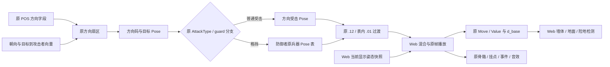

# 方向受击与防御过渡接入报告

2026-11-06，本地 v0.6.2 方向/防御阶段。普通逆向与移植报告，`flavor=null`。本报告记录该阶段证据和验证范围；后续开发中的工作区变化不自动继承这里的验收结论。

## 结果与授权范围

此前 Web 端始终使用攻击块的默认 TargetPose，侧面和背面命中不会选择原来的方向反应；格挡只免伤和播放声音，没有接入原防御受击动作。本阶段恢复原方向扇区、七类兵器的防御动作表，以及普通受击与防御受击的短过渡。普通受击的 TargetMove/TargetValue 与格挡的 DefenseMove/DefenseValue 分别驱动原场景轨迹倍率和最低保持时长。连续挨打会从当前显示的骨骼、武器挂点快照开始过渡，避免把半途混合姿态跳回某一整帧。原版完整打击感、全部兵器和效果仍未完成，不能由此阶段的通过记录推断为完全还原。

授权沿用 [scope.md](../scope.md)：用户指定的本地客户端离线静态分析、资源解析、Web 移植和验证。样本 `Meteor.exe` 为 PE32/x86、1,945,600 字节，基址 0x400000、入口 0x50982e，SHA-256 为 `289afb0aa44a47921d167fc24d6d404c60d6d00c299ac27d45fc61e16231b498`。导入表与依赖分类保存在 [E-imports](../evidence/E-imports.json)，包括原图形、Windows、声音及网络依赖；本阶段只读这些代码和数据，没有运行、修改或上传原客户端。

## 方向、防御与过渡的原证据

| 机制 | 原程序证据 | Web 接入与边界 |
|---|---|---|
| 方向字段 | 0057aaf0 的 Bison 规则 0x39–0x3d；攻击记录 +48/+4c/+50/+54/+58 | 分别对应 TargetPose、Front、Back、Left、Right；005754d0 会把未设置的 -1 方向字段回填为默认 TargetPose |
| 朝向与夹角 | 004dc060 读取原矩阵第 1 行并取负；004f3380 调用 00548270 求有符号水平夹角 | 使用目标朝向和“目标到攻击者”的向量，按 native(x,y)=(Web x,-Web z) 换轴；不是按攻击点颜色或命中音效猜方向 |
| 扇区边界 | PE 双精度常量 ±0.7853975、±2.3561924999999997 | 保留原边界及开闭关系；JS 坐标和算术仍是 Web 实现，不是整个 x87 指令环境模拟 |
| 格挡条件 | 004af630 检查 AttackType=0 且目标 guard flag=1；004f4010 接收防御消息 | 方向选择防御动作，不额外添加原分支没有的“背后必定破防”角度规则；原非零类型攻击仍可破防 |
| 防御 Pose | 004f4010→004d04d0→兵器状态虚函数+1c/004dcf10→+68/004dce50 | 按防御者当前兵器选择原 Pose；不把攻击者的受击 Pose 当成防御动画 |
| 防御运动和保持 | 防御消息中 DefenseMove/DefenseValue 的高 16 位；沿用已恢复的百分位打包/解包 | 防御受击也进入原 d_base 位移、统一碰撞和最低保持时长链；持续按防御、松开、再按及破防中断均有 CPU 检查 |
| 强制过渡 | 004cfc00 默认 float32(0.12)；兵器状态+30/004dd070 对其防御表内目标改为 float32(0.01) | 判断依据是目标 Pose 是否在当前兵器防御表中；过渡时原动作时间保持在 Start，完成后再推进受击动作及其最低保持时钟 |
| 中断中的显示姿态 | 原强制过渡路径经过 00559720、004dbf80/0055d260 | Web 的 capturePose 记录实际显示中的骨骼和 dummy；半途再命中使用该快照。该快照实现及场景接触体仍属于 Web 宿主，不声称整个原骨骼引擎逐指令等价 |

原扇区的准确映射如下。字段名描述选择的反应，并不直接等同于攻击者站在目标身体的哪一侧。

| direction | 夹角范围 | 普通受击字段 | 防御表槽位 |
|---|---|---|---|
| 0 | -low < angle < low | TargetPoseFront | 前四槽的随机选择；原标准精度最大随机值可落在槽 4 |
| 1 | -high < angle ≤ -low | TargetPoseRight | 槽 4 |
| 2 | low ≤ angle < high | TargetPoseLeft | 槽 5 |
| 3 | angle ≤ -high 或 angle ≥ high | TargetPoseBack | 槽 6 |

其中 low=0.7853975，high=2.3561924999999997。原剑 262 的四方向反应为：正面 93、背面 92、正有符号侧 94、负有符号侧 91；方向事件、显示的原动画和碰撞音效引用名称现在使用同一个选择结果。

七类兵器的表直接取自原兵器状态初始化函数，并以其防御站姿字段交叉匹配：

| 兵器 | 初始化函数 | 防御站姿 | 正面常用四槽 | direction 1 / 2 / 3 |
|---|---|---|---|---|
| 飞镖 | 004df190 | 11 | 40, 41, 42, 43 | 77 / 78 / 79 |
| 双刺 | 004e0ed0 | 14 | 52, 53, 54, 55 | 77 / 78 / 79 |
| 匕首 | 004e07c0 | 15 | 56, 57, 58, 59 | 83 / 84 / 85 |
| 剑 | 004dd370 | 16 | 60, 61, 62, 63 | 80 / 81 / 82 |
| 长枪 | 004ddac0 | 17 | 64, 65, 66, 67 | 86 / 87 / 88 |
| 大刀 | 004de220 | 18 | 68, 69, 70, 71 | 80 / 81 / 82 |
| 重锤 | 004e0080 | 19 | 72, 73, 74, 75 | 77 / 78 / 79 |

## 随机选择与浮点精度的核对

0050a8de 的原 CRT 随机函数返回 `(state>>16)&32767`，状态更新为 `state*214013+2531011` 的 32 位回绕。防御正面分支 004dce50 将该整数乘 PE 常量 0.00012207403790398877，其字节为 `800040002000203f`，值为 binary64 的 4/32767，再经 00509980 截断。最初把常量写成 4/32768 的审计断言失败；读取原字节后已修正，未删除该核对来掩盖差异。

只看 x87 指令不足以确定最大值的结果：64 位有效尾数中间值会略小于 4，而 24/53 位中间结果会舍入为 4。原初始化函数 0050f131 请求 `controlfp(0x10000,0x30000)`，0051283e 将此精度项映射到硬件 CW 的 0x200，即 53 位。Microsoft 的 [Direct3D 浮点控制说明](https://learn.microsoft.com/en-us/windows/win32/dxtecharts/top-issues-for-windows-titles) 与 [IDirect3D8::CreateDevice 资料](https://learn.microsoft.com/en-us/previous-versions/ms889264(v=msdn.10))说明了默认单精度及 FPU 保留标志的关系。据这些静态代码和接口规则推断，标准 CRT53 位路径或 Direct3D 默认 24 位路径在随机值 32767 时都会选择槽 4；没有动态观测任意驱动、插件或异常处理后的全局控制字。

审计对全部 32768 个输入做有理数与有效尾数舍入枚举。24/53 位模式的槽计数为 `[8192,8192,8192,8191,1]`；64 位模式为 `[8192,8192,8192,8192,0]`。Web 保留前一映射，并从 Math.random 抽取 15 位值。原 CRT 的进程/线程种子、与其他系统共享的抽取顺序以及全部浮点环境仍未复现；不能据此称随机序列完全一致。

## 验证范围与已保留的失败

[完整 TAP](../evidence/native-runtime-directional-guard-final-2026-11-06.tap) 为 261/261 通过，0 失败、跳过或取消，54.369836333 秒；SHA-256 为 `497616e95d31c7dadb6c293d6e028d978ccf48589e2db09c94a695bfeaaaf54b`。期间有并行外观工作，`dist/phoenix-spear.js`、`dist/native-character.js`、`dist/character-appearances.js`、`dist/app.js` 在全套启动后变化。因此另跑 [107 项补充回归](../evidence/native-directional-guard-supplemental-2026-11-06.tap)，107/107 通过、2.798979209 秒，SHA-256 为 `c367c8d51422ad63c711959fbba2933ad7075e1beaaf700841717ede60d1fdee`。补充覆盖相关人物、兵器、动作、命中和跳跃；其 58 项启动哈希保存在 [补充快照](../evidence/directional-guard-supplemental-start-2026-11-06.json)，该轮检查期间没有源文件变化。107 项与全套重叠，不相加当作 368 项独立测试，也不宣称 261 项在完全相同的最后工作树上重新执行。

[最终语法日志](../evidence/native-directional-guard-final-syntax-2026-11-06.log)确认 22 个运行模块通过。[原资产核验](../evidence/E-asset-coverage-current.json)为 3,858 条登记记录、零核验异常；清单中已有的缺失原素材与适用边界仍保留，零核验异常不代表全部游戏内容已实现。

真实 POS/ACT/RES、SKC/BNC/AMB 和原兵器用于下列 CPU 检查；图片解码、浏览器音频与 GPU 绘制不参与断言：

- 四方向原 Pose、坐标旋转不变性、精确扇区边界与未设置字段回填；实际命中事件、原显示动画和音效引用名称选择一致。该项不证明浏览器实际音频播放或每个兵器音频文件均完整。
- 防御表七组、四种常用正面变体、固定侧/背槽及全部 32768 个随机值分布。
- 普通受击开始时骨骼/武器挂点位置连续；45ms 的半途混合再受击后仍从显示快照衔接，不重置回旧整帧。
- 大刀 297 从背后击中持剑目标的防御链：原 Pose82、DefenseMove=8、DefenseValue=.6，.01 秒过渡后保持，碰撞根实际后移并回到防御站姿16。
- 玩家可在防御硬直中松开和重新按防御；重复格挡不扣血；攻击/跳跃不能取消硬直；原非零 AttackType 的破防攻击可中断该防御链。
- 既有击倒、卧地、起身、死亡优先级、连段攻击窗、局部命中停顿、四任务和外观回归继续通过。自定义兵器外观/视觉特效的通过不作为原 EF 完整恢复的证据。

方向、格挡参数及快照检查直接调用生产命中入口，以隔离这几个环节；夹具设置对练站位、足够 HP 并暂停 NPC 反击。公开输入的连击/击倒和首关自然受击另由集成用例覆盖。命中入口检查不等于全部方向的实际武器几何接触、活 AI 战斗或人工通关均已验收。

此前一次未固定冷却随机序列的全套为 [252/253](../evidence/native-runtime-directional-guard-resumed-2026-11-06.tap)：首关“敌人自然击杀玩家”在输入驱动上限时剩余 HP287，失败记录未覆盖。后续首关用四组可复现的 Web 冷却抖动序列检查，均通过正常移动、原 NPC 伤害、自然死亡、唯一失败结算和重开，未赋值 HP/dead/胜负。这些有限序列不能解释此前失败的准确随机历史，也不能证明全部原 AI 行为或所有停滞已修复；该问题继续开放。

本阶段没有新的浏览器、Windows 原版动态运行、人工手感对照或线上验证。此前内置预览连接超时，Computer Use 访问 Chrome 未获批准且未返回进一步原因；没有用其他通道绕过。没有新部署或资源上传结论。

## Evidence → Finding → Path

[源审计 JSON](../evidence/E-directional-guard-source-2026-11-06.json)包含 PE 节映射读取、5 条语法规则、方向常量、7 张兵器表、FPU 精度枚举和 176 项证据文件哈希。该文件 SHA-256 为 `10e37a0c86647b7e4c3db11e89619ba9d09882cb94d13059acd4db0d6d2ab5cf`；本次对所列原证据逐项核验无哈希差异。审计脚本的运行配置比较已容许后续新增兵器，七组原防御表的来源和检查仍独立保留。该 JSON 是本阶段源分析快照，不把后来继续开发的运行模块当成当时已验证源码。

| E-id | source_ref | repro_command | content_hash |
|---|---|---|---|
| E-DG01 | [PE 表/字节审计](../evidence/directional-guard-source-audit-2026-11-06.py)及源审计 JSON | `python3 work/meteor-original/evidence/directional-guard-source-audit-2026-11-06.py` | 源审计 sampleSha256、artifacts 及上方 JSON 哈希 |
| E-DG02 | [004f3380 方向选择](../evidence/directional-guard-native-2026-11-06/004f3380_FUN_004f3380.asm)、[00548270 角度函数](../evidence/directional-guard-native-2026-11-06/00548270_FUN_00548270.asm)、[004dc060 朝向读取](../evidence/actor-world-getter-2026-11-06/004dc060_FUN_004dc060.asm) | 既有 Ghidra 项目 `-readOnly -noanalysis` 导出 | E-DG01.artifacts |
| E-DG03 | [原防御选择器](../evidence/guard-selector-state-init-2026-11-06/004dce50_FUN_004dce50.asm)、[短过渡回调](../evidence/guard-blend-callback-native-2026-11-06/004dd070_FUN_004dd070.asm)、各兵器状态初始化函数 | 同上；源审计核对表与运行配置 | E-DG01.artifacts |
| E-DG04 | [FPU 精度请求](../evidence/fpu-device-creation-native-2026-11-06/0050f131_FUN_0050f131.asm)、[原随机函数](../evidence/guard-crt-rand-2026-11-06.asm)、[FPU 写入点](../evidence/fpu-policy-native-2026-11-06/fpu-writers.tsv) | 源审计有理数/有效尾数枚举；ReadOnlyFpuPolicy.java | E-DG01.artifacts；接口解释引用上方 Microsoft 主资料 |
| E-DG05 | 完整 TAP、补充 TAP、语法日志和 58 文件哈希快照 | `npm test`；下方补充命令；`npm run check` | 本节实际 TAP 哈希及各原文件 |
| E-DG06 | [未固定序列的失败记录](../evidence/native-runtime-directional-guard-resumed-2026-11-06.tap)及当前四组首关输入用例 | `node --test --test-name-pattern='walking normally into the source enemies' tests/mission-acceptance.test.mjs` | 失败 TAP SHA-256 `385bfb290106d45e1d58c0c5923013c1b74dc9f6ce1ac84cdeb5a8f46493ee8f` |

| F-id | severity | evidence_ids | confidence | location | status |
|---|---|---|---|---|---|
| F-DG01 | n/a_re | E-DG01/E-DG02/E-DG05 | 原字段/分支 high；全浮点环境未等价 | nativeHitAngle/nativeHitSelection、_applyNativeHit | 四方向原反应及共同事件/音效选择已接入 |
| F-DG02 | n/a_re | E-DG01/E-DG03/E-DG05 | high | nativeGuardPose、react/update、_move | 七类原防御 Pose、DefenseMove/Value、持续格挡与破防中断通过 CPU 检查 |
| F-DG03 | n/a_re | E-DG03/E-DG05 | 原时长 high；快照为已验证 Web 实现 | capturePose/setPoseBlend、react | 原 .12/.01 时长规则接入；中断混合无骨骼/挂点位置跳变 |
| F-DG04 | n/a_re | E-DG01/E-DG04/E-DG05 | 标准精度路径有静态及接口依据；未动态观测全局环境 | nativeGuardPose、源审计精度枚举 | 15 位抽样映射接入；原种子/抽取次序及任意控制字变化未恢复 |
| F-DG05 | n/a_re | E-DG05/E-DG06 | 有限输入序列通过；偶发根因未确定 | sn01 CPU 输入驱动/任务宿主 | 四序列通过；此前随机停滞继续开放，不判作已修复 |

P-DG01，`path_type=callflow`：POS 方向字段及原朝向 → 原方向扇区 → 普通受击或原 AttackType/guard 分支 → 方向受击 Pose 或防御者兵器 Pose 表 → 原强制过渡时长规则 → Web 当前显示快照与原动画帧 → 原 Move/Value 场景轨迹和宿主碰撞 → 事件、音效和 HUD。



可编辑源见[方向与防御流程](../diagrams/directional-guard-2026-11-06.mmd)。图中“Web”节点均是宿主接入，并不当成原 EXE 实现。已调用技能渲染脚本，因本机缺少 mmdc 未生成 SVG；保留源码和[渲染日志](../evidence/directional-guard-diagram-render-2026-11-06.log)，未自动安装渲染器。

## 复现、阶段记录与后续工作

在项目根目录运行：

```sh
python3 work/meteor-original/evidence/directional-guard-source-audit-2026-11-06.py
node --test tests/native-hit-reaction.test.mjs tests/native-command-engine.test.mjs tests/native-mission-weapons.test.mjs
npm test
npm run check
python3 scripts/analysis/verify-recovered-assets.py
```

该阶段的补充回归命令为：

```sh
node --test tests/native-phoenix-spear.test.mjs tests/native-butterfly-sword.test.mjs tests/native-butterfly-vfx.test.mjs tests/native-hd-character.test.mjs tests/native-hutao-character.test.mjs tests/native-raiden-character.test.mjs tests/native-emilia-character.test.mjs tests/native-hit-reaction.test.mjs tests/native-command-engine.test.mjs tests/native-combo-controller.test.mjs tests/native-jump-camera.test.mjs tests/native-mission-weapons.test.mjs
```

命令用于重跑相应检查；后续工作区继续增加兵器和功能时，测试数量与源哈希会改变，不能用新运行结果冒充上方的历史 TAP。

既有 Ghidra 12.1.4/Java21 项目以只读、不重新全分析的方式导出原函数；radare2 6.2.4 用于读取 CRT 原汇编。新增 FPU 扫描脚本只读现有指令和所属函数，临时 Java 用户目录位于 `/private/tmp`。这些工具运行不等于执行原样本。

阶段顺序为：恢复方向与防御调用链 → 接入 Pose/参数与强制过渡 → 检查连续受击快照 → 核对随机常量与精度 → 保留未固定序列失败 → 四组可复现首关序列及完整/补充回归。案件历史见 [timeline](../timeline.md)，本阶段经验记录见 [journal](../field-journal/2026-11-06_directional-guard.md)。

本报告对应阶段尚缺火铳、飞轮、乾坤刀、指虎和忍刀的完整战斗、全部原 EF、完整原输入、运动向量生产/旋转/碰撞/AI/PRNG 行为及其余剧情。已有局部命中停顿、微震、火花、0.65 秒卧地等待仍是明确 Web 适配。当前显示快照使动作连续，但不能替代原版实机手感对照；完整目标保持开放。后续更改若接入其中系统，应以各自新证据和验收更新状态，不回写本阶段已取得的历史结果。
