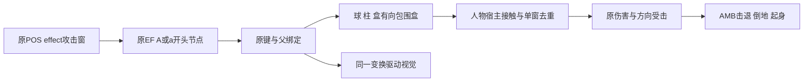

# 长枪气罩与原EF效果命中

2026-11-07，本地v0.7.1；普通逆向与Web移植，`flavor=null`。

## 结果与授权

长枪“万圣龙王破”的原293气罩和294前方冲击体已接入实际人物命中，使用原伤害、AttackType、方向反应、TargetMove/Value及AMB受击轨迹。三名周围角色在CPU夹具中分别被击退，经过103→112→119的倒地/起身链；20米前方角色被第二段命中，后方和侧面远处角色不受影响。同一POS攻击窗的身体、兵器和效果共用命中身份，避免重复扣血。EF时钟与POS加速帧分离，柱体的底端锚点也已修正。完整原物理、霸体、全部EF和人工实战仍未恢复。

沿用[scope](../scope.md)中的granted/offline静态逆向、资源解析、Web移植和本地验证。原PE32/x86 `Meteor.exe`为1,945,600字节，SHA-256 `289afb0aa44a47921d167fc24d6d404c60d6d00c299ac27d45fc61e16231b498`；未运行、修改或上传。依赖概况沿用[E-imports](../evidence/E-imports.json)，本阶段不是Windows原客户端动态行为观测。

## 原程序证据与实现

| 原证据 | 含义 | 当前接入与边界 |
|---|---|---|
| 00556910 | POS的`effect`解析为0x1001 | 只有当前原Attack检查effect时查询EF体，不把所有视觉网格都变成攻击 |
| 0055da50→0056f1d0 | 当前攻击窗查询效果；名字首字节A/a是攻击候选，排除AUDIO2/PATH10，PARTICLE9另走专门路径 | 当前支持球、柱、盒；粒子命中和其他类型未合成 |
| 005818f0→0055d950→00570630/005706c0 | 效果有向包围盒对人物整体包围盒查询，使用分离轴检测 | 原EF尺寸/键/绑定进入有向包围盒；Web人物仍用半径0.4、半高1.3的宿主体，非完整原人物包围盒 |
| 00584e50 | 球体包围盒三轴半长为原半径 | 293原AttackBall01半径30，随原键缩放；普通Sphere_7不因外观巨大而产生伤害 |
| 00588ed0 | 柱体横向半长取两个半径较大者，轴向为高度/2；公共flag0=1时中心沿原Z偏移高度/2 | 修复AttackShock/AttackWave原本从底端展开却被居中绘制的问题 |
| 00589a40 | 盒体半长为三维尺寸/2；flag0=1时中心Z取第二尺寸/2 | 保留该原偏移规则，不将它擅自改成第三尺寸 |
| 005663e0 | EF实例累计秒时钟，与POS帧速度独立 | 控制器输出效果时间和跨越的帧时间区间，视觉/接触共用；宿主命中停顿、插值和生命周期仍有Web规则 |

原293的Attack包含身体、weapon和effect，AttackType=1，原方向反应103/104/105/106，TargetMove=1.2、TargetValue=1.5；自动衔接294，其Attack窗口3447–3487，Move=2、Value=1。Web不额外施加一个猜测的“推开速度”，而由原方向姿态和d_base轨迹经既有墙/地面/险地宿主移动目标。

新`native-effect-transforms.js`为渲染与接触共享原键和父绑定变换；接触模块不依赖贴图成功、透明度或网格可见性。每个原帧区间加入不超过1/120秒间距的采样以及区间内的原EF键时刻，避免粗更新跳过移动冲击体；这属于明确的Web采样，未声称原客户端使用120Hz。角色骨骼在查询各时刻后恢复到原显示帧。暂停、受击中断、换兵器、重开、换图和销毁均不保留旧攻击体。

## Evidence

| ID | source_ref / artifact_path（相对案件目录） | content_hash SHA-256 | repro_command / 观察 |
|---|---|---|---|
| E-EF01 | [原函数、数据及修正索引](../evidence/E-effect-contacts-2026-11-07.json) | `9b238d73dced6c5b0adc4c648035226ea4ecae2bcd87f5b063d670bc64402358` | 复读索引中的94份C/ASM/引用文件；Ghidra `-readOnly -noanalysis`，原函数不能在当前平台直接执行 |
| E-EF02 | [最终全套TAP](../evidence/native-runtime-effect-contacts-final-2026-11-07.tap) | `50b6b94444b03e118bc2bf01569821218ad74b221688ee08b373b9478767996d` | `npm test`：306通过、0失败/跳过/取消，49282.581ms |
| E-EF03 | [最终语法日志](../evidence/native-effect-contacts-syntax-final-2026-11-07.log) | `75b9c544f39454a442cbe9896e5d0b0222f709fedae713537623f75f83cb2b3a` | `npm run check`：27运行模块通过 |
| E-EF04 | [资产复核](../evidence/E-asset-coverage-current.json) | `b2f263e8ac21677b64709907d78d75cb7240a59148af8d09aaf97b849bbe65d8` | `python3 scripts/analysis/verify-recovered-assets.py`：3885记录、0新异常；原已声明缺项保留 |

## Findings与Path

F-EF01：原效果攻击路径已进入Web人物伤害与反应链。`severity=n/a_re`，`category=reverse_algo`，`status=validated`，`confidence=high`，`evidence_ids=[E-EF01,E-EF02]`。位置为`dist/native-effect-contacts.js`、`dist/engine.js`及原293/294。影响为气罩和冲击体能击退真实角色；剩余边界为Web人物接触体、其他EF家族、完整原时钟和状态。复现：`node --test tests/native-effect-contacts.test.mjs`，检查三个目标的真实血量、各方向位移、倒地/起身、远端/后方边界和去重。

F-EF02：EF时间和柱体锚点修正。`severity=n/a_re`，`category=reverse_algo`，`status=validated`，`confidence=high`，`evidence_ids=[E-EF01,E-EF02]`。位置为`native-combat.js`、`native-effect-transforms.js`、`native-rage-vfx.js`。影响为视觉和攻击查询使用相同的秒时钟与底端柱体位置；剩余边界为完整原插值、绑定标志和全局调度。复现同上，并运行`node --test tests/native-rage-vfx.test.mjs`。

P-EF01，`path_type=callflow`，start为普通S/W/W/J输入，goal为原气罩命中后击退/倒地。①原目录进入293并支付100怒气（E-EF02/F-EF01）；②原POS effect窗口选择0x1001路径（E-EF01/F-EF01）；③原键、父绑定和包围盒产生攻击体（E-EF01、E-EF02/F-EF02）；④有向包围盒检查人物宿主体，共享原Attack身份（E-EF02/F-EF01）；⑤原伤害和方向反应驱动AMB轨迹、卧地和起身（E-EF01、E-EF02/F-EF01）。residual_risks为尚未恢复的原接触体、效果分支、完整战斗/AI语义。

[图源](../diagrams/effect-contacts-2026-11-07.mmd)与[渲染日志](../evidence/effect-contacts-diagram-render-2026-11-07.log)保留；未交付已渲染SVG。

## 验证范围、并行变化与遗留问题

新增11项检查和48项针对性检查通过。气罩测试使用原SKC/BNC/AMB/POS/RES、原武器和生产输入/碰撞/伤害路径，在CPU平面上运行，NPC反击和导航暂停，未启用无限怒气。三个3.5米处的目标各出现一次293效果命中，测得向外最大位移均约6.573米；该数值是此夹具结果，不是任意人物、地形下的原版固定击退距离。另覆盖20米前方冲击、20米后方/侧方不命中、暂停/中断/换兵器、无贴图接触、无效父绑定、零缩放、有向边界和粗时间步。

第一次全套304项通过后，工作区同期加入无限怒气的UI、偏好、引擎和两项测试，均已保留；因此重新冻结74份源码/测试/导入脚本及5清单，最终306项通过。此后仅修正接触模块的一处注释类型名，保留测试时源文件并以精确字符串替换确认可执行JavaScript未变，当前文件另经语法检查。实际情况见[当前验证](../evidence/E-validation-current.json)，不将较早304项结果冒充最新版本。

首次专项测试的浮点精确相等断言和无贴图视觉夹具失败均保留，修正理由在E-EF01中。原控制器虚表候选被构造函数证据否定并更正为005aa6a8，未据错误候选实现霸体。第一次资产校验误用了不存在的脚本目录，错误日志保留，正确路径包含`analysis/`；旧报告的简写不是可直接执行的命令。

效果对场景机关的原命中、原穿墙语义、粒子/模型/路径和其余效果类型、隐身/瞬移/擒拿等状态、原霸体/爆气/群战AI以及完整移植目标仍开放。未新增浏览器、GPU、触屏或人工通关结论；此前浏览器访问限制未绕过，没有部署或上传。

时间线见[timeline](../timeline.md)，工单见[workitems](../workitems.md)。上一工作阶段属于progress：运行代码、原函数证据及真实资产验证已变化；暂停按用户要求结束，恢复后继续原目标。

- [x] 样本授权、哈希与导入表证据沿用并复核。
- [x] 原函数和运行验证挂接Evidence→Finding→Path。
- [x] 11项新增、306项全套、27模块语法及3885资产记录检查通过。
- [x] 原始失败、并行改动、注释修正与验证边界保留。
- [x] README、项目内匿名日志、图源、时间线与工单已更新。
- [ ] 完整原版战斗、全部EF、所有剧情、人工实战及联网还原。
