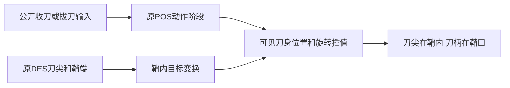

# 乾坤刀收刀入鞘修正

2026-11-09，普通逆向工程，flavor=null。本轮修正v0.7.4的握持回归：↓↓A虽然切入拔刀待发姿态，裸刀仍固定在右手，未进入刀鞘。

## Scope、样本和证据

沿用[scope.md](../scope.md)的本地离线授权。原EXE未执行、客户端未改动。样本为既有x86 Meteor.exe，SHA-256 `289afb0aa44a47921d167fc24d6d404c60d6d00c299ac27d45fc61e16231b498`；13个DLL的导入表在[E-imports.json](../evidence/E-imports.json)。本轮Ghidra采用既有项目与`-readOnly -noanalysis`。

E-QS01：[原DES端点与适配说明](../evidence/E-qiankun-sheathing-2026-11-09.json)，含四款模型的RS/RE和LS/LE坐标、所有新增原生导出文件SHA-256。POS明确含431/441转式、485回鞘过程、486回鞘后动作、487大绝回鞘后动态。静态导出命令见`work/qiankun-sheathing-2026-11-09/native*/export.log`。原控制器的两组pose查询和装载链未完全闭合，没有将其猜测成隐藏刀身的规则。

E-QS02：[握持/收鞘/怒招专项TAP](../../qiankun-sheathing-2026-11-09/grip-tests.tap)，`node --test tests/native-command-engine.test.mjs tests/native-effect-contacts.test.mjs`，58/58通过；[完整最终TAP](../evidence/native-runtime-sheathing-final-2026-11-09.tap)，370/370通过，69.793秒。

E-QS03：[收刀对照](../../qiankun-sheathing-2026-11-09/closed-comparison.jpg)、[收刀中13%](../../qiankun-sheathing-2026-11-09/closing.jpg)、[已拔出](../../qiankun-sheathing-2026-11-09/drawn.jpg)、[举刀](../../qiankun-sheathing-2026-11-09/raised.jpg)。浏览器对照使用生产装备、公开方向输入和原控制器；省略NPC/地图物理以隔离握持动画。修复后的预览阶段无新增控制台错误。预览最初漏播idle导致空timeline，已修正测试页；临时测试页未进入游戏包。

以上文件的content_hash由当前验证JSON记录；原始失败与诊断TAP保留。

## Finding与Path

F-QS01，`severity=n/a_re;category=web_binding;status=validated;confidence=high;evidence_ids=[E-QS01,E-QS02,E-QS03]`。位置为`native-qiankun-grip.js`、`native-character.js`及`engine.js`。旧修复对所有姿态要求右手握刀，使收刀姿态仍呈现裸刀。现通过原DES端点建立刀身在刀鞘中的目标变换，按原POS收刀/拔刀/回鞘阶段进行位置和旋转插值，始终保留可见刀柄。站姿、持枪式收刀、拔刀攻击后回鞘和四款原刀均验证。

P-QS01，`path_type=callflow`：公开↓↓A→431或441→原485/486自动链→403待发；每次原骨骼帧/混合帧更新→读取姿态阶段→在右掌握持与DES鞘内目标间插值→可见刀尖进入鞘体、刀柄保留→下次拔刀攻击→回鞘。换兵器取消旧姿态订阅，人物销毁清理订阅；原R/L控制轨道、模型、贴图和伤害规则不变。

## 验收与交付

旧“所有帧都必须跟右手”的测试改为真实几何验收：出刀时靠近手掌；入鞘时刀尖/刃段位于可见鞘体包围盒内，刀柄位于包围盒外，刀本身仍可见；中间存在部分入鞘进度。两种前置架式的公开↓↓A、随后的↓↑A与自动回鞘均通过。

完整回归先出现一个已有单机断言失败。记录显示没有玩家出招输入，103/104/105受击动作的身体攻击窗造成被动撞伤；原POS确有这些窗口。修正验收为只允许原受击身体攻击窗并核对伤害总数，未修改运行时伤害规则。诊断和首次失败保留，最终370项全通过。

30个运行模块语法检查、3,885条原资产核验通过。77个最终测试输入保持一致。v0.7.5本地运行包校验4,089文件，包含新握持模块、原地图和武器、转换角色网格与16张自定义角色PNG，不依赖PMX；未上传或远端部署。

边界：这是基于原资产端点与动作阶段的Web收鞘插值，不声称完整复现原EXE装载、补偿和插值算法。完整原粒子、物理、网络和所有技能条件仍开放。

[时间线](../timeline.md) · [匿名日志](../field-journal/2026-11-09_qiankun-sheathing.md)
