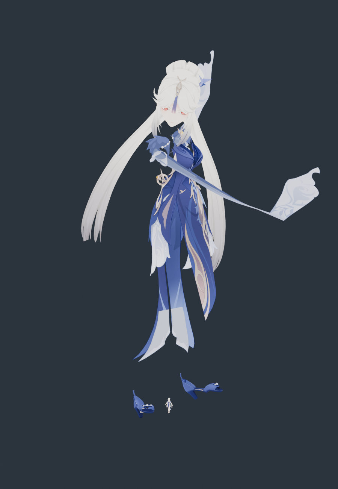

# 凝光 · 纱中幽兰 · 模型导入与体型核查

2026-11-11。源文件是**可编辑 `.blend`**（不是 PMX），已归档到 `assets/source/ningguang`；运行时和重建只读项目内归档。

**结论：能加，且没有压变形，也没有浮空。** 读取器直接打开作者的 Blender 场景，每个源顶点只做一次等比变换，站立面按脚部顶点求。

## 这个格式和 PMX 的差别

| 项 | PMX 包（前 8 个） | 本包（.blend） |
|---|---|---|
| 源数据 | 二进制 PMX + 散装贴图 | Blender 场景：网格 + 骨架 + **贴图打包在文件内** |
| 骨骼命名 | `左足D` / `足.D` 等日文名 | MMD 名 + `.L/.R` 后缀（`足.L`、`腕.R`、`親指０.L`） |
| 材质 | PMX 材质表 | mmd_tools 节点组，基色贴图在 `mmd_base_tex` 节点 |
| 形态键 | 无 | **53 个 MMD 表情 morph** |
| 头发弹簧 | 有独立链 | **无**，头发刚性绑在 `頭` |

读取器改成直接取 `凝光_mesh` 的顶点/法线/UV/权重与 `凝光_arm` 的骨骼，其余（30 槽映射、原长度显示骨架、动作烘焙）完全复用原有管线。

## 源模型

| 项 | 值 |
|---|---|
| 文件 | `凝光_纱中幽兰_可编辑.blend`（29 MB，贴图已打包） |
| 网格 | `凝光_mesh`，24,547 顶点 / 31,188 面 |
| 骨架 | `凝光_arm`，94 根骨骼 |
| 材质 / 贴图 | 31 / 5 张 2048²（颜、髪、体、肌1、肌2） |
| 署名 | 未附；原模型版权归 miHoYo |

## 体型与落地核查

| 指标 | 源模型 | 运行时 | 变化 |
|---|---:|---:|---:|
| 静止总高度 | 39.4000 | 39.4000 | +0.00000% |
| 肩关节跨度 | 5.3286 | 5.3286 | +0.00000% |
| 锁骨→肩 | 2.2593 | 2.2593 | −0.00001% |
| 上臂长 | 5.1377 | 5.1377 | +0.00002% |
| 前臂长 | 4.6818 | 4.6818 | −0.00001% |
| 大腿长 | 9.5191 | 9.5191 | +0.00000% |
| 小腿长 | 10.0007 | 10.0007 | +0.00000% |
| 足长 | 3.2657 | 3.2657 | +0.00001% |
| 髋→颈 | 9.9122 | 9.9122 | +0.00002% |
| 髋→下躯干 | 2.2374 | 2.2374 | +0.00004% |
| 下躯干→上躯干 | 3.6501 | 3.6501 | +0.00000% |
| 上躯干→颈 | 4.0248 | 4.0248 | +0.00002% |
| 颈→头 | 1.6574 | 1.6574 | −0.00015% |
| 头→头顶 | 5.4739 | 5.4739 | +0.00004% |

- 逐顶点最大偏差：**9.38 × 10⁻⁸**；骨架误差 **0**；长度变化骨段 **无**
- 源包围盒 == 运行时包围盒（逐轴完全相同）；5 个截面宽/厚变化均 **0.0000%**
- 落地：`meshFloor = soleFloor`，实测鞋底世界高度 **−0.8288**，与其余角色一致

对照图：[source-vs-current.png](../ningguang-proportions-2026-11-11/source-vs-current.png)、[侧面](../ningguang-proportions-2026-11-11/source-vs-current-side.png)

## 脸上不对劲的原因（已修）

用户反馈"脸上好像穿模"。实际是两个原因叠加：

**1. UV 的 V 方向翻错了（主因）。** 前 8 个 PMX 包用的是 `1-v`，因为 PMX 的 UV 原点在左上；而 Blender 的 UV 原点在左下，three.js 又把贴图按 `flipY=true` 上传，两者本来就一致。我照搬了 PMX 的翻转，等于把整张贴图上下颠倒。

用语义期望验证（眼白该亮、睫毛该暗、牙齿该白）：

| 材质 | 期望 | 修正后 `v` | 旧 `1-v` |
|---|---|---:|---:|
| 睫（睫毛） | 暗 | **0.172** ✓ | 0.926 ✗ |
| 齿（牙齿） | 纯白 | **1.000** ✓ | 0.615 ✗ |
| 目（瞳孔） | 深色 | 0.076 | 0.632 |
| 白目（眼白） | 亮 | 0.782 | 0.909 |

旧方向会把睫毛画成亮白、牙齿画成灰，正是"脸上不对劲"的观感。

**2. 零偏移的共面图层会 z-fighting。** 实测有 46 个顶点在 `颜` 与 `颜2` 之间位置完全相同，`颜2` 与 `白目` 之间同样 46 个，`睫` 与 `颜` 之间 32 个。MMD 靠固定绘制顺序解决，带深度测试的 WebGL 会打架。给这三层加了亚毫米级外移偏置（源单位 1.5/2.5/3.5 mm，运行时 0.035–0.082 单位），共 510 个顶点，记入 `build-evidence.json` 的 `decalVertices` / `decalBiasMax`。

其余 24,037 个顶点仍是**严格单一等比变换**，逐顶点偏差 9.4 × 10⁻⁸。

## 处理细节

| 情况 | 处理 |
|---|---|
| **53 个形态键**会覆盖直接写入的顶点坐标 | 在可编辑副本上清除形态键后再烘焙等比变换（运行时本来就不支持 morp） |
| `肌` 与 `体2` 顶点集完全相同、`肌2` 是 `体` 的子集（作者自带「隐藏共面叠色层」预览节点组就是为这个） | 判定为共面叠色层，跳过并记入 `omittedRenderPasses`（合计 7,383 面） |
| 材质是 mmd_tools 节点组，没有 Principled BSDF | 改为读取 `mmd_base_tex` 节点的贴图；粗糙度按材质名映射 |
| 透明方式在 4.x 里是 `surface_render_method` | `DITHERED` → alphaTest 抠图；`BLENDED` → 透明不写深度（`睫` 走这条） |
| 贴图打包在 .blend 内 | 构建时导出为 PNG 到 `dist/.../textures/`，记录尺寸与 SHA-256 |
| 没有头发弹簧链 | `secondaryMotion = null`；运行时按"无弹簧"处理，实测 `available:false` |

## 保留与未完成

保留：24,547 顶点；23,805 三角面（跳过 7,383 面共面叠色层）；3 张基础色贴图；法线 / UV / 双面；4 组动作烘焙；可编辑 Blender 文件。

未完成：无头发弹簧（源模型没有）；裙摆、流苏刚性；表情 morph 未接（53 个已随形态键移除）；mmd_tools 的 toon/sphere 通道未复现。

## 复现

```sh
/Applications/Blender.app/Contents/MacOS/Blender --background --factory-startup --disable-autoexec --python scripts/blender/build_ningguang.py
/Applications/Blender.app/Contents/MacOS/Blender --background --factory-startup --disable-autoexec --python scripts/blender/audit_ningguang_proportions.py -- --render
/Applications/Blender.app/Contents/MacOS/Blender --background --factory-startup --disable-autoexec --python scripts/blender/render_ningguang_preview.py
node --test tests/native-ningguang-character.test.mjs
```

## E → F → P

| 证据 | 内容 |
|---|---|
| E-001 | `assets/source/ningguang/` 1 个 .blend，SHA-256 见 [source-copy.json](source-copy.json) |
| E-002 | `scripts/blender/build_ningguang.py`：单一 `uniform()` 变换 + 按脚部顶点定站立面 |
| E-003 | [proportions.json](../ningguang-proportions-2026-11-11/proportions.json)：逐顶点偏差、关节尺寸、同顶点截面 |
| E-004 | [build-evidence.json](build-evidence.json)：骨架误差、烘焙动作、落地高度、贴图哈希 |

F-001，severity=n/a，confidence=high，status=validated，evidence=E-001~E-004：`.blend` 源可以走同一套导入管线，且体型与落地均未被改变。P-001：.blend 场景 → 单一等比变换 → 原长度显示骨架 → 原生 AMB/POS 旋转 → 运行时网格。

