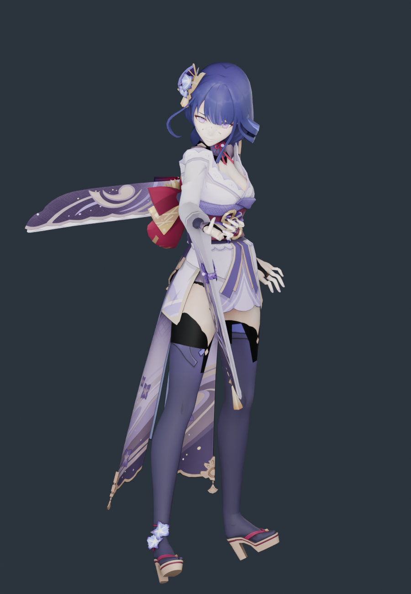

# 雷电将军 · 模型导入与体型核查

2026-11-10。源模型来自用户下载目录，已整体归档到 `assets/source/shogun`；运行时和重建只读项目内归档，不依赖原下载路径。

**结论：没有发生体型压变形。** 每个源顶点只做一次等比变换加地面偏移，没有逐段身高映射、头部缩放或横向宽度缩放；30 根骨骼显示骨架按原模型关节长度建，只接收《流星》的原生旋转。

## 源模型

| 项 | 值 |
|---|---|
| 文件 | `雷电将军.pmx`（PMX 2.0，1.4 MB） |
| 顶点 / 三角面 | 20,614 / 25,517 |
| 骨骼 / 材质 / 贴图 | 309 / 23 / 10 |
| 二次骨骼 | 头发 42 根（辫 24、左髮 9、右髮1 9）、裙 111 根、袖 30 根、流苏 4 根 |
| 署名 | 模型提供：miHoYo；模型改造：观海（BiliBili：观海子） |

原配布说明禁止二次配布、拆件改造和商业使用。本目录只是本地适配，不构成对上述条款的授权或发布。

## 体型核查

参照：源 PMX 网格经单一等比缩放到 39.4 个原生坐标单位，与运行时网格用**同一批源顶点**逐点比较。

| 指标 | 源模型 | 运行时 | 变化 |
|---|---:|---:|---:|
| 静止总高度 | 39.4000 | 39.4000 | 0.00000% |
| 肩关节跨度 | 5.1880 | 5.1880 | 0.00001% |
| 锁骨→肩 | 2.2242 | 2.2242 | −0.00000% |
| 上臂长 | 5.0579 | 5.0579 | 0.00001% |
| 前臂长 | 4.6090 | 4.6090 | 0.00001% |
| 大腿长 | 9.3712 | 9.3712 | −0.00001% |
| 小腿长 | 9.8453 | 9.8453 | 0.00000% |
| 足长 | 3.4385 | 3.4385 | 0.00000% |
| 髋→颈 | 9.7582 | 9.7582 | −0.00001% |
| 髋→下躯干 | 2.2026 | 2.2026 | −0.00002% |
| 下躯干→上躯干 | 3.5933 | 3.5933 | 0.00002% |
| 上躯干→颈 | 3.9622 | 3.9622 | −0.00004% |
| 颈→头 | 1.6317 | 1.6317 | 0.00006% |
| 头→头顶 | 5.4713 | 5.4713 | 0.00003% |

- 逐顶点最大偏差：**1.03 × 10⁻⁷**
- 显示骨架关节位置误差：**0**
- 长度发生变化的骨段：**无**
- 源包围盒 == 运行时包围盒（逐轴完全相同）
- 5 个身高截面用固定源顶点 ID 测宽测厚，变化均 **0.0000%**

对照图：[source-vs-current.png](../shogun-proportions-2026-11-10/source-vs-current.png)、[侧面](../shogun-proportions-2026-11-10/source-vs-current-side.png)

## 这套模型与甘雨的差异（处理方式）

| 差异 | 处理 |
|---|---|
| 没有 `足先EX`（脚尖末端骨），只有 `つま先` | 30 骨骼映射的第 6/10 槽改锚到 `つま先`，足长取自源模型自身，不虚构 |
| 材质 `发sph+` 与 `发` 三角面完全相同（各 2943 面），是球面加法叠加通道 | 作为渲染通道跳过，记入 `omittedRenderPasses`，避免头发被重复叠加 |
| `饰品2`（2504 面）实际挂在袖子与雷标上 | **不**按头发处理，随父级落到手臂槽 |
| `花` 位于膝盖，材质不透明 | 不做透明处理 |
| 袖子 30 根骨挂在 `左腕/右腕` | 随父级映射到上臂槽，跟随手臂而非骨盆 |
| 流苏挂在 `上半身3` | 随父级映射到上躯干槽（不当作裙摆） |

## 保留与未完成

保留：20,614 顶点全部保留（跳过 2943 面重复球面通道，其余 22,574 面全在）、4 张基础色贴图按 SHA-256 原样复制、法线/UV/双面标志、42 根头发弹簧骨骼 + 3 个碰撞体、4 组动作烘焙（误差 7.6 × 10⁻⁶）、可编辑 Blender 文件。

未完成：裙摆、袖摆、流苏仍是刚性绑定，没有布料解算；表情 morph 未接；原版 sphere/toon 通道未复现；手指只映射到原生拇指/食指两段链；源 PMX 无可核实厘米标定，不宣称现实身高。

同目录的 `武器.pmx`（刀，71 KB + `tex/刀.png`、`sph/katana.bmp`）**没有**导入——游戏已有独立武器外观系统。需要的话可以另做一版「雷电将军佩刀」替换。

## 复现

```sh
/Applications/Blender.app/Contents/MacOS/Blender --background --factory-startup --disable-autoexec --python scripts/blender/build_shogun.py
/Applications/Blender.app/Contents/MacOS/Blender --background --factory-startup --disable-autoexec --python scripts/blender/audit_shogun_proportions.py -- --render
/Applications/Blender.app/Contents/MacOS/Blender --background --factory-startup --disable-autoexec --python scripts/blender/render_shogun_preview.py
node --test tests/native-shogun-character.test.mjs
```

## E → F → P

| 证据 | 内容 |
|---|---|
| E-001 | `assets/source/shogun/` 20 个归档文件，SHA-256 见 [source-copy.json](source-copy.json) |
| E-002 | `scripts/blender/build_shogun.py`：单一 `uniform()` 变换，无分段缩放 |
| E-003 | [proportions.json](../shogun-proportions-2026-11-10/proportions.json)：逐顶点偏差、关节尺寸、同顶点截面 |
| E-004 | [build-evidence.json](build-evidence.json)：骨架误差、烘焙动作、贴图打包、运行资产哈希 |

F-001，severity=n/a，confidence=high，status=validated，evidence=E-001~E-004：雷电将军的原始身高、躯干与四肢比例在适配后未发生改变。P-001：源 PMX → 单一等比变换 → 原长度显示骨架 → 原生 AMB/POS 旋转 → 运行时网格。

