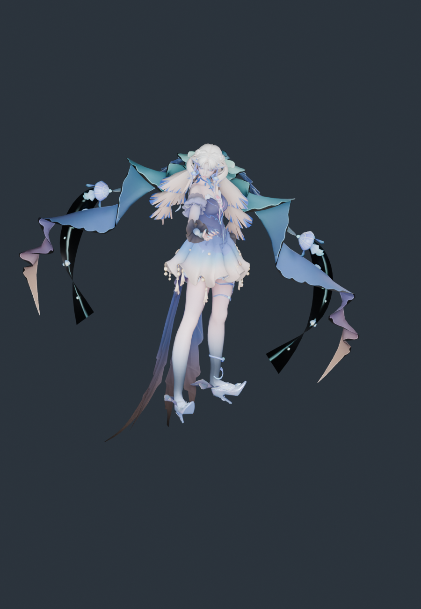

# 王昭君 · 长夜焕生 · 模型导入与体型核查

2026-11-11。源模型来自用户下载目录，已整体归档到 `assets/source/zhaojun`；运行时和重建只读项目内归档，不依赖原下载路径。

**结论：没有发生体型压变形。** 每个源顶点只做一次等比变换加地面偏移，没有逐段身高映射、头部缩放或横向宽度缩放；30 根骨骼显示骨架按原模型关节长度建，只接收《流星》的原生旋转。

## 署名与授权

**这一包没有附任何 readme、署名或配布说明文件。** 前几个模型都能引用原作者条款，这里没有可引用的内容。归档里如实记录了这一点（`source-copy.json` 的 `licenseNote`，manifest 的 `provenance.license`），并按"本地私有转换"处理，不再分发。

角色与美术素材归属：腾讯《王者荣耀》王昭君「长夜焕生」皮肤（资源编号 15213）。

## 源模型

| 项 | 值 |
|---|---|
| 文件 | `长夜焕生.pmx`（PMX 2.0，3.8 MB） |
| 顶点 / 三角面 | 41,289 / 58,373 |
| 骨骼 / 材质 / 贴图 | 353 / 21 / 12 |
| 二次骨骼 | 头发 44 根（`Toufa_*` 17 + `qianToufa_*` 26 + `Bone_Toufa001` 根骨）；裙层 `qunzi_*` 72、`QunBai_*` 18、`Peishi_*` 60（均为刚性） |
| 材质命名 | Unity 风格长名（`15213_WangZhaoJun_*_VeryHigh`） |

## 体型核查

| 指标 | 源模型 | 运行时 | 变化 |
|---|---:|---:|---:|
| 静止总高度 | 39.4000 | 39.4000 | +0.00000% |
| 肩关节跨度 | 4.9183 | 4.9183 | +0.00001% |
| 锁骨→肩 | 2.2250 | 2.2250 | +0.00001% |
| 上臂长 | 5.8019 | 5.8019 | -0.00001% |
| 前臂长 | 5.4610 | 5.4610 | +0.00000% |
| 大腿长 | 9.3416 | 9.3416 | +0.00009% |
| 小腿长 | 10.6350 | 10.6350 | +0.00006% |
| 足长 | 2.5536 | 2.5536 | -0.00083% |
| 髋→颈 | 10.4401 | 10.4401 | -0.00001% |
| 髋→下躯干 | 2.5722 | 2.5722 | -0.00001% |
| 下躯干→上躯干 | 3.6958 | 3.6958 | -0.00002% |
| 上躯干→颈 | 4.1721 | 4.1721 | +0.00001% |
| 颈→头 | 1.7804 | 1.7804 | +0.00005% |
| 头→头顶 | 3.8763 | 3.8763 | +0.00002% |

- 逐顶点最大偏差：**8.43 × 10⁻⁸**
- 显示骨架关节位置误差：**0**；长度变化的骨段：**无**
- 源包围盒 == 运行时包围盒（逐轴完全相同）
- 5 个身高截面：宽/厚变化均 **0.0000%**
- 足长那 0.00081% 来自 `mesh.json` 保留 7 位小数的舍入（绝对差 1.8 × 10⁻⁵），不是几何改变

对照图：[source-vs-current.png](../zhaojun-proportions-2026-11-11/source-vs-current.png)、[侧面](../zhaojun-proportions-2026-11-11/source-vs-current-side.png)

## 站姿修正（浮空问题）

初版导入后角色悬空约 30 cm。原因不是头发，而是**绿飘带和裙衬下摆比鞋底还低**：

| 几何 | 最低 Y（源单位） |
|---|---:|
| `Greenstreamers2`（绿飘带） | −3.42 |
| `Wenli_..._215`（纹样带） | −2.69 |
| `QunBai`（裙衬） | −1.64 |
| `ShuiJingXie`（水晶鞋） | 0.32 |
| `左足先EX`（脚趾骨） | 0.83 |

初版用「整网格最低点」当站立面，于是整个人被抬高 3.735 个源单位（×1.785 ≈ 6.7 运行时单位 ≈ 0.53 世界单位）。

现改为按**脚部顶点**（足首/足先/つま先 权重 ≥ 0.5）求地面：`soleFloor = 0.3198`，抬高量归零。游戏内实测鞋底世界高度 **−0.8288**，与荧、芙宁娜完全一致（此前为 −0.296）。

代价：飘带和裙衬会插入地面约 0.53 世界单位（约 30 cm）。这是源模型把飘带摆到鞋底以下造成的，不是缩放错。要消除就得把飘带骨骼整体上抬或缩短——属于改美术，需要你确认后我再做。

## 这套模型的特殊处理

| 情况 | 处理 |
|---|---|
| 骨骼是拼音命名，`Toufa_*` / `qianToufa_*` / `Bone_Toufa001` 三套混用 | 统一按 `toufa` 子串识别，44 根全部挂到头发弹簧 |
| 骨架里混有 `Bip001 Spine`（Biped 残留）和 `腰キャンセル左`（MMD 风格） | 随父级落到对应 slot，不单独处理 |
| 材质名是 Unity 风格长名，且有 4 个同名 `SiChou` 材质（各自贴图不同） | 按子串规则分类（Hair/Face/EyeMask/Leg/ShuiJingXie/BeiKe/Peishi/SiChou/Qun），不做精确名匹配 |
| 贴图路径带反斜杠且编号前缀很长 | 按 `textures\...` 原路径复制并改名去空格，12 张贴图全部按 SHA-256 校验 |
| 2 个顶点带零长度法线（源模型自带） | 忠实保留，不编造方向；数量记入 `build-evidence.json` 的 `degenerateNormals`，测试对其显式放行 |
| 21 个材质、58,373 面 | **全部保留，无丢弃**（本包没有叠加通道材质） |

## 保留与未完成

保留：41,289 顶点、58,373 三角面全保留；12 张贴图 SHA-256 原样复制；法线/UV/双面标志；44 根头发弹簧 + 3 个碰撞体；4 组动作烘焙（误差 7.6 × 10⁻⁶）；可编辑 Blender 文件。

未完成：长裙 4 层、飘带、披帛、贝壳饰件刚性绑定，无布料解算；表情 morph 未接；Unity 的 MatCap / 法线 / 自发光贴图（`tex2/` 里那 30 张）没有接入；手指只映射到原生拇指/食指两段链；源 PMX 无可核实厘米标定，不宣称现实身高。

## 复现

```sh
/Applications/Blender.app/Contents/MacOS/Blender --background --factory-startup --disable-autoexec --python scripts/blender/build_zhaojun.py
/Applications/Blender.app/Contents/MacOS/Blender --background --factory-startup --disable-autoexec --python scripts/blender/audit_zhaojun_proportions.py -- --render
/Applications/Blender.app/Contents/MacOS/Blender --background --factory-startup --disable-autoexec --python scripts/blender/render_zhaojun_preview.py
node --test tests/native-zhaojun-character.test.mjs
```

## E → F → P

| 证据 | 内容 |
|---|---|
| E-001 | `assets/source/zhaojun/` 45 个归档文件，SHA-256 见 [source-copy.json](source-copy.json) |
| E-002 | `scripts/blender/build_zhaojun.py`：单一 `uniform()` 变换，无分段缩放 |
| E-003 | [proportions.json](../zhaojun-proportions-2026-11-11/proportions.json)：逐顶点偏差、关节尺寸、同顶点截面 |
| E-004 | [build-evidence.json](build-evidence.json)：骨架误差、烘焙动作、退化法线、运行资产哈希 |

F-001，severity=n/a，confidence=high，status=validated，evidence=E-001~E-004：该模型的原始身高、躯干与四肢比例在适配后未发生改变。P-001：源 PMX → 单一等比变换 → 原长度显示骨架 → 原生 AMB/POS 旋转 → 运行时网格。

